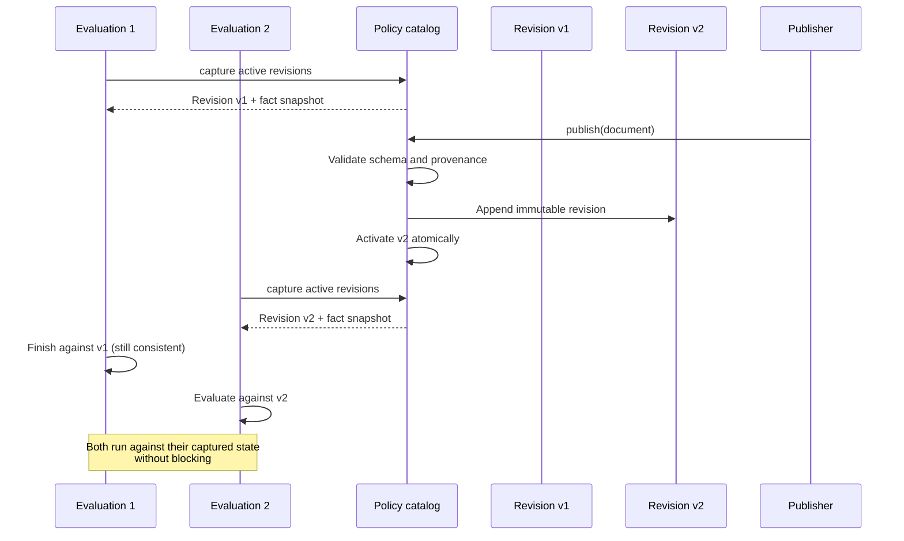

# Mission

Build a fast, reliable authorization engine in Rust. Make authorization decisions without network round-trips to external systems. Update policies without restarting services. Let teams manage authorization rules separately from application code.

> **Removed legacy engine.** The original embedded stack — hand-written parser, AST, bytecode compiler, stack interpreter, lock-free policy store, and Cranelift JIT with adaptive tiering — was removed after the version-2 runtime landed. This document now describes the v2 runtime: scoped policy documents, TTL-bounded runtime facts, and snapshot evaluation. The implemented workflow lives in [docs/RUNTIME_DATA.md](docs/RUNTIME_DATA.md).

## Executive Summary

**IPE (Idempotent Predicate Engine)** is an authorization runtime written in Rust. The version-2 runtime service evaluates language-2 policy documents against TTL-bounded runtime facts and returns allow, deny, or indeterminate for scoped tenants and environments. Facts persist in RocksDB with atomic commits, an HTTPS pull connector, and mandatory expiry; policy documents publish as immutable revisions with atomic activation, content digests, and typed `policy.*` parameters. Every decision reads one immutable snapshot and rechecks its earliest evidence deadline before allowing. Work that remains includes production hardening (persistence and replication bounds, audit durability), a control plane for policy management, and language bindings. The architecture separates authorization into a policy layer (versioned documents and bootstrap sources), a fact layer (expiring typed observations), and an evaluation layer (budgeted snapshot evaluation) — enabling teams to update policies independently of running decisions and to keep authorization context out of application databases.

---

## What IPE Does

IPE evaluates authorization policies. When your application asks "can user X do action Y on resource Z?", IPE answers in microseconds.

**Core capabilities:**
- Evaluate language-2 policies against schema-validated caller input and expiring typed facts
- Publish policy documents as immutable revisions with atomic activation
- Keep authorization context (facts, approvals, relationships) out of application data
- Isolate tenant data in multi-tenant scopes
- Track temporary approvals with automatic expiration (mandatory TTL)

## Why IPE Exists

Most systems handle authorization in one of two ways:

**Option 1: Hard-code it**
- Authorization mixed with business logic
- Every change requires deploying code
- Hard to audit across microservices
- Each service implements it differently

**Option 2: Use existing policy engines**
- OPA and similar tools work, but have limitations
- Garbage collection causes latency spikes (2ms+)
- Updating policies often requires restarts
- Limited support for approvals and relationships

**What we need:**
- Consistent latency under 100μs
- Update policies while system runs
- Keep policies, application data, and authorization context separate
- Support approval workflows and trust chains
- Multi-tenant isolation built in

IPE solves these problems with three key decisions:

**1. Use Rust**
No garbage collection means no latency spikes. Memory safety prevents security vulnerabilities. This is critical infrastructure, so reliability matters more than ease of development.

**2. Immutable revisions and snapshots**
Policy documents activate atomically, one revision at a time. Each evaluation captures the active revisions and one fact snapshot, so a concurrent update cannot change a running decision.

**3. Separate storage**
Application data stays in your database. Authorization context (runtime facts, approvals, relationships) lives in RocksDB. Policies are versioned documents. Each layer scales independently.

---

## Design Decisions

### Why Rust

Authorization runs on every request. A memory leak or race condition could expose sensitive data or crash your service.

Rust prevents these problems at compile time. No garbage collector means no unpredictable pauses. The trade-off is a steeper learning curve, but for security infrastructure, correctness matters more than convenience.

### How Updates Work

Authorization systems do far more reads than writes (typically 1000:1 ratio). IPE optimizes for this pattern.

Policies live in immutable revisions and snapshots. Readers — evaluations — capture one snapshot and finish against it with no locks. Updates happen out of band: publish a revision, activate it atomically, and clean expired facts on a schedule. Running evaluations keep their captured snapshot; new evaluations get the new state.

This means:
- Readers never wait
- No coordination between requests
- Updates complete in microseconds
- Rollback is just another swap

### When Things Go Wrong

Authorization must fail safely. If something breaks, deny access rather than accidentally allowing it.

**Error handling:**
- Missing policy → deny
- Compilation error → reject update, keep old policies
- Approval store down → policy evaluation continues (may deny if approvals required)
- Invalid input → deny with clear error message

The system prefers being too restrictive over being too permissive.

### Observability

Every authorization decision returns:
- Which policies matched
- Why the decision was allow or deny
- How long evaluation took
- Full context (user, resource, action)

This integrates with OpenTelemetry for distributed tracing. You can debug authorization issues in production without recreating them locally.

### Gradual Adoption

The core engine has zero external dependencies. No network calls. No database required. Just evaluate policies against the data you provide.

**Optional features:**
- RocksDB stores for approvals and relationships (compile-time flag)
- Pull connectors for HTTPS snapshot sources (bootstrap configuration)
- Control plane for policy management (separate service)

Start simple. Add complexity only when you need it.

### Human-Readable Policies

Security teams need to review authorization logic. Developers need to understand what policies do.

Each policy includes a plain English description. The policy language reads like structured logic, not code. Policies are text files that work with git, diff tools, and code review.

---

## Implementation Status

### What Works Today

**v2 runtime (ipe-server + ipe-core):**
- Scoped HTTP API: push fact commits, evaluation, catalog inspection, policy publication, candidate testing
- Language-2 policies with triggers, typed fact bindings, and aggregate requirements
- Runtime facts with mandatory TTL, atomic commits, revision-conflict and replay detection
- HTTPS pull connectors with whole-generation snapshot replacement
- Policy documents with immutable revisions, atomic activation, digests, and external provenance
- RocksDB stores for approvals and relationships (embedded, separate from the runtime API)

Run the external acceptance suite (`python3 scripts/accept-runtime-data.py`) or `make policy-acceptance` to see the real server end to end.

### What's In Progress

**Production hardening:**
- Persistence and replication bounds beyond the single-node store
- Durable audit logging
- Performance characterization under production load

### What's Not Started

**Control plane:**
- gRPC/API for managing policies across scopes
- Staging, approval, and activation workflows
- A/B testing and gradual rollouts

**Developer tools:**
- Python, Node.js, Go bindings
- Web UI for editing policies
- VS Code extension
- Migration tools from OPA and Cedar

**Infrastructure integration:**
- Service mesh plugins
- API gateway adapters
- Kubernetes admission controller

---

## Repository Structure

The project is organized into several crates:

**ipe-core**
- Runtime facts (TTL, schemas, snapshots), policy documents (revisions, provenance), and language-2 evaluation with budgets
- Approval and relationship stores behind the `approvals` feature
- Location: `crates/ipe-core/`
- Owner: Platform team

**ipe-server**
- The axum HTTP runtime service: credentials, connectors, clock, scoped routes
- Location: `crates/ipe-server/`
- Owner: Platform team

**ipe-control** (stub)
- gRPC API for managing policies
- Version control and deployment
- Location: `crates/ipe-control/`
- Owner: Infrastructure team

**ipe-ffi** (stub)
- C FFI and language bindings
- Python (PyO3), Node.js (napi-rs), Go (cgo)
- Location: `crates/ipe-ffi/`
- Owner: Developer experience team

**ipe-web** (stub)
- Web-based policy editor
- Real-time validation and debugging
- Location: `crates/ipe-web/`
- Owner: Frontend team

**ipe-wasm** (stub)
- WebAssembly compilation
- Browser and edge runtime support
- Location: `crates/ipe-wasm/`
- Owner: Platform team

**ipe-parser** (stub)
- Originally planned as separate crate
- Parser now integrated into ipe-core
- Location: `crates/ipe-parser/`

---

## Work for Incoming Teams

These initiatives would suit teams taking over the project:

### 1. Production Readiness (3-4 months, 3-4 engineers)

Make IPE production-grade for high-scale deployments.

**Tasks:**
- Harden persistence: replication bounds, disaster recovery, audit durability
- Build a control plane for policy management
- Add comprehensive metrics and distributed tracing
- Security audit and penetration testing
- Characterize performance under production load
- Write SRE runbooks

**Success looks like:**
- Replicated deployment with a stated convergence bound
- No security vulnerabilities found
- 99.99% uptime in production
- 10+ organizations using it

### 2. Developer Experience (3-4 months, 2-3 engineers)

Make IPE easy to adopt and use.

**Tasks:**
- Language bindings for Python, Node.js, Go
- Web editor for policies
- VS Code extension
- Migration tools from OPA and Cedar
- Tutorials and examples
- Community building (Discord, forums)

**Success looks like:**
- 1000+ downloads per month
- Developers can write their first policy in under 30 minutes
- Active community contributing improvements

### 3. Cloud Integration (2-3 months, 2-3 engineers)

Connect IPE to cloud infrastructure.

**Tasks:**
- Service mesh plugins (Istio, Linkerd)
- API gateway adapters (Kong, Envoy)
- Kubernetes admission controller
- Helm charts and operators
- Terraform and CloudFormation modules

**Success looks like:**
- Works in 3+ service meshes
- 2+ API gateways support it
- 500+ Kubernetes deployments

### 4. Enterprise Features (4-5 months, 3-4 engineers)

Add features large organizations need.

**Tasks:**
- Time and location-based policies
- Policy versioning and rollback
- Audit log analysis
- Formal verification tools
- Support for Cedar and OPA patterns

**Success looks like:**
- Handles all Cedar use cases
- Handles all OPA use cases
- 10+ enterprise customers

---

## Migration from OPA and Cedar

### Can you compile OPA and Cedar policies to IPE?

Yes, but not perfectly. IPE's language is smaller than both Rego and Cedar.

### OPA/Rego (60-70% compatible)

**What works:**
- Simple comparisons and logic (AND, OR, NOT)
- Field access (user.role, resource.type)
- Basic built-in functions

**What doesn't:**
- Logic programming and unification
- Native set operations
- List comprehensions
- Recursive rules
- Partial evaluation

**Example:**
```
# Rego
allow { input.user.role == "admin" }

# IPE equivalent
predicate AdminAccess:
  "Admins have access"
  triggers when request.user.role == "admin"
  requires true
```

A transpiler could handle 80% of common Rego policies. Complex queries would need rewriting.

### Cedar (80-90% compatible)

**What works:**
- Attribute-based access control
- Entity relationships
- Action-based policies
- Set membership checks

**What doesn't:**
- First-class entities (IPE uses strings)
- Strict schema validation
- Policy templates

**Example:**
```
// Cedar
permit(principal in Group::"admins", action == "deploy", resource)

// IPE equivalent
predicate AdminDeploy:
  "Admins can deploy"
  triggers when principal.groups contains "admins" and action == "deploy"
  requires true
```

Cedar maps well to IPE's Resource-Action-Request model. A transpiler is realistic.

### Migration Strategy

Build transpilers for Cedar (higher priority) and Rego (common patterns only). Provide tools that highlight unsupported features. Let organizations migrate gradually rather than all at once.

---

## How to Know It's Working

Good metrics tell you if IPE solves real problems:

**Performance:**
- No published latency targets; performance under production load is not yet characterized
- Bounded evaluation via instruction and collection-visit budgets
- Bounded storage with explicit capacity limits

**Reliability:**
- 99.99% uptime
- Zero-downtime policy updates
- No security vulnerabilities
- Policy rollback under 30 seconds

**Adoption:**
- 10+ organizations in production within a year
- Developers write their first policy in under 30 minutes
- 1000+ downloads per month
- Active community (forums, contributions, blog posts)

**Integration:**
- Works in 3+ service meshes
- Supports 2+ API gateways
- Deployed in 500+ Kubernetes clusters

---

## Why These Decisions Matter

### Fast Enough for the Hot Path

Authorization happens on every request. If it's slow, it becomes the bottleneck.

OPA (written in Go) has unpredictable garbage collection pauses. p99.9 latency can spike above 2ms. That's too slow for high-throughput services.

IPE targets under 100μs consistently. This lets you check authorization inline in proxies, gateways, and service meshes without degrading performance.

### No Surprises in Production

Garbage collectors pause unpredictably. You can't plan capacity when latency spikes randomly.

Rust has no garbage collector. Memory management is deterministic. You get consistent latency you can measure and plan for.

### Security Built In

Authorization bugs can leak sensitive data or crash services. Memory safety matters.

Rust prevents entire categories of bugs at compile time: use-after-free, data races, buffer overflows, null pointer dereferences. These account for 70% of security vulnerabilities in C/C++ systems.

The trade-off is a steeper learning curve. But for security infrastructure, correctness is more important than convenience.

### Operations That Work

Updating policies shouldn't require maintenance windows or service restarts.

IPE's immutable snapshots make updates atomic. Swap in new policies while old requests finish with old policies. Rollback is just another swap. No coordination, no blocking, no downtime.

### Start Small, Grow as Needed

Don't replace your entire authorization system at once.

Start with the runtime service in front of one service. Add approval stores when you need approval workflows. Add pull connectors when facts live upstream. Build migration tools when you're ready to move from OPA or Cedar.

Each piece is optional. You control complexity.

---

## How It Works

### Three Layers

IPE separates concerns into three layers:

```
┌─────────────────────────────────────────────────────────────┐
│                    CONTROL PLANE                            │
│  Policy Management, Updates, Versioning, Rollbacks          │
│  • Scoped policy-management API (authenticated)             │
│  • Immutable revisions with atomic activation               │
│  • Publication history and digests                          │
│  • Staging and canary activation (planned)                  │
└──────────────────────┬──────────────────────────────────────┘
                       │ Publish revisions
                       ▼
┌─────────────────────────────────────────────────────────────┐
│                     DATA PLANE                              │
│  Policy Evaluation (Read-Only, High-Throughput)             │
│  • One immutable snapshot per evaluation                    │
│  • Instruction and collection-visit budgets                 │
│  • No network requests during evaluation                    │
│  • Deny over indeterminate over allow                       │
└──────────────────────┬──────────────────────────────────────┘
                       │ Query during evaluation
                       ▼
┌─────────────────────────────────────────────────────────────┐
│                   CONTEXT PLANE                             │
│  Application-Specific Data (Separate from Policy)           │
│  • RocksDB: TTL-bounded facts, approvals, relationships     │
│  • Application DB: User data, resources, metadata           │
│  • External services: HTTPS snapshot sources, IdPs          │
└─────────────────────────────────────────────────────────────┘
```

### Atomic Policy Activation

**The Problem:**
Traditional authorization systems mutate policies in place during updates, causing:
- Readers seeing half-applied rule sets
- Unpredictable behavior during rollouts
- Deployment risk (updates require maintenance windows)

**IPE's Solution: Immutable Revisions + Captured Snapshots**

```text
1. Publisher posts a document revision with expected_revision.
2. The catalog validates it, appends an immutable revision,
   and activates it atomically. Invalid publishes change nothing.
3. Each evaluation captures the active revisions and one fact
   snapshot once, then finishes against that captured state.
4. Concurrent updates affect only evaluations that start later.
```

**Characteristics:**
- **Read path:** no locks, no network, no coordination during evaluation
- **Update path:** validated append, atomic activation, full history retained
- **Rollback:** publish the earlier document content as a new revision
- **Memory safe:** captured snapshots are immutable, so no use-after-free

### High Availability Through Immutability



**Key properties:**
1. **Consistent reads:** Each evaluation sees one consistent set of revisions and facts
2. **No torn reads:** Activation is atomic (all-or-nothing) per document
3. **No blocking:** Evaluations never wait for writers
4. **Gradual migration:** Running evaluations complete with their captured revisions
5. **Auditable:** Revision history with digests remains available; nothing is updated in place

### Bounded, Honest Performance

**Authorization decisions must be predictable.** The v2 runtime bounds work instead of promising latency figures:

| Mechanism | What it bounds |
|--------|-----------|----------|
| **Instruction budget** | Work per evaluation |
| **Collection-visit budget** | Fact lookups per evaluation |
| **Evidence deadline** | How long a decision may lean on one observation |
| **Bounded store** | Keys, encoded state, and value size |

No published latency or throughput targets exist for the v2 runtime; performance under production load has not been characterized. The removed legacy interpreter's microbenchmarks (sub-50μs claims) described a different engine and no longer apply.

**No garbage collection** still holds:
- No unpredictable GC pauses
- No safepoint delays
- Rust's deterministic memory management

### Deployment Models

**1. Local Runtime Service** (Default)
```text
# Loopback bind; evaluate over HTTP from co-located processes
IPE_RUNTIME_CONFIG=runtime.json ./ipe-server
# Remote callers go through a local TLS-terminating proxy
```

**2. Sidecar Service** (Container co-location)
```
┌─────────────────────────┐
│     Application Pod     │
│  ┌──────────┐           │
│  │   App    │ ◄──────┐  │
│  │ Service  │        │  │
│  └──────────┘        │  │
│        │   loopback  │  │
│  ┌─────▼──────┐     │  │
│  │    IPE     │─────┘  │
│  │  Runtime   │        │
│  └────────────┘        │
└─────────────────────────┘
```

**3. Centralized Service** (Multi-tenant)
```
┌─────────────┐  ┌─────────────┐  ┌─────────────┐
│   App 1     │  │   App 2     │  │   App N     │
└──────┬──────┘  └──────┬──────┘  └──────┬──────┘
       │                │                │
       │ gRPC (1-2ms)   │                │
       └────────────────┴────────────────┘
                        │
                        ▼
              ┌──────────────────┐
              │   IPE Service    │
              │  (Multi-tenant)  │
              │   Load-balanced  │
              └──────────────────┘
```

### Failure Modes & Recovery

**What happens when...?**

│ Failure | Impact | Recovery |
|---------|--------|----------|
| **Invalid policy publication** | Publisher rejected with 422/409 | Previous revision stays active |
| **Connector unreachable** | Facts age out toward expiry | Evaluation yields indeterminate when evidence goes stale |
| **RocksDB corruption** | Storage unavailable | Server reports 503; restore from database artifacts |
| **Clock discontinuity** | Readiness refused | Restore trusted time and restart |
| **Memory exhaustion** | OOM killed, pod restarts | Load balancer routes around |
| **CPU spike** | Latency increases | Budgets keep evaluations bounded; rate limit callers |

**IPE's resilience strategy:**
1. **Fail closed:** Missing evidence is indeterminate; no applicable policy denies
2. **Degrade gracefully:** Evaluation needs no network; stale facts expire rather than lie
3. **Immutable history:** Published revisions and digests remain inspectable
4. **Isolate failures:** Fact store and policy catalog are separate databases with no joint transaction (documented, not hidden)

---

## Separation of Concerns: Policy vs. Application Data

### The Clean Architecture

**Policy Engine ≠ Application Database**

IPE maintains strict separation between:

```
┌─────────────────────────────────────────────────────────────┐
│                    POLICY ENGINE (IPE)                      │
│  Concerns: Authorization logic, rules, decisions            │
├─────────────────────────────────────────────────────────────┤
│  • Who can do what?                                         │
│  • Under what conditions?                                   │
│  • With whose approval?                                     │
│  • Following which relationships?                           │
│                                                             │
│  Data stored: Policies (revisions), runtime facts,          │
│               approvals, relationships, scoped metadata     │
└─────────────────────────────────────────────────────────────┘
                            ▲
                            │ Queries during evaluation
                            │
┌───────────────────────────┴─────────────────────────────────┐
│              APPLICATION DATA LAYER                         │
│  Concerns: Business logic, entities, transactions           │
├─────────────────────────────────────────────────────────────┤
│  • User profiles and attributes                             │
│  • Resource ownership and metadata                          │
│  • Audit logs and history                                   │
│  • Application-specific state                               │
│                                                             │
│  Data stored: Users, resources, sessions, transactions      │
└─────────────────────────────────────────────────────────────┘
```

### Why Separation Matters

**1. Independent Scaling**
- Policy evaluation is read-heavy (1000:1 read/write ratio)
- Application data is read-write balanced
- Scale them independently based on different characteristics

**2. Different Consistency Requirements**
- Policies: Eventually consistent (updates can take seconds)
- Application data: Strong consistency (transactions, ACID)

**3. Deployment Independence**
- Update policies without deploying application code
- Change application schema without touching policies
- Different release cadences (policies change frequently)

**4. Security Isolation**
- Policy engine has narrow surface area (authorization only)
- Application DB compromise doesn't expose policy logic
- Separate credentials and access controls

### RocksDB: The Context Bridge

**Why RocksDB for IPE's data layer?**

RocksDB provides a **lightweight, embeddable key-value store** for policy-related context:

```rust
// Three distinct data types in RocksDB
pub enum IPEDataType {
    Approval,      // Granted permissions with TTL
    Relationship,  // Entity relationships and trust chains
    Attribute,     // Cached attributes (future)
}
```

**1. Approvals** (Authorization grants)
```rust
// Key format: approvals:{scope}:{identity}:{resource}:{action}
// Example: "approvals:tenant:acme-corp:alice:doc-123:read"

pub struct Approval {
    identity: String,           // Who has approval
    resource: String,           // For what resource
    action: String,             // To perform what action
    granted_by: String,         // Who granted it
    scope: Scope,               // Multi-tenant isolation
    ttl_seconds: Option<i64>,   // Auto-expire
    metadata: HashMap<...>,     // Context (reason, conditions)
}
```

**Use case:** "Alice has approval to deploy to production (granted by Bob, expires in 8 hours)"

**2. Relationships** (Entity graph)
```rust
// Key format: relationships:{scope}:{subject}:{relation}:{object}
// Example: "relationships:tenant:acme:alice:editor:doc-123"

pub struct Relationship {
    subject: String,           // Source entity
    relation: String,          // Relationship type
    object: String,            // Target entity
    relation_type: RelationType, // Role, Trust, Membership, etc.
    scope: Scope,              // Multi-tenant isolation
    ttl_seconds: Option<i64>,  // Auto-expire
}
```

**Use case:** "Certificate-1 is trusted_by Intermediate-CA, which is trusted_by Root-CA"

**Transitive traversal:**
```rust
// Check if alice has transitive relationship to root-ca
store.has_transitive_relationship("alice", "trusted_by", "root-ca")?;
// Returns true if there's a path: alice → intermediate → root-ca
```

### Flexible Application Entity Modeling

**IPE doesn't dictate your data model.** It provides hooks:

```rust
pub struct EvaluationContext {
    pub resource: Resource,           // Your resource model
    pub action: Action,               // Your action model
    pub request: Request,             // Your request context

    // Optional: Connect to IPE's data layer
    pub approval_store: Option<Arc<ApprovalStore>>,
    pub relationship_store: Option<Arc<RelationshipStore>>,
}
```

**Example: E-commerce application**

```rust
// Your application entities (in your database)
struct Product {
    id: ProductId,
    owner_id: UserId,
    price: Money,
    category: Category,
}

struct User {
    id: UserId,
    role: Role,
    tier: SubscriptionTier,
}

// Map to IPE's generic model
let ctx = EvaluationContext {
    resource: Resource::new(ResourceTypeId::Product)
        .with_attribute("id", product.id)
        .with_attribute("owner", product.owner_id)
        .with_attribute("price", product.price)
        .with_attribute("category", product.category),

    action: Action::new(ActionTypeId::Update),

    request: Request::new(user.id)
        .with_attribute("role", user.role)
        .with_attribute("tier", user.tier),
};

// Evaluate policy
let decision = engine.evaluate(&ctx)?;
```

**IPE doesn't care about your schema.** It evaluates policies against the attributes you provide.

### Scope-Based Multi-Tenancy

**Problem:** How do you isolate tenant data without separate databases?

**IPE's solution: Scoped storage keys**

```rust
pub enum Scope {
    Global,                                    // Cross-tenant (admin)
    Tenant(String),                           // Single tenant
    Environment(String),                      // Dev/staging/prod
    TenantEnvironment { tenant, environment}, // Most common
    Custom(Vec<String>),                      // Hierarchical
}
```

**Example: Multi-tenant SaaS**

```rust
// Tenant A: Acme Corp
let acme_scope = Scope::tenant("acme-corp");
store.grant_approval(
    Approval::new("alice@acme.com", "document-1", "GET", "admin")
        .with_scope(acme_scope)
        .with_ttl(24 * 3600) // 1 day
)?;

// Tenant B: Widgets Inc (completely isolated)
let widgets_scope = Scope::tenant("widgets-inc");
store.grant_approval(
    Approval::new("alice@widgets.com", "document-1", "GET", "admin")
        .with_scope(widgets_scope)
        .with_ttl(24 * 3600)
)?;

// Queries are automatically scoped
let acme_approvals = store.list_approvals_in_scope(
    "alice@acme.com",
    &acme_scope
)?;
// Only returns Acme Corp's approvals (no data leakage)
```

**Security benefits:**
- [DONE] **Data isolation** at storage key level
- [DONE] **Logical separation** prevents cross-tenant access
- [DONE] **Environment separation** (dev data can't touch prod)
- [DONE] **Audit trail** (every record tagged with scope)

### TTL-Based Automatic Cleanup

**Problem:** Temporary access grants accumulate, creating security risk.

**IPE's solution: TTL with automatic expiration**

```rust
// Grant temporary contractor access
store.grant_approval(
    Approval::new("temp-contractor", "api-endpoint", "POST", "manager")
        .with_scope(Scope::tenant("acme-corp"))
        .with_ttl(3600) // Expires in 1 hour
)?;

// After 1 hour + next RocksDB compaction:
// Record is automatically deleted (no manual cleanup)
```

**Benefits:**
- [DONE] **Reduced attack surface** (expired credentials removed)
- [DONE] **Compliance** (temporary access enforced)
- [DONE] **No stale data** (old approvals don't accumulate)
- [DONE] **Zero overhead** (cleanup during background compaction)

**TTL presets:**
```rust
TTLConfig::temporary()   // 1 hour default, 1 day max
TTLConfig::short_lived() // 1 day default, 1 week max
TTLConfig::long_lived()  // 30 days default, 1 year max
```

---

## Use Cases: Where IPE Excels

### 1. Dynamic Authorization (RBAC, ABAC, ReBAC)

**Problem:** User roles and permissions change frequently. Hardcoding authorization logic requires deployments.

**IPE Solution:**
```rust
predicate AdminAccess:
  "Admins can access all resources"

  triggers when
    request.user.role == "admin"

  requires true

predicate OwnerAccess:
  "Resource owners can modify their resources"

  triggers when
    resource.owner_id == request.user.id
    and action.operation == "Update"

  requires true

predicate DelegatedAccess:
  "Users with delegated access and approval"

  triggers when
    action.operation in ["Deploy", "Delete"]

  requires
    approvals.count >= 2
    where approver.role == "senior-engineer"
```

**Update policies without deploying code.** Changes take effect in <100ms.

### 2. Feature Flags and Progressive Rollouts

**Problem:** Feature flags are scattered across codebase, difficult to manage.

**IPE Solution:**
```rust
predicate BetaFeatureAccess:
  "New dashboard available to beta users"

  triggers when
    resource.type == "DashboardV2"

  requires
    request.user.id in beta_user_list
    or request.user.tier == "enterprise"
    or random_percentage() < 10  // 10% rollout

predicate GeographicRestriction:
  "GDPR-compliant features only in EU"

  triggers when
    resource.contains_pii == true

  requires
    request.geo.region in ["EU", "UK"]
    and resource.encrypted == true
```

**Benefits:**
- Centralized feature flag management
- Gradual rollouts with percentage-based rules
- Geographic and compliance-based gating
- Real-time updates (no deploys)

### 3. Workflow Approvals and Gates

**Problem:** Approval workflows are hardcoded, inflexible, require backend changes.

**IPE Solution:**
```rust
predicate ProductionDeployment:
  "Production deployments need 2 senior approvals"

  triggers when
    resource.type == "Deployment"
    and environment == "production"

  requires
    approvals.count >= 2
    where approver.role in ["senior-engineer", "staff-engineer"]
    and approver.department != requester.department  // Cross-team approval

predicate HighValueTransaction:
  "Transactions >$10k need manager approval"

  triggers when
    resource.type == "Transaction"
    and resource.amount >= 10000

  requires
    approval_store.has_approval(
      request.user.id,
      resource.id,
      "execute"
    )
```

**Approval grants are stored in RocksDB:**
```rust
// Manager grants approval
approval_store.grant_approval(
    Approval::new("alice", "transaction-123", "execute", "manager-bob")
        .with_ttl(3600) // Expires in 1 hour
)?;

// Alice tries to execute
let ctx = EvaluationContext::new(...)
    .with_approval_store(approval_store);

let decision = engine.evaluate(&ctx)?; // Checks for approval
```

### 4. Time-Based and Conditional Access

**Problem:** Access rules based on time, location, device are hard to implement.

**IPE Solution:**
```rust
predicate BusinessHoursOnly:
  "Sensitive operations only during business hours"

  triggers when
    resource.sensitivity == "high"
    and action.operation in ["Delete", "Export"]

  requires
    current_time.hour >= 9
    and current_time.hour <= 17
    and current_time.weekday in ["Mon", "Tue", "Wed", "Thu", "Fri"]

predicate GeofencedAccess:
  "Office network required for admin actions"

  triggers when
    action.privilege_level >= "admin"

  requires
    request.ip in office_network_cidrs
    or request.vpn_verified == true
```

### 5. Compliance and Audit Requirements

**Problem:** Compliance policies (SOC2, HIPAA, GDPR) require audit trails and access controls.

**IPE Solution:**
```rust
predicate PHIAccess:
  "HIPAA-compliant PHI access logging"

  triggers when
    resource.contains_phi == true

  requires
    request.user.hipaa_certified == true
    and request.purpose in ["Treatment", "Payment", "Operations"]
    and audit_log.recorded(request)

predicate DataRetention:
  "GDPR data retention enforcement"

  triggers when
    resource.type == "UserData"
    and action.operation == "Access"

  requires
    resource.created_at >= (current_time - 2_years)
    or user_consent.active == true
```

**Audit trail automatically captured:**
```rust
Decision {
    kind: Allow,
    matched_policies: vec!["PHIAccess"],
    reason: "User is HIPAA certified, accessing for Treatment",
    evaluated_at: Utc::now(),
    context: EvaluationContext { ... },
}
```

### 6. Multi-Tenant SaaS Authorization

**Problem:** Tenant isolation, different permission models per tenant.

**IPE Solution:**
```rust
// Tenant-scoped approvals
let tenant_a_scope = Scope::tenant("acme-corp");
let tenant_b_scope = Scope::tenant("widgets-inc");

// Each tenant has isolated approvals
store.grant_approval(
    Approval::new("alice", "dashboard", "access", "admin")
        .with_scope(tenant_a_scope)
)?;

// Policies reference scoped stores
predicate TenantAdminAccess:
  "Tenant admins can access their tenant's resources"

  triggers when
    resource.tenant_id == request.tenant_id

  requires
    relationship_store.has_relationship(
      request.user.id,
      "admin",
      request.tenant_id
    )
```

### 7. Certificate and Trust Chain Validation

**Problem:** Validating certificate trust chains is complex and error-prone.

**IPE Solution:**
```rust
// Store certificate relationships
relationship_store.add_relationship(
    Relationship::new("cert-leaf", "trusted_by", "cert-intermediate")
        .with_type(RelationType::Trust)
)?;

relationship_store.add_relationship(
    Relationship::new("cert-intermediate", "trusted_by", "root-ca")
        .with_type(RelationType::Trust)
)?;

// Policy checks transitive trust
predicate TrustedCertificate:
  "Certificate must chain to trusted root CA"

  triggers when
    action.operation == "Authenticate"

  requires
    relationship_store.has_transitive_relationship(
      request.certificate_id,
      "trusted_by",
      "root-ca"
    )
```

**IPE's relationship store performs BFS traversal** to find trust paths:
```rust
// Returns: cert-leaf → cert-intermediate → root-ca
let path = relationship_store.find_relationship_path(
    "cert-leaf",
    "trusted_by",
    "root-ca"
)?;
```

### 8. Rate Limiting and Quota Management

**Problem:** Rate limits need to be dynamic based on user tier, resource type.

**IPE Solution:**
```rust
predicate APIRateLimit:
  "API rate limits based on subscription tier"

  triggers when
    resource.type == "APIEndpoint"

  requires
    (request.user.tier == "free" and request.call_count < 100)
    or (request.user.tier == "pro" and request.call_count < 10000)
    or (request.user.tier == "enterprise")  // Unlimited
```

**Application tracks call counts, IPE enforces limits.**

---

## Architecture: Policy Engine vs. Application Concerns

### What IPE Does (Policy Engine)

[DONE] **Authorization logic**
- Evaluate "can user X perform action Y on resource Z?"
- Combine multiple policies with deny-by-default
- Check approvals and relationships

[DONE] **Policy management**
- Compile, validate, and store policies
- Atomic updates with versioning
- Rollback to previous versions

[DONE] **Context storage (optional)**
- Approvals (temporary grants)
- Relationships (entity graph)
- Scoped, tenant-isolated data

[DONE] **Observability**
- Audit decisions with full context
- Trace policy evaluation
- Export to OpenTelemetry

### What IPE Does NOT Do (Application's Job)

[NO] **Application business logic**
- IPE doesn't know about your domain models
- You map your entities to `Resource`, `Action`, `Request`

[NO] **User management**
- IPE doesn't store users or sessions
- You provide user attributes in evaluation context

[NO] **Resource metadata**
- IPE doesn't store your resources
- You provide resource attributes on demand

[NO] **Transactional data**
- IPE doesn't replace your application database
- Policies reference your data via attributes

### The Integration Pattern

```rust
// Your application code
async fn handle_request(req: HttpRequest) -> HttpResponse {
    // 1. Authenticate user (your responsibility)
    let user = authenticate(&req).await?;

    // 2. Fetch resource (your database)
    let resource = db.get_resource(&req.resource_id).await?;

    // 3. Build evaluation context (bridge)
    let ctx = EvaluationContext {
        resource: Resource::new(resource.type_id)
            .with_attribute("id", resource.id)
            .with_attribute("owner", resource.owner_id)
            .with_attribute("sensitivity", resource.sensitivity),

        action: Action::new(req.method),

        request: Request::new(user.id)
            .with_attribute("role", user.role)
            .with_attribute("tier", user.tier),
    }
    .with_approval_store(approval_store)  // Optional
    .with_relationship_store(relationship_store);  // Optional

    // 4. Evaluate policy (IPE's responsibility)
    let decision = policy_engine.evaluate(&ctx)?;

    // 5. Act on decision (your responsibility)
    match decision.kind {
        DecisionKind::Allow => perform_action(&resource).await,
        DecisionKind::Deny => Err(PermissionDenied(decision.reason)),
    }
}
```

**Clear separation:**
- **Your app:** Manages entities, handles requests, performs actions
- **IPE:** Decides if actions are allowed based on policies

---

## Current Status and Next Steps

### What's Production-Ready Today

**v2 runtime (ipe-server, ipe-core):**
- Scoped HTTP API: push fact commits, evaluation, catalog inspection, policy publication, candidate testing
- Runtime facts with mandatory TTL, atomic commits, conflict/replay detection, bounded RocksDB storage
- Policy documents with immutable revisions, atomic activation, digests, external provenance
- HTTPS pull connectors with whole-generation replacement
- Approval and relationship stores behind the `approvals` feature

**Deployment options:**
- Local runtime service bound to loopback, behind a TLS proxy for remote access
- Sidecar service pattern
- Centralized service (no replication yet — single-node storage)

### What's Not Ready

**Production hardening:**
- Replication and convergence bounds (single-node storage today)
- Durable audit logging
- Performance characterization under production load

**Control plane:**
- API for managing policies across scopes (not started)
- Staging, approval, and activation workflows (not started)
- Multi-environment promotion (not started)

**Language bindings:**
- Python, Node.js, Go bindings (not started)
- WebAssembly compilation (not started)

**Tooling:**
- Web-based policy editor (not started)
- Migration tools from OPA/Cedar (not started)
- VS Code extension (not started)

### Recommended Adoption Path

**Phase 1 (Current):** Pilot the runtime service in front of a low-risk service. Validate the operational model and TTL choices.

**Phase 2:** Add approval stores for dynamic workflows. Test multi-tenant isolation and expiry behavior.

**Phase 3:** Deploy as a sidecar in a production service. Monitor publication and connector patterns.

**Phase 4:** Expand to additional services. Build migration tools for existing authorization logic.

**Phase 5:** Harden persistence (replication bounds, audit durability) based on production experience.

### Technical Debt and Risks

**Known gaps:**
- Single-node storage; no replication or convergence bound
- No formal security audit completed
- Performance under production load not characterized
- Migration tooling incomplete

**Operational concerns:**
- Rust expertise required for operations/debugging
- Limited ecosystem compared to OPA
- Breaking changes likely before 1.0 release

**Mitigation strategies:**
- Fail-closed evaluation: indeterminate and empty catalogs deny
- Immutable revision history makes policy state auditable
- Acceptance suites exercise the real server end to end
- Active development and documentation

### Success Criteria

**Technical:**
- Replicated storage with a stated convergence bound
- Policy activation with no torn reads, validated in production
- Scope isolation tested with multiple tenants
- No security vulnerabilities in audit

**Operational:**
- Policy updates <5 minutes from merge to production
- Rollback by publishing the prior document content
- Observability integrated with existing monitoring
- On-call runbooks documented

**Adoption:**
- 3+ production services using IPE
- Team trained on policy development and debugging

---

## References

### Core Documentation

| Document | Description | Location | Lines |
|----------|-------------|----------|-------|
| **Runtime data workflow** | Implemented v2 workflow, API, and limits | `docs/RUNTIME_DATA.md` | - |
| **Architecture** | System architecture with diagrams | `docs/ARCHITECTURE.md` | - |
| **Roadmap** | Production roadmap | `ROADMAP.md` | 16KB |
| **MVP Plan** | MVP implementation plan (historical) | `MVP_PLAN.md` | 13KB |
| **Summary** | Executive summary and vision (historical) | `SUMMARY.md` | 8KB |
| **Requirements** | Formal requirements specification | `REQUIREMENTS.md` | - |
| **Quick Start** | Getting started guide | `QUICKSTART.md` | - |
| **End-to-End Example** | Legacy engine lifecycle walkthrough (historical) | `END_TO_END_EXAMPLE.md` | - |

### Technical Specifications

| Document | Description | Location | Lines |
|----------|-------------|----------|-------|
| **AST Specification** | Legacy parser AST design (historical) | `docs/AST.md` | - |
| **Bytecode Documentation** | Legacy bytecode instruction set (historical) | `docs/BYTECODE.md` | - |
| **Relationship Implementation** | Entity graph design | `docs/relationship-implementation-summary.md` | - |
| **Scope & TTL Model** | Multi-tenant isolation design | `docs/scope-ttl-implementation-summary.md` | 406 lines |
| **Test Coverage Analysis** | Legacy coverage report (historical) | `docs/test-coverage-analysis.md` | - |

### RFCs (Request for Comments)

| RFC | Title | Status | Location | Lines |
|-----|-------|--------|----------|-------|
| **RFC-001** | Predicate Service Architecture | Draft | `rfcs/001-predicate-service-architecture.md` | - |
| **RFC-002** | SSE/JSON Protocol (MCP-inspired) | Draft | `rfcs/002-sse-json-protocol.md` | - |
| **RFC-003** | Policy Tree Storage | Draft | `rfcs/003-policy-tree-storage.md` | - |
| **RFC-004** | Low-Overhead Execution Tracing | Draft | `rfcs/004-low-overhead-execution-tracing.md` | - |
| **RFC-0001** | RocksDB Integration Testing | Merged | `docs/rfcs/0001-rocksdb-integration-testing.md` | - |
| **RFC-0002** | Scope and TTL Model | Complete | `docs/rfcs/0002-scope-and-ttl-model.md` | 605 lines |

### Test Results

Test counts and coverage percentages from the legacy engine era ("248 tests, 93.67% coverage") described code that has been removed and are no longer claimed. Run the current checks yourself:

```sh
cargo test --all-features        # unit and integration tests
make runtime-acceptance           # external HTTP acceptance against the real server
make policy-acceptance            # deterministic scenarios + HTTPS import workflow
make docs-check                   # docs site build and link contract
```

### Key Milestones

| Milestone | Date | Description |
|-------------|------|-------------|
| **Scope/TTL model** | 2025-11-03 | Multi-tenant isolation and TTL designed (RFC-0002) |
| **Approval and relationship stores** | 2025-11 | RocksDB-backed embedded stores |
| **v2 runtime facts + policy language** | #36 | Push/pull ingestion, mandatory TTL, language 2 |
| **Policy documents and provenance** | #37 | Versioned documents, external import, candidate testing |
| **Legacy engine removed** | deletion PR | Parser, AST, bytecode, interpreter, JIT, tiering, lock-free store deleted |

### Technology Stack

| Component | Technology | Purpose |
|-----------|-----------|---------|
| **Language** | Rust | Core implementation |
| **Storage** | RocksDB | Fact store, policy catalog, approval/relationship stores |
| **HTTP** | axum + tokio | Runtime API service |
| **Serialization** | serde + strict JSON decoder | Request/response handling |
| **Connectors** | reqwest (HTTPS-only) | Pull snapshot ingestion |

### Repository Statistics

| Metric | Value |
|--------|-------|
| **GitHub Stars** | - |
| **Contributors** | - |
| **Commits** | - |
| **License** | MPL-2.0 |
| **Language** | Rust 100% |
| **Repository** | github.com/jrepp/ipe |

---

*Last updated: with the legacy-engine removal*
*Version: 0.1.0*
*Status: v2 runtime (early stage; explicit deployment limits)*
*License: Mozilla Public License 2.0*
