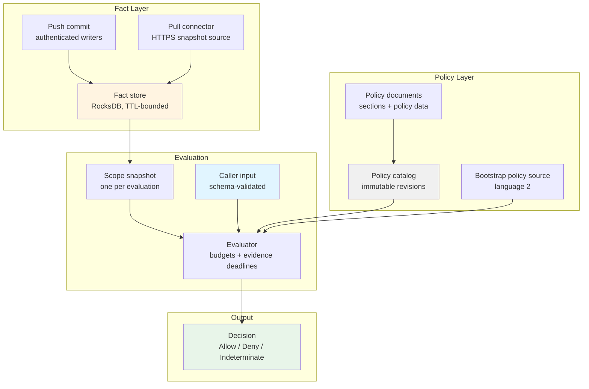

# Idempotent Predicate Engine (IPE)

**A fast, reliable authorization engine built in Rust**

[](https://github.com/jrepp/ipe/actions)
[](https://github.com/jrepp/ipe/actions/workflows/ci.yml)
[](https://codecov.io/gh/jrepp/ipe)
[](https://deps.rs/repo/github/jrepp/ipe)
[](LICENSE)

## Overview

The experimental [runtime data workflow](docs/RUNTIME_DATA.md) provides scoped,
authenticated fact writes, an HTTPS pull connector, mandatory TTL, and typed
language-2 policies. Its [external acceptance suite](acceptance/runtime-data/README.md)
exercises the real server with several data shapes. This profile has explicit
deployment and feature limits; the legacy APIs and architecture described below
are not a production-readiness guarantee.

The separate [Integration Workload discovery slice](docs/INTEGRATION_DISCOVERY.md)
provides CLI and MCP access to bounded ServiceNow metadata discovery. Its local
deployment demo uses a lightweight HTTPS stand-in and needs no real provider account.

The local [integration host](docs/INTEGRATION_HOST.md) runs installed JavaScript on a schedule.
Its GitHub example captures external requirements, expiring status facts, and execution outcomes for agent and human review.

IPE is a Rust authorization runtime. The version-2 runtime service (`ipe-server`) evaluates language-2 policy documents against TTL-bounded runtime facts and returns allow, deny, or indeterminate per scoped tenant/environment. Facts persist in RocksDB with atomic multi-key commits and a configured HTTPS pull connector; policy documents publish as immutable, activatable revisions with typed `policy.*` parameters and external provenance. Every decision reads one immutable snapshot and rechecks its earliest evidence deadline before allowing — missing or expired evidence is indeterminate, and consumers must treat indeterminate as denial.

**Quick facts:** scoped multi-tenant API | mandatory fact TTL | versioned policy documents | bounded storage with explicit limits

See [MISSION.md](MISSION.md) for the product mission and [docs/RUNTIME_DATA.md](docs/RUNTIME_DATA.md) for the implemented workflow.

### Key Capabilities

- **Declarative Policy Language**: Language-2 rules describe intent, with triggers, fact bindings, and requirements
- **Policy Documents**: Immutable revisions with atomic activation, content digests, and unsupported-section handling
- **Runtime Facts with TTL**: Push commits and HTTPS pull snapshots; every observation expires, and freshness clauses can tighten deadlines
- **Fail-Closed Evaluation**: Deny overrides indeterminate overrides allow; no applicable policy denies
- **Scoped HTTP API**: Bearer-authenticated routes with independent `write`, `evaluate`, `inspect`, and `manage_policies` grants

### Use Cases

- Access control: "production deployments require 2 senior engineer approvals"
- Workflow validation: "tickets must have priority assigned before closing"
- Change gates: "a merge needs approvals from distinct reviewers on this commit"
- Dynamic configuration: Change rules without redeploying services

---

## Architecture



The runtime pipeline:

1. **Publish**: Policy documents append immutable revisions; bootstrap policies load at startup
2. **Ingest**: Writers commit fact mutations; connectors pull complete snapshot generations
3. **Snapshot**: Each evaluation captures one immutable scope snapshot plus the active revisions
4. **Evaluate**: Language-2 rules run against input and snapshot within instruction/visit budgets
5. **Decide**: Deny overrides indeterminate overrides allow; the earliest evidence deadline is rechecked before any allow

## Features

### Runtime
- Typed, schema-validated facts with mandatory TTL and freshness clauses
- Atomic multi-key commits with revision-conflict and replay detection
- Policy documents with immutable revisions, digests, and external provenance
- Fail-closed combination: deny over indeterminate over allow
- Bounded RocksDB-backed storage with explicit capacity limits

### Developer Experience
- Natural language intent strings for documentation
- Language-2 syntax with typed `policy.*` parameters and aggregate queries
- Candidate testing API that evaluates unpublished documents against current facts
- Git-friendly text format for bootstrap policy sources

### Deployable
- Single runtime service binding to loopback; pair with a local TLS proxy for remote access
- Bearer credentials with independent, least-privilege grants per scope
- External HTTP acceptance suite exercising the real server end to end

## Quick Start

### Example Policy

```text
language 2
policy Approved: "Two different senior approvers"
  triggers when input.action.operation == "Deploy"
  facts
    approvals = data.approvals[input.resource.id] fresh within 5m
  requires
    approvals.value.active == true
    and count_distinct(
      a.principal_id for a in approvals.value.approvers
      where a.role == "senior"
    ) >= 2
```

`input` is caller-attested request data; `data` names fact collections; `policy` names typed parameters fixed inside one policy revision.

### Running the Runtime

```bash
# Build and run the v2 runtime service with a bootstrap configuration
cargo build --locked -p ipe-server
IPE_RUNTIME_CONFIG=runtime.json ./target/debug/ipe-server

# Or run the external acceptance workflow, which starts the real server itself
cargo build --locked -p ipe-server
python3 scripts/accept-runtime-data.py

# Run the test suite
cargo test --all-features
```

The bootstrap JSON declares the database path, loopback bind address, input schema, scoped collections, policy sources, credentials, and connectors. See [docs/RUNTIME_DATA.md](docs/RUNTIME_DATA.md) for the complete request shapes and limits.

## Documentation

**📚 [Documentation Index](docs/INDEX.md)** - Start here for guided navigation

### Quick Links

- **[QUICKSTART](QUICKSTART.md)** - Get running in 5 minutes
- **[SUMMARY](SUMMARY.md)** - Executive summary and vision (historical)
- **[END_TO_END_EXAMPLE](END_TO_END_EXAMPLE.md)** - Complete usage walkthrough (legacy engine; historical)

### Technical Reference

- **[RUNTIME_DATA](docs/RUNTIME_DATA.md)** - The implemented v2 runtime workflow and API
- **[ARCHITECTURE](docs/ARCHITECTURE.md)** - System architecture with diagrams
- **[AST](docs/AST.md)** - Legacy parser AST specification (historical)
- **[BYTECODE](docs/BYTECODE.md)** - Legacy bytecode instruction set (historical)
- **[RFCs](rfcs/INDEX.md)** - Design proposals and specifications

### Sidecar Architecture RFCs

- **[RFC-001](rfcs/001-predicate-service-architecture.md)** - Minimal sidecar service (<50MB)
- **[RFC-002](rfcs/002-sse-json-protocol.md)** - SSE/JSON protocol (MCP-inspired)
- **[RFC-003](rfcs/003-policy-tree-storage.md)** - Content-addressable policy storage

## Project Structure

```
ipe/
├── RFC.md                    # Historical technical specification
├── Cargo.toml                # Workspace configuration
├── crates/
│   ├── ipe-core/             # Runtime facts, policy documents, language-2 evaluation
│   ├── ipe-server/           # Axum HTTP runtime service
│   ├── ipe-parser/           # Placeholder crate
│   ├── ipe-control/          # Control plane placeholder
│   ├── ipe-wasm/             # WebAssembly placeholder
│   ├── ipe-ffi/              # C FFI placeholder
│   └── ipe-web/              # Web application placeholder
├── acceptance/
│   ├── runtime-data/         # External HTTP acceptance guide
│   └── policy-data/          # Policy document fixtures
└── examples/
    └── load_test.rs          # Load-test example
```

The legacy in-process engine (parser, AST, bytecode compiler, interpreter, resource index, lock-free policy store, JIT, tiering) was removed after the v2 runtime landed.

## Building

### Prerequisites

```bash
# Install Rust
curl --proto '=https' --tlsv1.2 -sSf https://sh.rustup.rs | sh

# Install dependencies (Ubuntu/Debian)
sudo apt-get install build-essential pkg-config

# Install dependencies (macOS)
brew install pkg-config
```

### Build

```bash
# Debug build
cargo build

# Release build
cargo build --release

# Run tests
cargo test --all-features

# Runtime acceptance (external HTTP workflow)
make runtime-acceptance
```

## Roadmap

The v2 runtime is the shipping product. Near-term work hardens what exists: persistence and replication bounds, audit durability, timestamp/duration values, cross-collection transactions, live schema publication, and global execution wall-time budgets. See [docs/RUNTIME_DATA.md](docs/RUNTIME_DATA.md) (limits and future work) and [ROADMAP.md](ROADMAP.md).

## Performance

No performance targets are claimed for the v2 runtime yet; performance under production load has not been characterized. Run the test suite and the acceptance workflows to validate behavior:

```bash
cargo test --all-features
make policy-acceptance
```

Archived microbenchmarks of the removed legacy interpreter remain on the [performance page](docs/performance.html) for reference only.

## Contributing

See [CONTRIBUTING.md](CONTRIBUTING.md) for guidelines.

## License

Licensed under the Mozilla Public License Version 2.0 ([LICENSE](LICENSE) or https://www.mozilla.org/en-US/MPL/2.0/).

## Acknowledgments

- Inspired by Cedar, Rego/OPA, and other policy languages
- Built with Rust for safety and performance

---

**Status:** Early-stage runtime; explicit deployment limits apply
**Version:** 0.1.0
**Contact:** [Your contact info]

Policy documents now separate immutable typed `policy.*` parameters from expiring
`data.*` evidence, with named sections and external-source provenance. Run
`make policy-acceptance` for PR-landing scenarios and the HTTPS import workflow.
See [policy data and provenance](docs/RUNTIME_DATA.md#separate-policy-data-from-runtime-evidence)
for the management API, agent trust boundary, and experimental limits.
