# IPE project map

IPE connects sourced evidence to explicit policy decisions and shows where those decisions take effect.
The current runtime and integration host provide separate foundations. The connected product below is still being designed.

This is the current project organization, proposed from the product discussion on 2026-11-17.
Projects describe outcomes and ownership boundaries, not separate deployed services or assigned teams.
No schedule, capacity, or staffing commitment is implied.

## Core principles

| Principle | Product consequence |
| --- | --- |
| Evidence has a source and a deadline. | Preserve provenance, scope, observation time, and expiry in every relevant view and decision. |
| Unknown is a result. | Keep missing, stale, restricted, and ambiguous evidence visible. Do not convert absence into permission. |
| Modeling, integration, and enforcement have distinct roles. | Show who describes a rule, who supplies facts, who evaluates it, and who applies the decision. |
| Review does not imply activation. | Separate discovery, model acceptance, publication, and active policy selection. |
| Authority is explicit and bounded. | Grants and exceptions have named issuers, scope, validity, and revocation. They do not renew evidence. |
| Evaluation uses a local snapshot. | Keep source reads and reconciliation off the request decision path. |
| Explain the user's object first. | Start with a policy, control, evidence item, or governed action. Show raw identifiers in details. |
| Claims follow evidence. | Separate implemented behavior, tested fixtures, proposed features, and measured outcomes. |

[MISSION.md](../MISSION.md) owns product positioning. [Vocabulary](../docs/VOCABULARY.md) owns current domain terms.
The principles summarize existing runtime and design boundaries; the PRDs identify work that is still proposed.

## Subway map

Each line is a project. Stations are user outcomes. Shared stations are handoffs between projects.
The dashed connection is the missing integration-to-runtime publication path.
The route is a dependency map, not a calendar or an implementation-status chart.

```mermaid
flowchart LR
    S[Source requirement] --> M[Model] --> R[Review] --> P[Publish policy revision]
    C[Connect source] --> O[Observe] --> A[Assess evidence]
    A -. Planned publication .-> F[Publish runtime facts]
    P --> B[Bind scope]
    F --> B
    B --> E[Evaluate] --> G[Apply decision] --> U[Record outcome]
    A --> I[Inspect evidence and links]
    U --> I
    I --> T[Time conditions] --> X[Temporary authority] --> H[Audit]
    D[Explain product] --> V[Validate docs and CI] --> W[Publish static site]
    R --> V
    I --> D
    classDef modeling fill:#e8efff,stroke:#325fc4,color:#172b53
    classDef integration fill:#e4f4ed,stroke:#287952,color:#173e2c
    classDef enforcement fill:#fcebdc,stroke:#a65a18,color:#593312
    classDef operations fill:#f0e8fa,stroke:#7950a3,color:#39224e
    classDef delivery fill:#e8edf1,stroke:#4a657b,color:#243541
    class S,M,R,P modeling
    class C,O,A,F integration
    class B,E,G,U enforcement
    class I,T,X,H operations
    class D,V,W delivery
```

## Projects and delivery states

| Project | Route | Current foundation | Next product outcome | Owning requirements |
| --- | --- | --- | --- | --- |
| P1 — Policy modeling | Source → Model → Review → Publish revision | Policy documents, provenance, candidate testing, and activation exist. | One sourced policy reviewed and activated with explicit unsupported sections. | [PRD 002](prd/prd-002-policy-modeling.md) |
| P2 — Evidence integration | Connect → Observe → Assess → Publish facts | Sandboxed collectors, source records, receipts, and assessments exist. | One authorized observation reaches a runtime fact collection with recovery and preserved expiry. | [PRD 003](prd/prd-003-evidence-integration.md) |
| P3 — Policy enforcement | Bind scope → Evaluate → Apply → Record | Scoped snapshot evaluation and expiry checks exist. | One identified application gate reports the decision it applied and its outcome. | [PRD 004](prd/prd-004-policy-enforcement.md) |
| P4 — Evidence operations | Inspect → Time conditions → Temporary authority → Audit | Policy/evidence previews and some governance descriptions exist. | Trace suppliers and consumers; then add reviewed temporal control, exception, and access lifecycles. | [PRD 001](prd/prd-001-evidence-system-map.md) |
| P5 — Product site and delivery | Explain → Validate → Publish | Static site, tests, Pages workflow, and structured docs exist. | Publish a clear project story from a checked source revision through automatic Pages delivery. | [PRD 005](prd/prd-005-product-site-and-delivery.md) |

All five PRDs are Draft. A current foundation is not proof of the complete project outcome.
Owners are not yet assigned. Use project IDs in planning and PR descriptions; do not imply a team exists because a line exists.

Shared infrastructure choices and reuse candidates are recorded in the [shared-foundations survey](memos/memo-001-shared-foundations.md).
It maps common needs to consuming lanes, existing packages, permissive candidates, and adoption checks.

## Shared stations and dependencies

| Handoff | Producer → Consumer | Contract and evidence needed |
| --- | --- | --- |
| Source observation | P2 → P1 and P4 | Stable source identity, observed revision, coverage, and original validity. |
| Reviewed policy revision | P1 → P3 | Publication authority, explicit activation, and active-revision reporting. |
| Runtime fact | P2 → P3 | [RFC 014](../rfcs/014-fact-publication-and-synchronization.md) delivery and recovery; live host publication remains missing. |
| Decision and applied outcome | P3 → P4 and P2 | Distinct evaluator and action gate identities; source-backed events rather than inferred success. |
| Exception or access grant | P4 → P3 and evidence access gates | [RFC 015](../rfcs/015-policy-access-and-identities.md) access boundary plus [RFC 018](rfcs/rfc-018-evidence-system-map.md) lifecycle proposal. |
| Product statement | P1–P4 → P5 | Implemented or planned state, source links, and verification limits. |

## First connected milestone

Demonstrate one governed action with one sourced policy, one fresh evidence path, and one identified enforcement point.
A reviewer must trace the source observation, exact policy revision, evaluation result, and observed action outcome.
The same path must expose missing or expired evidence without allowing the blocked action.

This milestone depends on P2 publication and P3 action-gate work. Current sample previews cannot establish it.
P4's map can develop with labeled sample data while those boundaries are implemented.
Temporary authority follows reviewed decisions about approval, eligible controls, clock behavior, and offline revocation.
P5 can publish the honest product story and current roadmap before the live milestone is complete.

## Design and documentation ownership

- [PRD 001](prd/prd-001-evidence-system-map.md) remains the source for the user's map, temporal control, exception, and access requests.
- [RFC 018](rfcs/rfc-018-evidence-system-map.md) supplies the cross-system design and its unresolved decisions.
- The other PRDs organize supporting product work. They do not duplicate or override PRD 001's acceptance criteria.
- Existing [RFCs](../rfcs/INDEX.md) keep their area contracts. New implementation RFCs must declare the PRDs they cover.
- Existing [runtime](../docs/RUNTIME_DATA.md) and [integration](../docs/INTEGRATION_HOST.md) guides describe implementation.
- The previous [roadmap](../ROADMAP.md) is historical. Its parser/JIT milestones are not current project commitments.

## Product message

**Headline:** Evidence-backed policy decisions.

**Description:** Connect external evidence to explicit policy checks. See the rule, the source, and the reason for each decision.

**Audience:** Platform teams and developers governing application and agent actions across external systems.

**Current capability:** A Rust runtime evaluates scoped policies against expiring facts. A separate integration host collects and explains source evidence.

**Product direction:** Connect those foundations with reviewed models, visible enforcement points, and bounded temporary authority.

**Evidence boundary:** No production latency, cost saving, compliance certification, or complete source-to-enforcement integration is claimed without proof.
