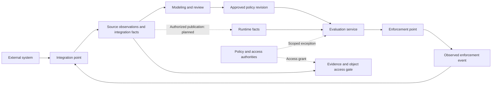

# Summary

Add a system map that separates integration, modeling, evaluation, and action enforcement.
Connect evidence suppliers and consumers. Show control time conditions, fact validity, exceptions, and access grants.
This is a proposed design for [PRD 001](../prd/prd-001-evidence-system-map.md), baseline 2026-11-17.
No diagram or coverage row establishes a running service or a passed feature test.

# Current behavior and design ownership

| Area | Current evidence | Boundary |
| --- | --- | --- |
| Runtime | [Runtime guide](../../docs/RUNTIME_DATA.md) and [fact storage](../../crates/ipe-core/src/runtime_facts.rs) | Scoped facts, expiry, immutable evaluation snapshots, and policy revisions exist. |
| Integration | [Host guide](../../docs/INTEGRATION_HOST.md) | Collector runs, records, and review catalogs exist. The host does not publish enforcement facts. |
| Governance | [Governance records](../../crates/ipe-integration/src/host/governance.rs) | Control mechanisms and some role validity fields exist; no complete hard/soft control lifecycle exists here. |
| Preview | [Policy map source](../../tools/product-ship-mocks/app.js) | Sample policy dependencies and evidence details exist; no live service topology is established. |
| Domain | [RFC 013](../../rfcs/013-domain-constraints-and-projections.md) | Owns source descriptions and projections. |
| Publication | [RFC 014](../../rfcs/014-fact-publication-and-synchronization.md) | Owns delivery ordering, expiry preservation, and receiver recovery. |
| Access | [RFC 015](../../rfcs/015-policy-access-and-identities.md) | Already proposes disclosure rules, scoped temporary elevation, and revocation. |
| Audit and API | [RFC 016](../../rfcs/016-integration-signals-and-audit.md), [RFC 017](../../rfcs/017-enforcement-mcp-surface.md) | Own audit and enforcement API contracts, including proposed authority checks. |

This RFC owns the cross-system view and the proposed relationships needed by the requested features.
It does not replace those transport, access, or audit contracts.
The [project vocabulary](../../docs/VOCABULARY.md) remains the current term reference. New terms below are proposed.

# System roles

This diagram shows logical roles, not a required deployment layout.
Modeling may be an authorized agent and review workflow, not a separate service.
An integration point identifies a collector installation and its source scope.
An evaluation service computes a policy result. An enforcement point applies that result to a governed action.
They may share a process but retain distinct responsibilities.
A source's declared enforcer is not proof that an identified enforcement point performed an action.

# Records and links

Use scoped stable identities, revision references, source provenance, and observation times.
Keep these as proposed logical records until the API and storage design is reviewed.

| Record | Required meaning |
| --- | --- |
| Integration point | Installation identity, scope, program revision, permitted operations, last run, and source availability. |
| Modeling activity | Source capture references, mapper revision, candidate model, review state, and resulting policy revision. |
| Enforcement point | Governed action and scope, evaluator reference, assigned and reported active policy revisions, and last status time. |
| Evidence item | Subject and context, source observation, original validity, authority, revision, and supporting receipt where available. |
| Evidence dependency | Requirement revision, evidence selector, supplying integration, consuming evaluator or gate, and binding basis. |
| Control | Identified mechanism, governing requirements, enforcement mode, time condition, and eligible exception policy. |
| Policy exception | Exact requirement/control revision, subjects and objects, permitted waiver, reason, issuer, approval, interval, and revocation revision. |
| Access grant | Principal, audience, permitted actions and fields, objects, purpose, approving authority, interval, and revocation revision. |
| Lifecycle event | Record revision, actor, action, decision time, effective time, and per-point acknowledgment where applicable. |

One observation can support several requirements. One requirement can depend on several integrations and enforcement points.
An enforcement event can supply evidence to another control; mark that edge as production of evidence, not consumption.
Read receipts, evidence matches, evaluation decisions, and observed enforcement outcomes remain different records.

Edges carry a basis such as configured binding, source declaration, observed use, candidate match, or unknown.
Do not invent a resolved link from matching labels. Do not infer enforcement success from a successful collector run.
Fresh evidence does not imply current topology. Each point and edge has its own last observation and completeness state.
Use explicit pagination and bounded graph expansion; budget values remain an implementation decision.

# Interface behavior

Add System map alongside the existing Policy map. Keep the policy checklist and selected control as the main inspection context.
The system view starts from a selected policy, control, evidence item, or governed object.
Show role filters for Integration, Modeling, and Enforcement, plus a legend for known and uncertain links.
An evaluator and its action gate remain distinguishable within Enforcement details.

Selecting an evidence item shows its source, observed value, required value, validity, suppliers, and known consumers.
Selecting an enforcement point shows its active revision, last reported state, and observed events.
Selecting a control opens its time conditions, evidence checks, exceptions, and permitted access actions.
Keep raw IDs and source records in details. Provide a list view with equivalent links and keyboard access.
Retain selection when switching between the policy and system views.

Use the [IPE design guidance](../../.agents/skills/ipe-design/SKILL.md).
Show sample data, stale observations, missing reads, uncertain links, and restricted details explicitly where disclosure is permitted.
Do not display secret endpoints or reveal protected objects through counts, graph layout, search, or exports.
Access restrictions apply before building the user-visible graph.

# Time and control effect

Store instants in UTC and show the display time zone. Evaluate validity against a stated service clock, not browser animation.
Keep observation time, receipt time, validity interval, collection schedule, and control deadline distinct.
Use start-inclusive and end-exclusive authority intervals: start <= now < expiry.
Preserve the runtime's stricter freshness deadline when several bounds apply.
A cached read, model restore, retry, or new receipt cannot extend an old observation's expiry.

Proposed control modes are blocking and advisory, displayed with hard and soft as explanatory terms during review.
Mode and result are separate: an advisory check can fail, and a blocking check can be unknown.
A failed blocking control prevents continuation. An advisory failure produces a visible finding but does not independently block continuation.
Unknown blocking evidence cannot authorize an action. Existing runtime decision precedence remains unchanged.
Do not add an implicit advisory fallback to current policies.

Time-based controls need typed conditions for the selected initial use cases: active windows, deadlines, or recurring schedules.
Their time zone, calendar, grace period, and missed-event semantics must be explicit before implementation.
No grace period is inferred from a fact TTL. Full temporal coverage remains unresolved until those use cases are selected.

# Exceptions and grants

Keep policy exceptions and access grants as separate authority records.
An exception can waive only the named requirement within its approved context.
It cannot supply missing facts, grant disclosure, or waive unrelated requirements.
Show the original failed or unknown result together with the exception used and the final decision basis.
Eligibility, mandatory controls, overlap precedence, maximum duration, and approval duties remain policy decisions.

An access grant authorizes only the named principal, audience, actions, fields, and objects.
Check current authority on each protected request, including graph expansion, source detail, exports, and cached result delivery.
A grant does not imply permission to execute external operations or alter policies.
Use RFC 015's separation between access policy, ordinary evaluation, and source credentials.
An agent cannot approve its own elevation or bypass required human authentication.

Proposed lifecycle: requested, approved, scheduled, active, expired, revoked, or rejected.
Approval and validity are distinct. Approval does not imply every enforcement point has applied the change.
An approved record becomes active only when its interval and local authority checks permit use.
Expiry and revocation end future use. Renewal is a new reviewed revision, not an edit that silently extends cached authority.

Bind mutations to an expected revision and a stable request identity.
Unauthorized or stale updates do not change authority. Retries return the recorded result and cannot extend duration.
Record issuer, approver, reason, target revision, and lifecycle events with protected audit access.
Do not claim a complete audit guarantee until the selected persistence and failure policy are tested.

# Propagation and failure

Show requested state, authority revision, and each point's acknowledged revision separately.
Measure approval-to-effective and revocation-to-enforced delays. Do not label pending delivery as immediate revocation.
Periodic UI refresh alone does not enforce expiry or revocation.

Expired grants and exceptions must be unusable locally even without a fresh notification.
Apply ordered revisions so an old activation cannot override a newer revocation.
The authority freshness limit and offline policy are unresolved. They must bound any stale permission before live rollout.
Already disclosed data cannot be recalled. Long-running operations need an explicit reauthorization and cancellation boundary.
Do not assume a revoked grant rolls back a completed external action.

Preserve original fact deadlines during publication using RFC 014.
The hosted integration-to-runtime path is still missing; a preview may show that path only as planned or sample data.
Authorization-service failure must not disable ordinary local evaluation or allow new protected disclosure.

# Requirements Coverage

Covered means the proposed mechanism addresses the criterion. It does not mean implemented or verified.
Unresolved rows identify decisions that block complete acceptance, while unblocked design and preview work can proceed.
All references below are scoped to the PRD named by implements.

| Source requirement | Acceptance criterion | Disposition | Design section | Planned verification |
| --- | --- | --- | --- | --- |
| FR-1 | AC-1 | Covered | System roles | Map fixture with co-located but distinct roles; inspect gate versus evaluator. |
| FR-2 | AC-2 | Covered | Records and links | One observation, two consumers, and a failed source read; verify lineage and missing state. |
| FR-3 | AC-3 | Covered | Records and links | Two active policy revisions and an enforcement event; verify direction and provenance. |
| FR-4 | AC-4 | Covered | Time and control effect | Controlled clock before and at expiry; delayed receipt and replay cannot renew evidence. |
| FR-5 | AC-5 | Unresolved | Time and control effect | Verify blocking/advisory result separation; temporal cases await calendar and grace decisions. |
| FR-6 | AC-6 | Unresolved | Exceptions and grants | Verify scope, unauthorized updates, boundaries, and concurrent changes after exception precedence is agreed. |
| FR-7 | AC-7 | Unresolved | Exceptions and grants | Cross-principal, tenant, audience, action, and field tests after initial object scope is agreed. |
| FR-8 | AC-8 | Unresolved | Propagation and failure | Disconnect/reconnect, reordered delivery, duplicate activation, expiry, and revocation latency under the agreed offline contract. |
| NFR-1 | AC-9 | Covered | Interface behavior | Restricted fixtures across graph, counts, search, exports, and cached delivery; hidden policy still applies. |

# Delivery and review

1. Review the PRD, entity distinctions, and open authority/time decisions.
2. Add labeled sample map data and navigation. Verify supplier/consumer links and passing, failed, unknown, and restricted states.
3. Define live point identity and status APIs. Prove active-revision and evidence-dependency reporting without inventing missing publication.
4. Implement selected temporal and authority contracts. Use deterministic clock and authorization tests for failure paths.
5. Prove publication and lifecycle delivery in integration tests before enabling live grants or exceptions.

Keep test results with the tested code revision and environment. Documentation validation checks structure, not these behaviors.
Update the existing runtime and integration guides when behavior ships. Add an ADR for each resolved cross-system authority decision.

# Alternatives and open decisions

A policy-only graph cannot show who supplies evidence or where decisions take effect.
A single generic node type hides ownership and confuses source declarations with observed enforcement.
A global bypass would be simpler but would not preserve scoped evidence and access boundaries.

The [PRD open decisions](../prd/prd-001-evidence-system-map.md#scope-and-open-decisions) own unresolved product choices.
Storage placement, endpoint schemas, graph budgets, acknowledgment transport, and audit failure behavior need implementation design after those choices.
No new service deployment, distributed latency guarantee, or production capacity is claimed here.
