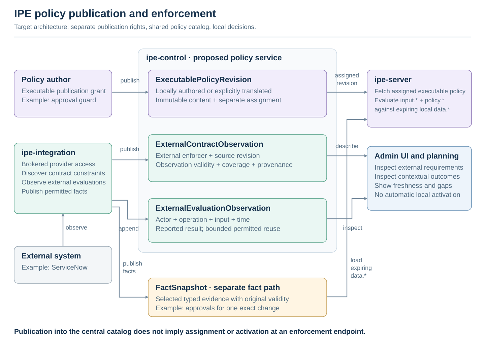
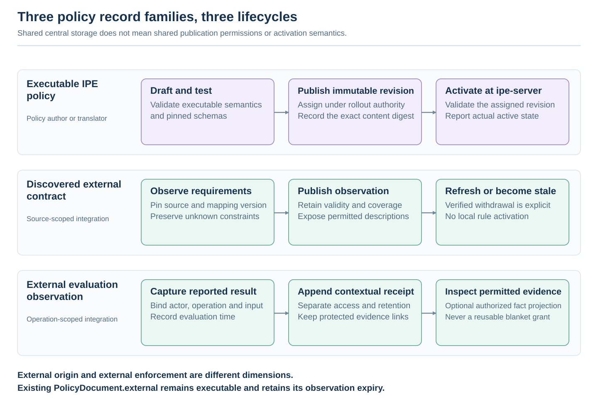
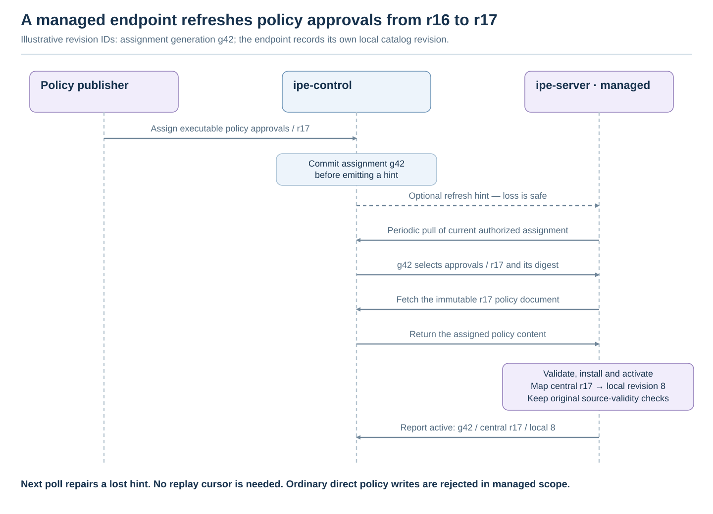
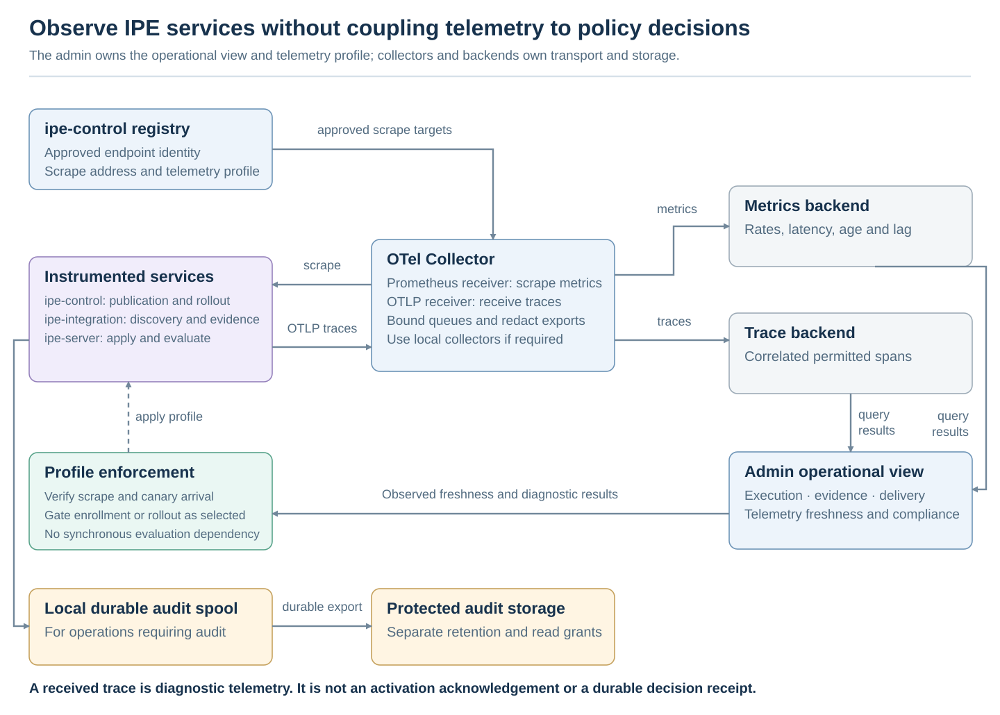

# Admin Control Plane Architecture Review

**Status:** Proposed architecture, revised after design review. No AT Protocol, xDS, or TUF adoption is selected. Implementation choices and unimplemented capabilities are identified below.

**Implementation baseline:** [IPE main at b9360e2](https://github.com/jrepp/ipe/tree/b9360e2). The [design critique](ADMIN_ARCHITECTURE_CRITIQUE.md) records the issues that motivated this revision.

## Architectural conclusion

Create one central administrative service with a policy service, an endpoint registry, desired assignments, and the primary operational UI. The central policy store contains distinct resource families for executable IPE policies, discovered externally enforced contracts and constraints, and references to externally reported evaluations. Their shared location provides a coherent operational view; each family retains its own publisher authority, lifecycle, and permitted uses.

Integration owns discovery and publication of external contract knowledge, external evaluation observations, and selected runtime facts. The external system remains authoritative for its own constraints and decisions. Authorized policy authors own executable IPE policies, including explicitly translated policies of external origin. Enforcement endpoints apply selected executable policy revisions to locally cached, expiring evidence. No local evaluation waits for discovery or a remote evaluation.

Use authenticated latest-state pulls with best-effort refresh hints for the initial configuration path. Durable assignments provide correctness; hints reduce latency; periodic reconciliation repairs missed hints. Add retained fact deltas only when complete snapshots cannot meet measured workload needs. Telemetry and durable audit are separate pipelines.

AT Protocol is comparative research, with no selected runtime role. xDS is a configuration-delivery alternative, and TUF is an artifact-security option. Neither is a required layer of this design. The architecture follows ownership and consistency requirements before selecting additional protocols.

## Overall system architecture

These are logical responsibilities. The admin API, policy service, registry, and notification emitter can initially share one process and transactional database. Storage arrows represent authenticated service operations, never direct database access by endpoints. Telemetry and enrollment are detailed separately.

An endpoint may expose several capabilities, but registration must not confer all corresponding permissions. Integration publication cannot activate a local policy merely because both records live in the central policy store. Registration and assignments determine which endpoints participate; the policy service and fact service independently authorize every read and write.

## Separation of concerns and authority

| Responsibility | Owner and authoritative state | Explicit boundary |
| --- | --- | --- |
| Operational UI | Admin presents permitted policy, fleet, delivery, and telemetry views | A derived view does not establish external truth or grant execution rights |
| Registry and enrollment | Admin binds endpoint ID to authenticated workload identity, owner, capabilities, and approved addresses | A heartbeat cannot self-register new grants or change assignments |
| Executable policy publication | Authorized policy authors or scoped automation publish immutable IPE policy revisions | Integration discovery credentials have no executable-policy activation grant |
| External contract publication | Integration publishes source-scoped observations into the policy service | The external system remains the source authority; import does not create a local guard |
| External evaluation publication | Integration records an external result and its exact context | A reported result is not a reusable permission or proof of future action success |
| Fleet assignment | Admin assigns resource revisions to authorized endpoints | Assignment selects already published resources; receipt does not prove activation |
| Fact publication | Integration owns scoped snapshots and permitted fact projections | Volatile evidence has separate capacity, expiry, and publication rules |
| Enforcement | Endpoint validates, caches, activates, and evaluates locally | It neither runs integration adapters nor fetches external evidence during evaluation |
| Observability | Collectors and backends receive permitted metrics and traces | Telemetry does not replace acknowledgements, authoritative evidence, or durable audit |
| Audit | Services record required actions; audit storage retains protected evidence | Sampling and best-effort export cannot satisfy a lossless audit requirement |

The registry is a directory, not the policy store or a global source of truth. The central policy service is authoritative for what IPE has recorded, authored, and assigned; it cannot certify that an imported external rule is complete or current merely by accepting it. The runtime's active revisions and local snapshot establish what actually participated in a decision.

## One central policy store with distinct resource families

Use a common catalog and query surface with typed namespaces, separate publication APIs, and independent grants. Shared storage must not become one generic “publish policy” operation that implicitly activates every record. Retention-heavy evidence bodies may live in protected object storage, with immutable references in the catalog. A logical central policy store does not require all payloads to share a table or transaction.

| Resource family | Publisher and meaning | Lifecycle and controls |
| --- | --- | --- |
| Executable IPE policy | Authorized author or translator defines rules that IPE evaluates | Draft and test, publish immutable revision, assign, validate, activate, retire; executable-policy grants control each supported operation |
| External contract or constraint | Integration describes requirements enforced by a named external authority | Observe, validate schema/provenance, publish a source-owned revision, refresh, mark stale, supersede, or record verified withdrawal; source-scoped discovery grants |
| External evaluation observation | Integration records what an external system evaluated or decided | Append a contextual receipt, validate source evidence, bound any permitted reuse, retain or expire under its evidence policy; no executable activation |
| Runtime fact projection | Integration releases selected typed evidence for local decisions | Publish to the fact path, enforce original validity, replace or delete according to the collection contract; separate fact-write grants |

**Origin and enforcement location are independent.** An externally authored rule explicitly translated into IPE is an executable policy of external origin. A discovered rule still enforced by an external system is contract knowledge. They must not share an activation path merely because both mention an external source.

### Discovered contracts and constraint validity

A contract record identifies its tenant, source binding, source-native reference or protected mapping, subject and operation, intended actor context, applicability, requirements, external enforcer, source revision, observation time, validity, mapping version, and coverage. Source-sensitive information remains protected; ordinary views use opaque references.

Keep source effective time, observation time, and ingestion time distinct. Expiring an observation means our knowledge is stale; it does not mean the external rule stopped existing. A denied read or incomplete scan cannot establish withdrawal. A verified complete source snapshot or explicit source deletion can retire the relevant current projection while retaining history under its retention policy.

Coverage, freshness, and disclosure are independent. A fresh description can be partial; a complete record can be hidden from a particular caller. Preserve unsupported expressions as opaque constraints rather than translating them into false certainty. Mapping changes produce new projections with pinned provenance and detectable differences. Integration may refresh records automatically within its granted source and schema scope; manual approval of every observation is not implied.

This extends the deployment placement of [RFC 013's domain contract](../rfcs/013-domain-constraints-and-projections.md#domain-contract) into the central policy service while preserving its distinction between descriptions and executable rules. RFC 013 remains a draft and does not implement the central store.

### External evaluation observations

Represent an external evaluation as an immutable observation tied to a specific subject, operation, actor, input or protected input digest, time, source response, and contract revision when the provider exposes one. If the revision is unavailable, record that gap rather than inventing a pin. Distinguish a provider's evaluation response from a later business-action outcome and from the integration adapter's interpretation of either.

Evaluation records have independent quotas, retention, and read grants; accepting a record into the catalog does not grant permission to act. The record says what was reported under those conditions. It cannot guarantee that a future operation will succeed after permissions, state, or source policy changes. A selected projection may become a short-lived fact only through a separately authorized projection contract with explicit applicability and validity. The source receipt and raw evidence remain subject to their own access and retention controls.

Recording a reported evaluation does not grant permission to invoke arbitrary evaluation APIs. A provider operation called “validate” may have effects or consume privileged resources. Broker operation grants must identify allowed calls and their effects; actual business-action execution remains a separate capability.

### Promotion into local enforcement

Explicit translation creates a new executable policy resource with a reference to the exact source contract observation, supported semantics, schema pins, and translation tests. It requires executable publication and assignment authority. Refreshing or withdrawing the source contract emits drift information; it does not silently modify an active local guard. A deployment can authorize controlled automatic regeneration, but that authority belongs to the policy publication workflow, not discovery publication.

A translated executable policy must declare whether it is an independent local guard or remains dependent on the source observation. Existing external executable imports retain their validity deadlines. Refreshing a descriptive contract cannot renew a dependent executable policy; that requires authorized republication with the applicable provenance and validity checks.

For example, integration may discover an external requirement for two approvals and record that a particular request was rejected. The UI can show both. An authorized author may separately implement a local two-approval guard using synchronized approval facts. The local guard does not imply that all other external constraints are satisfied.

## Implementation grounding and migration boundary

| Area | Implemented baseline | Required new work |
| --- | --- | --- |
| Policy catalog | [Publication appends and immediately activates](RUNTIME_DATA.md#policy-management-and-candidate-testing-api) through `manage_policies` | Central authoring, assignment, and rollout contracts must distinguish publishing from endpoint activation |
| External executable models | [PolicyDocument external provenance](RUNTIME_DATA.md#external-provenance-and-agent-import-contract) already exists and participates in local evaluation | Preserve these executable records; add a distinct descriptive contract family |
| Source trust | Existing importer asserts provenance; IPE checks shape and ordering | Capture broker receipts and publication provenance without claiming semantic completeness |
| Facts | [Scoped writes and HTTPS snapshot polling](RUNTIME_DATA.md#pull-connector), finite TTL, bounded state | Integration-owned publication and centrally managed assignments |
| Integration | [Discovery](INTEGRATION_DISCOVERY.md) and [sandbox SDK](INTEGRATION_SDK.md) implement bounded brokered reads | General external-constraint discovery, durable publication, and external evaluation observations |
| Admin | [ipe-control](../crates/ipe-control/src/lib.rs) is a stub | Registry, policy service, desired assignments, status, and operational UI |
| Telemetry and audit | [RFC 016](../rfcs/016-integration-signals-and-audit.md) is draft discovery | Instrumentation, collection, compliance checks, and any required durable audit profile |

Do not send descriptive discovery records to the existing executable-policy publication endpoint. The code checks `manage_policies` and immediately calls catalog publication; it is not a draft or knowledge-ingestion route. Existing external executable models retain their current observation expiry and evaluation semantics during migration. An `external` field alone is not a discriminator for the new descriptive family. [Runtime implementation](../crates/ipe-server/src/runtime.rs), [policy model](../crates/ipe-core/src/policy_document.rs)

Current listeners bind to loopback with startup-loaded bearer credentials. A remote admin design needs an explicit agent or authenticated proxy path and a credential lifecycle; registration alone does not make those listeners remotely reachable. [Deployment boundary](RUNTIME_DATA.md#bootstrap-and-credentials)

## Configuration distribution without a replicated event log

An endpoint authenticates to admin, pulls its complete authorized assignment set, and fetches referenced immutable policy or adapter artifacts. It periodically repeats that reconciliation with jitter and bounded concurrency. It can also maintain an outbound SSE subscription; a hint prompts an earlier pull. Endpoint status is sent separately over authenticated HTTP.

The initial hint stream is best effort and does not need a durable cursor, replay history, or an exactly-once promise. Commit desired state before emitting a hint. A crash after commit may lose the hint; the next poll discovers the revision. Multiple hints can be coalesced because the endpoint reads authoritative current assignments. A hint cannot nominate arbitrary URLs, introduce grants, or substitute for payload validation.

The assignment response needs an explicit completeness scope, generation, and applicability rules. If bounded pagination is necessary, pin a complete assignment generation; do not infer deletion from an incomplete pass. Endpoints retain the last accepted generation while staging a replacement. Removing an assignment is an explicit authorized state change, not an inference from a transient fetch failure.

Report received, validated, persisted, and active states separately. A missing acknowledgement means activation is unknown. Include endpoint incarnation and observation time so delayed status from an old process cannot override current state. Resource revision, assignment generation, and observation time serve different purposes and must not be collapsed into one “version.”

The current policy and fact stores have no joint transaction. Do not claim cross-policy, cross-collection, or fleet-wide atomicity. Introduce compatible schemas before assigning dependent policies, and expose per-endpoint activation and rejection. If coordinated bundles are required later, define their activation unit and recovery contract before promising atomic rollout. [Current consistency limits](ARCHITECTURE.md#consistency-and-limits)

### Managed activation has one authority

For a managed scope, central assignments govern which executable resources may be active. The managed endpoint accepts installation through its authenticated reconciler, validates the assigned identity and digest, and rejects ordinary direct policy-management writes for that scope. This requires a new managed deployment profile; it is not a claim that the current `manage_policies` API already enforces assignments. A separately configured standalone mode retains its direct management path.

An emergency override, if later required, needs an explicit audited override state and a defined reconciliation policy. The initial managed profile has no competing direct-write path. Detect and report drift rather than silently accepting whichever writer ran last.

Track the central policy ID, immutable central revision and digest, assignment generation, endpoint identity/incarnation, and resulting endpoint-local catalog revision together. A local catalog revision has no fleet-wide meaning. On restart, verify local active state against the current permitted assignment before reporting it as converged. Database restore and managed/standalone transitions require explicit reconciliation; they cannot silently reset accepted history or change authority.

## Fact distribution and external knowledge updates

Fact publication and external contract publication serve different consumers. A contract revision refreshes authorized knowledge views and may trigger a drift check for a derived local guard. A fact update supplies time-bounded evidence to enforcement. Notifications must be typed and scope-filtered so a descriptive change cannot trigger executable activation.

Begin with bounded complete fact snapshots where source size and freshness targets permit. The source owns a scoped generation, complete membership, observation metadata, and original validity deadlines. Enforcement validates a complete replacement before activation and enforces expiry locally. Re-fetching identical data or receiving a hint cannot renew source validity. A new verified observation may establish a new deadline under the collection rules.

For ordered fact deltas, [RFC 014](../rfcs/014-fact-publication-and-synchronization.md#publication-contract) proposes a stronger contract: producer epochs, predecessor checks, retained replay, atomic applied positions, and snapshot recovery. That is a separate implementation phase, not a prerequisite for every configuration hint. Choosing snapshots as the first slice narrows delivery scope; it does not declare RFC 014's delta work complete.

Use a durable outbox where loss of a publication event would violate a required delivery contract. Do not impose it on a coalescible cache-refresh hint when polling already supplies correctness. The [current-state listing proposal](rfcs/0003-fact-retrieval-api.md#5-consistency-and-reconciliation) is neither a pinned snapshot nor a retained feed and cannot silently fill either role.

## Registry and access controls

Separate operator-owned registration, desired assignments, endpoint-reported state, and independently observed telemetry. Stable endpoint identity survives address changes; process incarnation distinguishes restarts. Tenant, source, and collection permissions derive from authenticated enrollment and installation grants, not endpoint-supplied labels. The enrollment authority binds the current process incarnation through an authenticated issuance or replacement operation; a self-reported new incarnation cannot evict another process. Accept status only from the current binding. Provider resource identities remain a separate namespace from endpoint identities.

| Operation | Required authority |
| --- | --- |
| Enroll endpoint or change its identity binding | Fleet administration |
| Publish external contract observations | Specific source and contract namespace publication |
| Publish external evaluation observations | Specific source, permitted operation, and release schema |
| Publish executable policy or assign it | Policy publication and rollout authority, independently granted |
| Publish facts | Owned scoped collection and approved projection |
| Inspect topology, contracts, evidence, or traces | Corresponding disclosure permission; one grant does not imply the others |

These are proposed permission categories, not existing API scope names. A shared process can enforce separate categories without introducing separate services. Protect source credentials in the integration deployment; the central catalog stores references rather than provider secrets. Apply redaction before release and reauthorize reads and subscriptions when grants change. [Proposed disclosure contract](../rfcs/015-policy-access-and-identities.md#opaque-references-and-permitted-fields)

Disconnected enforcement creates a real limit: central revocation cannot instantly reach an offline endpoint. Choose a bounded authorization lifetime where required, and distinguish it from policy content validity and fact expiry. Native mTLS, federation, and a new identity service are not assumed by this review; select the enrollment mechanism against the deployment environment.

## Observability and durable audit

Admin provides the operational view, while an OTel Collector receives and exports telemetry to separate backends. The registry supplies approved scrape targets and expected telemetry profiles. Metrics can be scraped; traces are exported using OTLP. Collector and backend health must remain observable independently of the admin UI. [Collector architecture](https://opentelemetry.io/docs/collector/architecture/)

Use [Prometheus HTTP discovery](https://prometheus.io/docs/prometheus/latest/http_sd/) as the registry projection format. The Collector's [Prometheus receiver](https://github.com/open-telemetry/opentelemetry-collector-contrib/blob/main/receiver/prometheusreceiver/README.md) supports discovery but duplicate configurations can duplicate scrapes. Assign one scraper per target initially; the Kubernetes Operator's [Target Allocator](https://opentelemetry.io/docs/platforms/kubernetes/operator/target-allocator/) is an option for that deployment model. Private-network endpoints may require local collectors exporting to a gateway; an outbound SSE connection does not enable inbound scraping.

Make observability verifiable: check required metrics, authenticated service identity, exporter failures, queue pressure, and arrival of a bounded diagnostic canary trace. Idle or sampled services may have no recent application traces. Display execution health, external-contract freshness and coverage, fact expiry headroom, assignment/application lag, and telemetry compliance independently.

Telemetry claims are assertions unless bound to authenticated ingestion identity. Prevent endpoints from assigning themselves another tenant's labels. Redact sensitive source content and topology; bound cardinality and retention. Do not use arbitrary fact keys, raw external responses, or secrets as metric labels or baggage.

Telemetry noncompliance can block enrollment or new rollout according to an explicit deployment profile. It must not silently become a synchronous dependency of ordinary local evaluation. A profile requiring a durable decision record may fail closed when its audit spool cannot record. OTLP acknowledgement covers a hop, not end-to-end forensic retention. [OTLP delivery scope](https://opentelemetry.io/docs/specs/otlp/#otlpgrpc), [audit proposal](../rfcs/016-integration-signals-and-audit.md#forensic-audit)

## Protocol choices and the actual value of AT Protocol

The proposed initial implementation uses typed HTTP APIs, complete authorized state, and optional SSE hints. None of the following reference systems is an adopted dependency.

| Reference | Relevant design lesson | Unique capability that would justify adoption | Current decision |
| --- | --- | --- | --- |
| AT Protocol | Separate authorities from distribution and derived views; verify state and recover gaps | Portable identities and interoperable, independently verifiable records across administrative domains | Research reference only; no such federation requirement is established |
| Envoy xDS | Resource subscriptions, versions, and explicit acknowledgement/rejection | Existing xDS clients or a concrete need for its resource-discovery ecosystem | Alternative to the simple HTTP/SSE contract, not an extra layer |
| TUF | Artifact trust requires more than a content hash | Distribution through mirrors with explicit rollback/freeze defenses and a governed signing-key lifecycle | Evaluate when the artifact threat model requires it; no TUF protection is claimed today |
| OTel and Prometheus discovery | Standard telemetry ingestion and scrape target exchange | Directly serves the requested metrics and trace operations | Selected architectural direction; integration is new work |

AT's PDS/relay/App View architecture concerns account data and federation. Its standard repositories contain public records; its synchronization API includes unauthenticated repository exports. Its signatures and content addressing authenticate repository state, not the correctness of external business claims or IPE publication authority. These are material differences from a private central policy service. [AT protocol structure](https://atproto.com/specs/atp#protocol-structure), [repositories](https://atproto.com/specs/repository), [sync](https://atproto.com/specs/sync#repository-exports)

AT's identity, schema, and stream designs remain useful comparisons, but they are not unique solutions to our current requirements. [DIDs](https://atproto.com/specs/did#blessed-did-methods) introduce identity resolution and recovery choices; [Lexicon](https://atproto.com/specs/lexicon#primary-type-definitions) adds schema tooling; [event cursors](https://atproto.com/specs/event-stream#sequence-numbers) address retained streams. We need none merely to notify a registered endpoint that its assignment changed. Revisit AT if independent organizations must exchange portable, verifiable contract records under an agreed disclosure model.

xDS acknowledges resource validity and intent to apply, not successful activation. That distinction informs our status model even without its wire protocol. TUF specifies update verification, metadata roles, expiry, and version protections. Adopting a few signature ideas is not equivalent to implementing TUF; a reviewed implementation and operational trust model would be needed. [xDS acknowledgement semantics](https://www.envoyproxy.io/docs/envoy/latest/api-docs/xds_protocol#ack-and-nack-semantics-summary), [TUF specification](https://theupdateframework.github.io/specification/latest/)

## Failure behavior and tradeoffs

| Failure | Required behavior | Remaining cost |
| --- | --- | --- |
| Lost refresh hint | Periodic pull finds current authorized state | Update latency is bounded by polling and availability, not hint delivery |
| Admin unavailable | Retain accepted local configuration within its validity/authorization rules | Rollout and revocation can be delayed |
| External contract discovery fails | Mark coverage/freshness appropriately; retain history | Unknown source state cannot be represented as withdrawn rules |
| External evaluation becomes stale | Reject reuse outside its original context and validity | Another evaluation may require source access |
| Invalid policy or partial snapshot | Reject replacement and report failure | Prior evidence still expires normally |
| Restored publisher or old endpoint instance | Reject conflicting generation/history or stale status | Recovery needs explicit reconciliation |
| Telemetry backend unavailable | Bound queues and report telemetry failure | Sampled diagnostic data can be lost |
| Required audit spool full | Reject operations whose profile requires a durable record | Audit requirements reduce availability during prolonged outages |
| Refresh burst | Jitter polls, bound fetches, coalesce hints, cache immutable artifacts | Lower peak load can increase convergence time |

Shared central storage simplifies queries and operations but increases the blast radius of authorization bugs. Separate resource types and writer grants are therefore architectural requirements. Splitting them into services later can improve fault isolation; doing so immediately adds deployment and consistency costs without automatically improving authority boundaries.

## Specific references and decision status

| Concern | Reference | Status |
| --- | --- | --- |
| Local executable behavior and external-origin models | [Runtime policy contract](RUNTIME_DATA.md#separate-policy-data-from-runtime-evidence) | Implemented experimental baseline |
| Existing publication authority and immediate activation | [Policy API](RUNTIME_DATA.md#policy-management-and-candidate-testing-api) | Implemented; unsuitable for descriptive ingestion |
| Contract, observation, and outcome separation | [RFC 013](../rfcs/013-domain-constraints-and-projections.md#domain-contract) | Draft semantic contract; central placement clarified here |
| Stronger fact synchronization | [RFC 014](../rfcs/014-fact-publication-and-synchronization.md#publication-contract) | Draft; not required for best-effort configuration hints |
| Disclosure and audit | [RFC 015](../rfcs/015-policy-access-and-identities.md), [RFC 016](../rfcs/016-integration-signals-and-audit.md) | Draft controls with partial existing grounding |
| Configuration ACK/NACK | [xDS specification](https://www.envoyproxy.io/docs/envoy/latest/api-docs/xds_protocol#ack-and-nack-semantics-summary) | Published protocol; not selected |
| Secure artifact updates | [TUF specification](https://theupdateframework.github.io/specification/latest/) | Published specification; not selected |
| Metrics discovery and telemetry transport | [HTTP discovery](https://prometheus.io/docs/prometheus/latest/http_sd/#requirements-of-http-sd-endpoints), [OTLP](https://opentelemetry.io/docs/specs/otlp/) | Published contracts suitable for the observability direction |

Published specifications are reference contracts, not proof that every feature is stable forever or implemented by IPE. The repository's relevant RFCs remain drafts. No code behavior changes as a result of this architectural review.

## Delivery sequence and open decisions

1. **Policy resource boundaries.** Define executable policy, external contract, and external evaluation families, separate grants, and their UI projections. Prove discovery publication cannot activate executable policy, refresh cannot erase unsupported conditions, and existing external executable imports retain their behavior.
2. **Registry and simple configuration reconciliation.** Implement authenticated enrollment, complete assignment pulls, immutable resource fetches, periodic repair, optional hints, and active-state reports. Test lost hints, duplicate pulls, interrupted fetches, stale process reports, and revoked grants.
3. **External knowledge publication.** Publish one provider's constraints and actual reported evaluations with source-scoped ownership, freshness, coverage, and protected provenance. Prove partial discovery does not delete knowledge or claim complete source semantics.
4. **Facts and local decision proof.** Publish a bounded complete fact snapshot for one independently authored IPE guard. Test expiry through disconnect and repeated fetch, invalid snapshots, and external rejection despite local allow. Add deltas only after measuring snapshot costs.
5. **Observability and audit profile.** Instrument all services alongside these slices, validate canary traces and scrape discovery, and select any required durable audit behavior before production use. Test collector failures and disclosure boundaries.
6. **Production hardening based on requirements.** Choose admin availability, artifact trust/signing, backup recovery, credential rotation, retention, and fleet limits. Evaluate TUF or xDS only against a demonstrated requirement; federation would need a separate review.

Maintainer choices still needed are maximum disconnected lifetime, allowed reuse of external evaluation observations, required audit durability, production availability, retention limits, and convergence objectives. Reasonable initial defaults are one admin deployment, distinct logical policy resource families, scoped source publication, one activation authority per managed scope, complete snapshots, periodic HTTP pull, and best-effort hints. These choices keep administrative convenience separate from execution authority and evidence validity.
