# Architecture Overview

IPE evaluates policies through several execution tiers. An execution tier is a method that runs a policy. Concurrent readers can access policies without locks.

## System Architecture

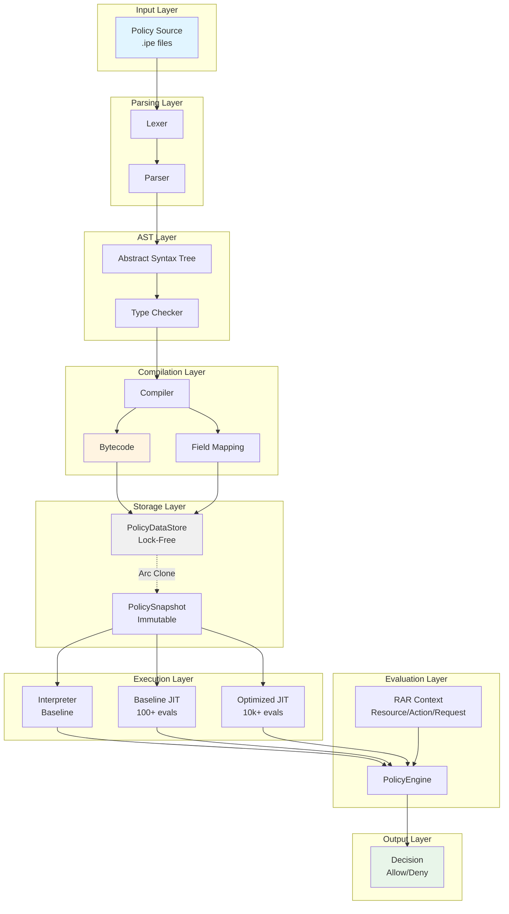

## Component Details

### 1. Lexer & Parser

The lexer splits policy text into tokens, the units of source text.
The parser converts these tokens into an abstract syntax tree (AST).
An AST represents the structure of a policy.

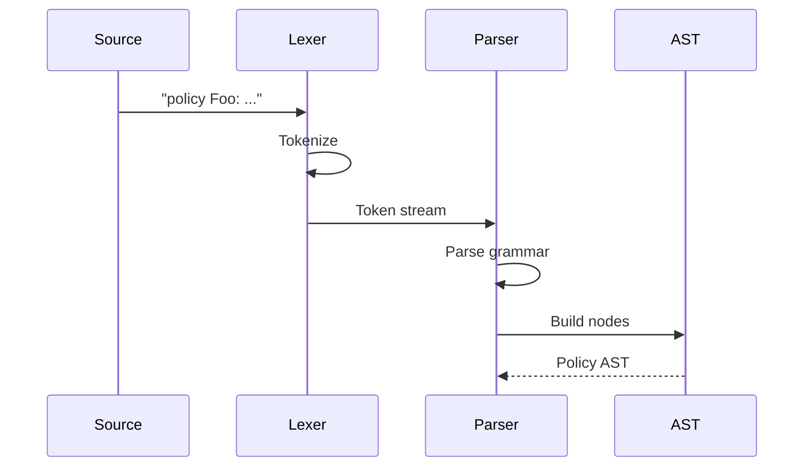

Files:

- [`crates/ipe-core/src/parser/lexer.rs`](../crates/ipe-core/src/parser/lexer.rs) - Tokenization
- [`crates/ipe-core/src/parser/parse.rs`](../crates/ipe-core/src/parser/parse.rs) - Recursive descent parser
- [`crates/ipe-core/src/parser/token.rs`](../crates/ipe-core/src/parser/token.rs) - Token definitions

Output: Abstract Syntax Tree (AST)

---

### 2. AST & Type System

The AST represents policies with types. The type system makes sure that policy expressions use compatible types.

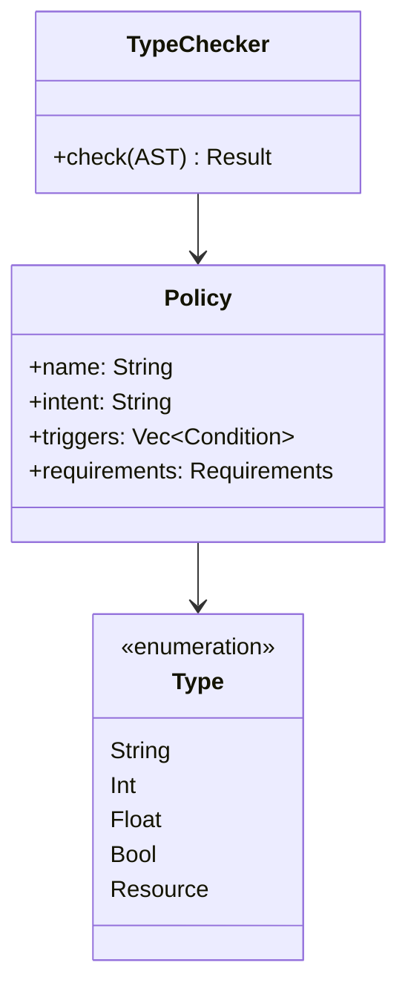

Features:

- Type inference from literals
- Type compatibility checking
- Int/Float coercion
- Path resolution

Files:

- [`crates/ipe-core/src/ast/nodes.rs`](../crates/ipe-core/src/ast/nodes.rs) - AST node definitions
- [`crates/ipe-core/src/ast/types.rs`](../crates/ipe-core/src/ast/types.rs) - Type system
- [`crates/ipe-core/src/ast/visitor.rs`](../crates/ipe-core/src/ast/visitor.rs) - Visitor pattern

Documentation: [AST Documentation](AST.md)

---

### 3. Bytecode Compiler

The compiler converts the AST to bytecode, a sequence of instructions for the interpreter.
The instructions use a stack, which stores values in last-in, first-out order.

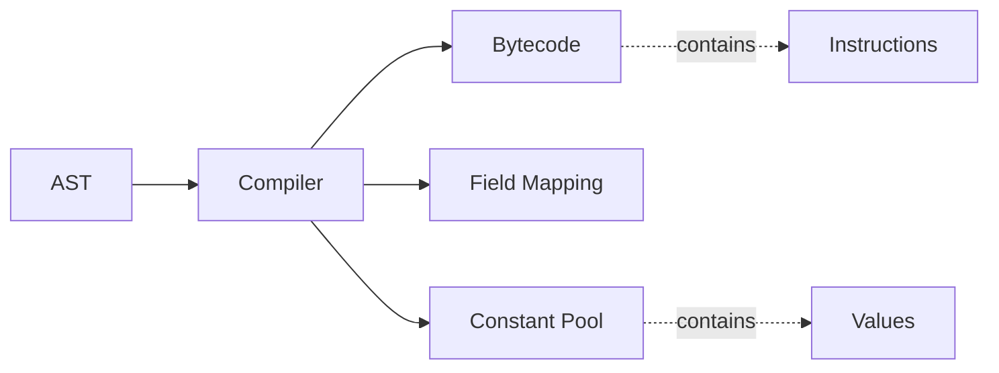

Optimizations:

- Constant deduplication
- IN expression expansion to OR chains
- Field offset allocation

Files:

- [`crates/ipe-core/src/compiler.rs`](../crates/ipe-core/src/compiler.rs) - AST to bytecode compiler
- [`crates/ipe-core/src/bytecode.rs`](../crates/ipe-core/src/bytecode.rs) - Bytecode definitions

Documentation: [Bytecode Documentation](BYTECODE.md)

---

### 4. PolicyDataStore (removed)

Removed in #36 - the v2 runtime uses per-scope snapshots from `runtime_facts.rs` instead. (Historical section retained below for context.)

PolicyDataStore stored policies for concurrent readers.

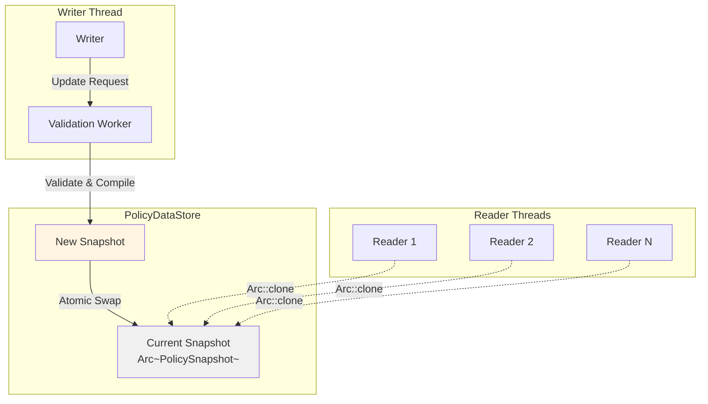

Features:

- Lock-free reads: Arc::clone() reads require no locks.
- Atomic updates: The store replaces each immutable snapshot in one operation.
- Background validation: A worker pool makes sure that policies are valid.
- Continuous access: Existing readers retain their snapshot during updates.

Performance:

- Reads: O(1) with Arc clone
- Updates: Asynchronous, non-blocking
- Memory: Copy-on-write (the store drops unused old snapshots)

Files:

- [`crates/ipe-core/src/store.rs`](../crates/ipe-core/src/store.rs) - Lock-free store implementation
- [`crates/ipe-core/src/index.rs`](../crates/ipe-core/src/index.rs) - Resource type indexing

---

### 5. Execution Tiers

Policy usage determines the execution tier.

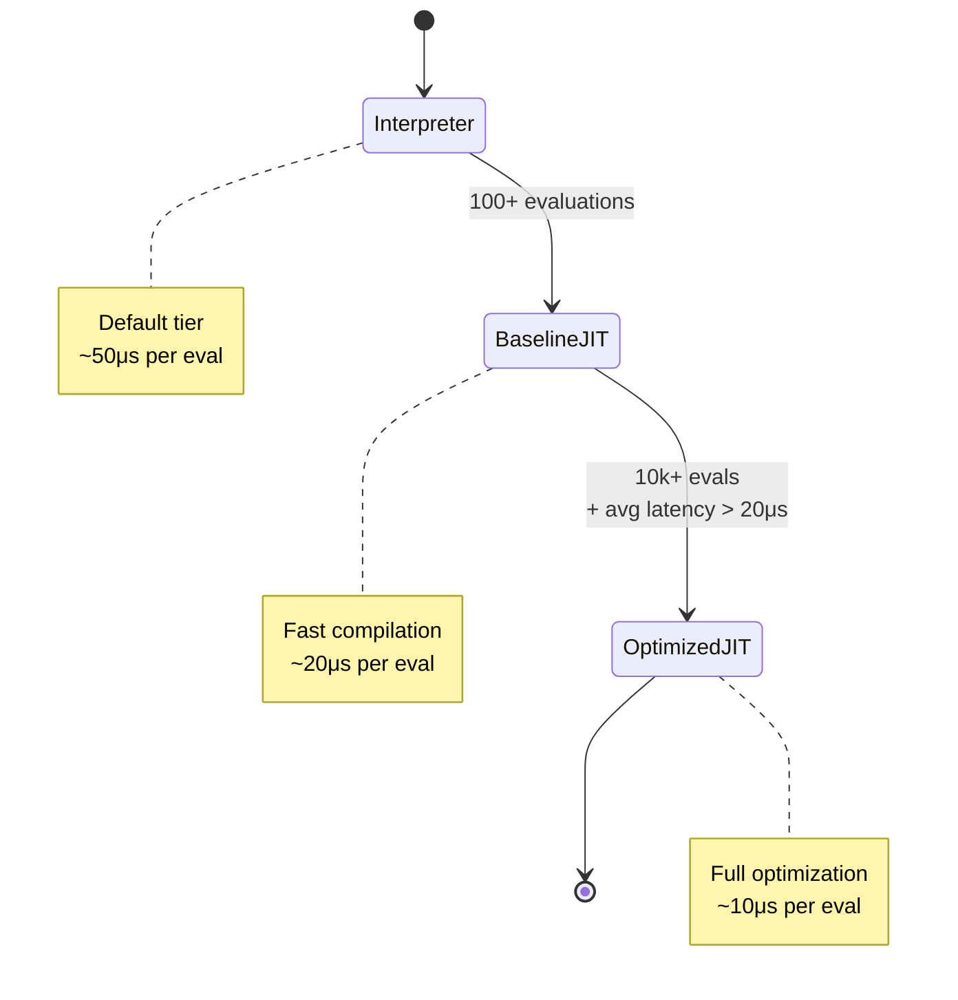

Promotion Logic:

```rust
match tier {
    Interpreter => {
        // Promote after 100 evaluations
        count >= 100
    },
    BaselineJIT => {
        // Promote after 10k evals AND high latency
        count >= 10_000 && avg_latency > 20_000
    },
    OptimizedJIT => {
        // Already at top tier
        false
    },
}
```

Files:

- [`crates/ipe-core/src/tiering.rs`](../crates/ipe-core/src/tiering.rs) - Adaptive tiering
- [`crates/ipe-core/src/jit.rs`](../crates/ipe-core/src/jit.rs) - JIT compiler (Cranelift)

---

### 6. Interpreter

The interpreter runs bytecode policies.

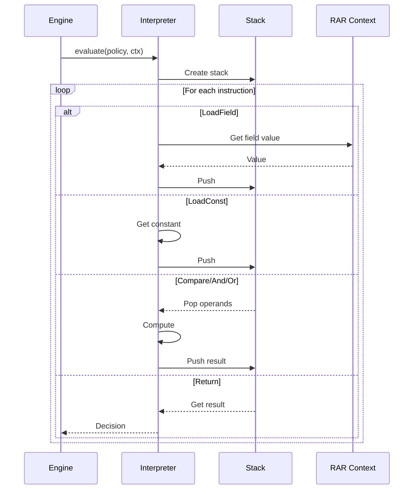

Stack Operations:

- Push adds a value to the stack.
- Pop removes and returns the top value.
- Peek returns the top value without removal.
- Clear resets the stack for the next evaluation.

Files:

- [`crates/ipe-core/src/interpreter.rs`](../crates/ipe-core/src/interpreter.rs) - Bytecode interpreter
- [`crates/ipe-core/src/rar.rs`](../crates/ipe-core/src/rar.rs) - Resource/Action/Request context

---

### 7. PolicyEngine (Public API)

PolicyEngine provides the public interface for policy evaluation.

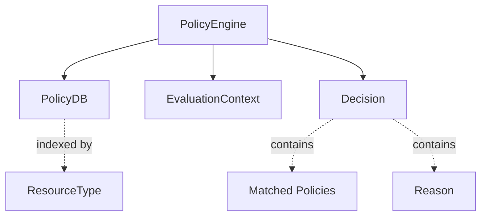

Decision Resolution:

1. No policies: The engine denies the request.
2. All policies allow: The engine allows the request and lists the matched policies.
3. Any policy denies: The engine denies the request. A deny overrides an allow.
4. Evaluation errors: The engine returns the error with the policy name.

Files:

- [`crates/ipe-core/src/engine.rs`](../crates/ipe-core/src/engine.rs) - Public API
- [`crates/ipe-core/src/index.rs`](../crates/ipe-core/src/index.rs) - Policy database

---

## Data Flow

### Policy Compilation

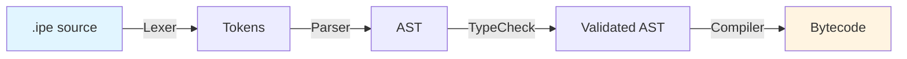

### Policy Evaluation

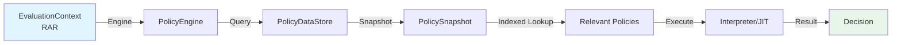

## Performance Characteristics

| Component | Operation | Time Complexity | Notes |
|-----------|-----------|----------------|-------|
| Lexer | Tokenize | O(n) | n = source length |
| Parser | Parse | O(n) | n = token count |
| TypeChecker | Check | O(nodes) | nodes = AST size |
| Compiler | Compile | O(nodes) | nodes = AST size |
| DataStore | Read | O(1) | Arc clone |
| DataStore | Update | O(m) | m = policy count |
| Interpreter | Evaluate | O(k) | k = instruction count |
| Engine | Query | O(p) | p = matching policies |

Typical Latencies:

- Parsing: 100-500μs per policy
- Compilation: 200-800μs per policy
- Evaluation (Interpreter): 10-50μs per policy
- Evaluation (JIT): 5-20μs per policy

## Concurrency Model

### Lock-Free Reads

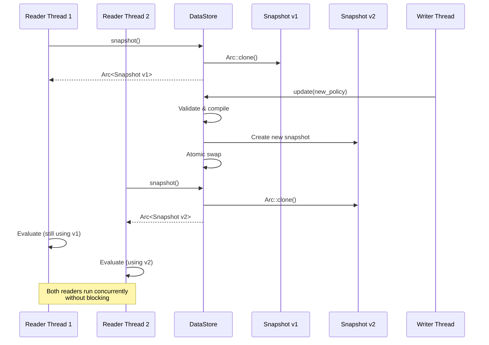

Read behavior:

- Readers and writers do not share locks.
- Readers do not compete with other readers for locks.
- Writers do not block readers.
- Readers see a consistent snapshot.

### Memory Management

Reference Counting:

```rust
Arc<PolicySnapshot> // Atomic reference counted

// When last Arc drops:
//  1. Snapshot memory freed
//  2. Policy bytecode freed
//  3. Constant pools freed
```

Typical Memory Usage:

- 1 Policy: ~500 bytes
- 100 Policies: ~50 KB
- 10,000 Policies: ~5 MB
- Snapshot overhead: ~100 bytes

## Testing & Quality

Test Coverage: 93.67% (248 tests)

Test Pyramid:

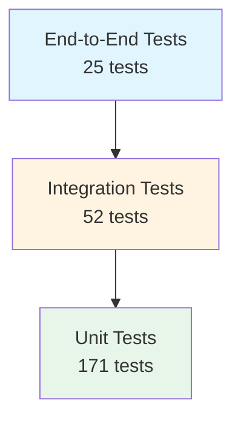

Key Test Files:

- [`crates/ipe-core/src/testing.rs`](../crates/ipe-core/src/testing.rs) - Test helpers
- Each module has tests in `mod tests`

## Related Documentation

- [AST Documentation](AST.md) - Abstract syntax tree details
- [Bytecode Documentation](BYTECODE.md) - Instruction set and execution
- [README](../README.md) - Project overview and quick start
- [RFC](../RFC.md) - Technical specification
