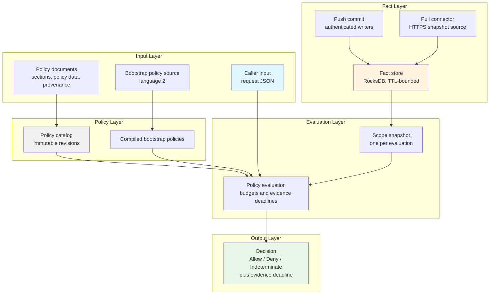
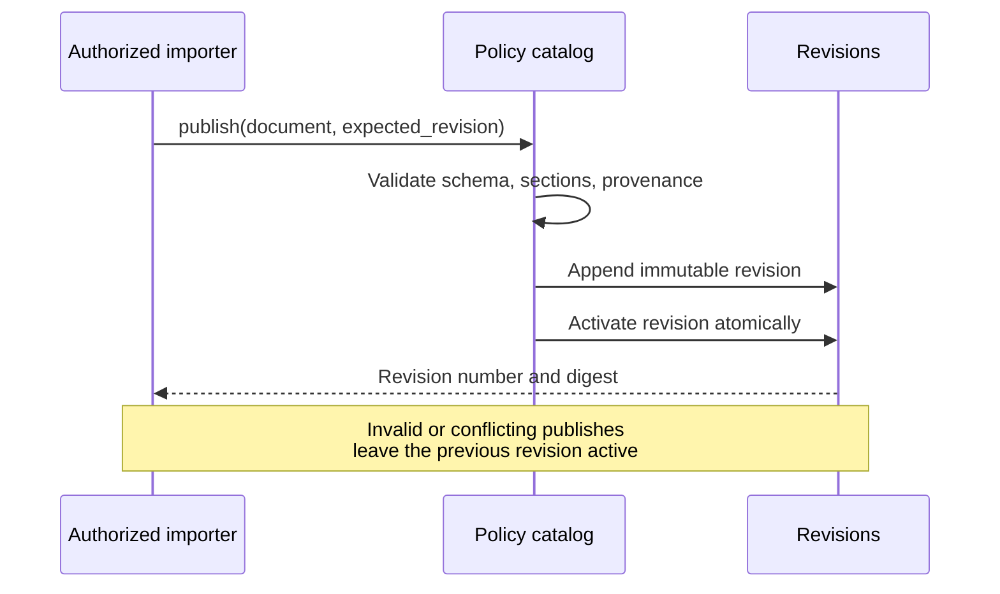
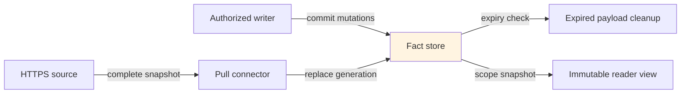
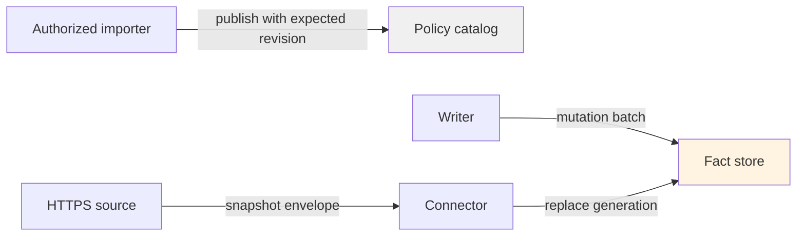

# Architecture Overview

IPE ships as a version-2 runtime service. A runtime serves scoped tenants and
environments: it ingests expiring typed facts, stores versioned policy
documents, and evaluates caller input against both to produce a decision.
Every decision is computed from one immutable snapshot; no evaluation takes
locks or performs network requests.

## System Architecture



## Component Details

### 1. Policy Documents and Revisions

A policy document groups named sections of language-2 rules with shared typed
`policy.*` parameters. Publishing appends an immutable revision and activates
it atomically; earlier revisions stay readable and nothing is updated in place.
Each revision records a content digest and, for imported rules, the external
provenance (source system, locator, revision, digest, observation window).



Properties:

- Revisions are immutable; activation is atomic per document.
- Each revision pins the input schema and referenced collection schemas it
  was compiled against.
- Local `policy.*` data never expires. Observations of external policy do
  expire and yield indeterminate past their deadline.
- Unsupported external rules stay as explicit sections and block the document
  conservatively instead of silently disappearing.

Files:

- [`crates/ipe-core/src/policy_document.rs`](../crates/ipe-core/src/policy_document.rs) - Document model, catalog, revision history

### 2. Runtime Facts (TTL-Bounded)

Facts are typed values organized into scoped collections under an exact
`{tenant, environment}` scope. Writers push atomic mutation batches with
`observed_at` and `ttl_seconds`; a configured connector can instead pull
complete snapshots from a fixed HTTPS source. Every fact expires; expired
payloads are reclaimed periodically while ordering metadata is retained.



Properties:

- Push commits are atomic within one collection and detect revision conflicts
  and replays; identical source retries return the original record.
- A pulled generation replaces the collection's keys atomically or is rejected
  as a whole; repeated identical source revisions are no-ops.
- Expiry is the earlier of acceptance time plus TTL and observation time plus
  the collection's maximum observation age. Future observations are rejected.
- Storage is bounded (10,000 keys per collection, 16 MiB encoded state,
  1 MiB per value) and persists synchronously in RocksDB before publishing
  in memory.

Files:

- [`crates/ipe-core/src/runtime_facts.rs`](../crates/ipe-core/src/runtime_facts.rs) - Fact store, schemas, TTL, snapshots

### 3. Policy Evaluation

Language-2 sources compile against a compile environment (input schema plus
collection schemas) into typed policies. Evaluation runs against caller input
and the scope snapshot with an instruction and collection-visit budget, and
reports an evidence deadline whenever a result depends on fact freshness.

```mermaid
sequenceDiagram
    participant E as Evaluator
    participant P as Compiled policy
    participant S as Scope snapshot
    participant C as Clock

    E->>P: evaluate(input, snapshot, now, budget)
    P->>S: Read fact bindings (typed, freshness-checked)
    P->>C: Compare against evidence deadline
    P-->>E: Allow / Deny / NotApplicable / Indeterminate + deadline
    Note over E: Missing or expired evidence yields Indeterminate;<br/>negation cannot turn missing evidence into an allow
```

Properties:

- All applicable bootstrap policies and active document sections combine:
  deny overrides indeterminate, indeterminate overrides allow, and an empty
  or entirely inapplicable catalog denies.
- Budgets bound work per evaluation; the runtime rechecks the earliest
  evidence deadline before returning an allow.
- No network requests occur during evaluation and no decision cache is
  enabled.

Files:

- [`crates/ipe-core/src/runtime_policy.rs`](../crates/ipe-core/src/runtime_policy.rs) - Language-2 compiler, evaluator, budgets

### 4. HTTP Runtime Service

The server loads one bootstrap configuration at startup: database path,
loopback bind address, input schema, scoped collections, scoped policy
sources, credentials, and connectors. Credentials carry independent grants
(`write_collections`, `evaluate`, `inspect`, `manage_policies`) and are
authenticated with constant-time bearer comparison. Evaluation captures the
active policy revisions and one fact snapshot once, so concurrent updates do
not change a running decision.

Routes (all scoped under `/v1/scopes/{tenant}/{environment}`):

- `POST .../facts/{collection}/commit` - atomic mutation batch (push)
- `GET .../facts/{collection}/{key}` - authorized inspection or revision lookup
- `POST .../evaluate` - evaluate all configured policies in the scope
- `GET .../catalog` - schemas, bootstrap policies, active documents
- `POST .../policies/{id}/revisions` - publish a policy document revision
- `GET .../policies/{id}/revisions/{revision}` - inspect a revision
- `POST .../policies/test` - evaluate a candidate document without publishing
- `GET .../connectors` - last pull attempt status

Files:

- [`crates/ipe-server/src/runtime.rs`](../crates/ipe-server/src/runtime.rs) - Axum routes, credentials, connectors, clock

## Data Flow

### Publication and Ingestion



### Evaluation


## Consistency and Limits

- Each evaluation reads one immutable snapshot and one set of document
  revisions; concurrent writes do not change a captured execution. The two
  stores provide no joint transaction.
- Snapshots taken earlier may finish against their earlier state. There is no
  replication, convergence bound, external-action fencing, or atomic
  check-and-act guarantee.
- The listener binds to loopback only; remote use requires a local
  TLS-terminating proxy. The process uses a monotonic clock anchor and
  rejects large discontinuities.
- Catalog limits: 100 documents per scope, 100 sections per document, 100
  bootstrap policies per scope, 10,000 historical revisions, bounded encoded
  state. Full stores reject writes with `507`.

## Testing and Quality

- [`acceptance/runtime-data/README.md`](../acceptance/runtime-data/README.md) - External HTTP acceptance workflow
- [`acceptance/policy-data/pr-landing.json`](../acceptance/policy-data/pr-landing.json) - Sectioned policy document fixture
- `make policy-acceptance` - Deterministic scenarios plus the HTTPS acceptance suite
- [`docs/RUNTIME_DATA.md`](RUNTIME_DATA.md) - Implemented workflow, API, and deployment limits

## Removed Legacy Engine

The original embedded engine is gone: the hand-written parser and AST, the
bytecode compiler and stack interpreter, the resource-type index and lock-free
`PolicyDataStore`, and the Cranelift JIT with adaptive tiering were removed
after the version-2 runtime landed (#36, #37, and the legacy-engine deletion).
That stack evaluated in-process `Resource/Action/Request` contexts with
execution tiers promoted by evaluation counts. Its promotion thresholds,
latency figures (interpreter ~50 microseconds, baseline JIT ~20, optimized
~10), and the "false `requires` can produce Allow" compiler gap described in
older revisions of this document no longer describe any shipped code.
Historical write-ups remain in [AST.md](AST.md) and [BYTECODE.md](BYTECODE.md)
as archived references; do not use them to understand the current runtime.

## Related Documentation

- [Runtime data workflow](RUNTIME_DATA.md) - The implemented v2 workflow and API contract
- [README](../README.md) - Project overview and quick start
- [RFC-009](../rfcs/009-runtime-facts-and-policy-language.md) - Broader target design (draft)
