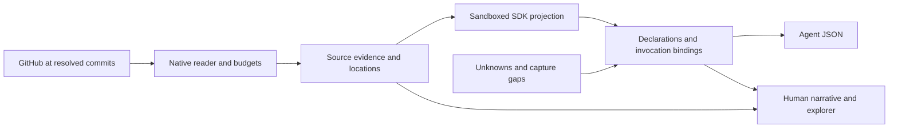

# From a GitHub workflow to an external contract

See the [model review and prioritized recommendations](INTEGRATION_MODEL_REVIEW.md) for the next implementation slice.

## Hosted extraction and external performance

The [integration host](INTEGRATION_HOST.md) is the primary implementation of this spike.
The endpoint hosts agent-authored JavaScript, schedules its reads, and stores requirements, expiring facts, and external outcomes.
Shared Rust code owns connections, secrets, retries, and execution limits.
The standalone capture below remains a diagnostic tool for source review.

The narrative now has three questions: What must the agent satisfy? What evidence is current? How did previous external executions perform?
The host serves one evidence model to an authenticated monitor and JSON clients.
A standalone HTML snapshot shares the same captured records without an API credential.

The live proof includes a manual extraction and a scheduled extraction against GitHub.
Repeated polls identify the same workflow attempt and jobs. They do not count as new executions.
Job and step durations come from GitHub timestamps. Collector duration describes the extraction process.
Unknown workflow completion time remains unknown. Large bundle read failures remain extraction gaps.
See the [proof record](../acceptance/integration-host/proof.json) for measured values and bounds.

This distinction supports agent trajectory modeling: declaration constraints guide planning, current facts support evaluation, and outcomes support diagnosis.
A failed job does not authorize bypassing an external control. An alternative trajectory must still satisfy its applicable requirements.

## The source story we can demonstrate

A workflow says “publish the checked site.” That statement hides several contracts.
A job must finish first. An event and branch condition must match. The job names an environment and requests token permissions.
An action packages files. Another action requests deployment. Each action adds defaults, dependencies, and implementation behavior.

This spike follows those layers from a real GitHub source into a local report.
It asks how much we can explain from source, and where we must retain uncertainty.
It does not run actions, change repositories, or publish enforcement policies.

The example is IPE's [docs workflow at commit 8346e53](https://github.com/jrepp/ipe/blob/8346e53d0b428b701349817df6624f0ad33a1639/.github/workflows/docs-site.yml).
The capture reads GitHub directly. It produces one evidence set for both the human view and agent JSON.

## Data path



## Run the spike

Build from the repository root:

```sh
cargo build --locked -p ipe-integration --bin github-contract
```

The reader uses public GitHub APIs. An optional `IPE_GITHUB_TOKEN` environment variable can avoid anonymous rate limits.
Use a protected environment handoff. Do not put a token in command arguments or report files.

```sh
target/debug/github-contract \
  --repo jrepp/ipe \
  --ref 8346e53d0b428b701349817df6624f0ad33a1639 \
  --workflow .github/workflows/docs-site.yml \
  --allow-repo actions/checkout \
  --allow-repo actions/setup-python \
  --allow-repo actions/setup-node \
  --allow-repo actions/upload-artifact \
  --allow-repo actions/upload-pages-artifact \
  --allow-repo actions/configure-pages \
  --allow-repo actions/deploy-pages \
  --out target/github-contract
```

The output contains:

- `capture.json`: versioned evidence, declarations, input bindings, source locations, and gaps.
- `report.html`: a standalone interactive report with embedded data, styles, and scripts. Share this file for human review.
- `index.html`, `view.js`, and `style.css`: the same view with separate assets and JSON.

The report includes captured source text. Preserve the source repositories' access restrictions when sharing it.
The example uses public repositories. Captured license files accompany the selected implementation evidence.

Open `report.html` directly, or serve the output directory:

```sh
python3 -m http.server 8766 --bind 127.0.0.1 --directory target/github-contract
```

Open <http://127.0.0.1:8766/report.html>. Stop the server with Ctrl-C when finished.
No frontend build is required. Editing the view requires rebuilding the binary and writing a new report.

## A useful walkthrough

1. Open the workflow and inspect the `publish` job.
2. Follow its dependency on `docs-site` and its branch/event condition.
3. Open checkout and compare caller inputs with declared defaults.
4. Inspect its post-job entry point and input-handling source clues.
5. Open the Pages packaging action and inspect its composite steps.
6. Follow its nested upload action and compare the resolved commit with the workflow's direct upload action.
7. Open deployment and inspect its artifact-name input and token default.
8. Read the unresolved expressions and capture gaps before drawing a conclusion.

The live example captured two different commits of `actions/upload-artifact`.
One came from the workflow's direct reference. The other came from the Pages packaging action.
A model keyed only by repository or display name would lose that difference.

Checkout declares credential persistence and a post-job entry point.
These declarations suggest a lifecycle that spans more than the checkout step.
They do not prove what credentials existed or whether cleanup completed in a particular run.

The Pages packaging action declares a default artifact name. Deployment declares an artifact-name input with a matching default.
That is a candidate producer/consumer relationship. The current capture preserves both declarations but does not infer successful artifact transfer.
A future outcome record must identify the actual artifact and workflow run.

## Representation for humans and agents

The format is an experiment: `ipe.github-contract.v1`. It is not the general external-contract schema proposed by RFC 013.
It retains GitHub's field names and expressions so that normalization does not erase meaning.

| Record | Current representation | Meaning and boundary |
| --- | --- | --- |
| Source observation | `documents[].source`, capture time, original YAML, `locations` | Exact repository, commit, path, SHA-256 digest, and JSON-pointer locations in the file |
| Declaration | `documents[].projection.model` | Workflow jobs or action interface, steps, permissions, conditions, inputs, outputs, and lifecycle declarations |
| Invocation | `edges[]`, call-site pointer, `bindings` | One caller's supplied values, declared defaults, unspecified inputs, and undeclared caller inputs |
| Unresolved expression | `projection.expressions[]` | Original expression, dialect context, and source pointer; no expression execution |
| Implementation clue | `implementation[].clues[]` | A bounded lexical match with a source line; not a verified effect, requirement, or grant |
| Coverage gap | Top-level `gaps`, projection gaps, implementation status | Unavailable evidence, unsupported semantics, limits, or deliberately uncaptured settings |
| External outcome | Not captured | A separate future observation of a run, job, artifact, deployment, or external effect |

The human view uses the same records as the JSON download.
It adds navigation and explanation, not another source of truth.
Source links include resolved commits. Expression links include line numbers.
Declared defaults remain distinct from caller values. Parsed YAML types are preserved; effective GitHub input coercion is not simulated.

Unknown fields remain under `unmodeled`, with the original YAML available for review.
Coverage remains partial even when all dependency reads succeed.
A successful read establishes that a definition was observed. It does not establish complete policy discovery.

## Modeling decisions this spike tests

**Keep definition identity separate from invocation identity.**
Use repository, resolved commit, and path for a definition.
Use the parent definition and call-site pointer for an invocation.
The same action can appear more than once with different inputs or revisions.
Document numbers are local report indices, not durable identities.

**Keep source declarations separate from effective behavior.**
A requested permission is not proof of a granted token capability.
An environment name is not its protection configuration.
A required input flag does not establish runtime validation.
An action's source files are not proof that its distributed bundle matches them.

**Preserve expression scope.**
`inputs`, `github`, `needs`, and `steps` depend on different execution contexts.
Keep the expression, call site, and source location together.
Do not replace unresolved conditions with true, false, or an absent requirement.

**Represent lifecycle and effects explicitly in the next model.**
Pre, main, and post hooks need separate applicability and ordering.
Declared outputs, artifact creation, credential setup, cleanup, and deployment are different effect classes.
The current extractor retains their evidence. It does not yet produce a verified effect graph.

**Add outcomes through joins, not overwrites.**
The hosted path now captures run and job outcomes. A complete join should reference the workflow commit, run ID, attempt, job, and action invocation.
Keep result status, conclusion, artifact identity, and deployment status distinct.
A source capture must remain readable after a later run succeeds or fails.

## Standalone diagnostic CLI path and bounds

Rust owns repository authorization, GitHub requests, commit resolution, YAML parsing, and evidence collection.
Only `api.github.com` is contacted. Redirects are rejected. Referenced repositories require an explicit allowlist entry.
Credentials remain native and never enter the guest, URLs, reports, or diagnostic messages.

The bundled adapter runs through the existing QuickJS host and `ipe` SDK.
It requests one captured document and returns a declaration projection.
The existing ServiceNow HTTP broker and its operation grants remain unchanged.
This is a local CLI workload, not a new hosted API or MCP operation.

`yaml-rust2` parses YAML syntax. A bounded event reader rejects duplicate keys, aliases, anchors, tags, merge keys, and multiple documents.
These rejected forms become failures or dependency gaps. They are not claims that GitHub rejects the same forms.
Parsed documents must fit the existing sandbox input and output limits.

The reader permits 96 requests, 24 definitions, four dependency levels, and a queue of 128 references.
A source response is limited to 512 KiB. YAML is limited to 48 KiB, depth 24, and 8,192 nodes.
The total response budget is 16 MiB. Requests have a 15-second timeout and a 180-second capture deadline.

Action evidence includes declared entry points, a sample of three author source files, package metadata, and available license text.
The source sample favors entry-file names and the declared runtime subdirectory.
Each captured file has a digest. Display excerpts stop at 12,000 characters, and lexical clues stop at 32 matches per file.
Local action paths require checkout workspace state and remain unresolved. Local reusable workflows resolve in their source repository.
Large distributed bundles appear as explicit gaps. Imported code, downloaded tools, containers, shell effects, and dynamic dependencies remain unresolved.

The collector does not execute workflow commands, imported actions, or captured source.
The report renders source as text and escapes embedded JSON for standalone HTML.

## Proof and next questions

The live acceptance test reads the pinned public workflow and follows the nested Pages action:

```sh
cargo test --locked -p ipe-integration --test github_contract_acceptance -- --ignored --nocapture
```

This check needs network access and sufficient GitHub rate allowance.
It requires successful dependency reads, commit provenance, input/default bindings, lifecycle metadata, author source evidence, and a standalone report.
Normal unit tests do not depend on GitHub availability.

Local checks:

```sh
cargo test --locked -p ipe-integration github_contract --lib
npm ci --prefix docs --ignore-scripts
node --test tools/github-contract/view.test.cjs
```

The [proof summary](../acceptance/github-contract/proof.json) records the reviewed live capture.
It excludes source bodies and credentials. The full local report contains the detailed evidence.

The hosted path now joins a real workflow attempt and job outcomes. Artifact and deployment records remain the next collection experiment.
Before promoting inferred effects into shared contracts, test action import graphs, source-to-bundle correspondence, and environment protection reads.
Use these counterexamples to refine [RFC 013](../rfcs/013-domain-constraints-and-projections.md), rather than treating this GitHub projection as a universal policy language.

## Source references

- [Workflow syntax](https://docs.github.com/en/actions/reference/workflows-and-actions/workflow-syntax)
- [Action metadata](https://docs.github.com/en/actions/reference/workflows-and-actions/metadata-syntax)
- [GitHub execution contexts](https://docs.github.com/en/actions/reference/workflows-and-actions/contexts)
- [Repository contents API](https://docs.github.com/en/rest/repos/contents)
