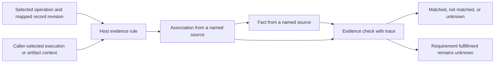

# Contextual evidence across integrations

The host connects external requirements to collected observations through explicit, expiring associations.
The implementation uses provider-neutral records and host-configured evidence rules. GitHub is the live trial; ticketing and compliance use synthetic fixtures.
An assessment explains evidence. It never grants authorization or activates a policy.



## Association record schema

An `association` links a subject to a target under a named predicate and explicit context:

```json
{
  "kind": "association",
  "subject": "service:release",
  "predicate": "change_for",
  "target": "ticket:CHG42",
  "context": {
    "artifact": "sha256:example",
    "environment": "production"
  },
  "authority": "ticketing",
  "resolution": "resolved"
}
```

Wrap this entity in the usual model, data, and native receipt envelope.
A resolved association requires a `provider_reported` claim. Candidate associations can use `inferred`.
Native validation checks the envelope and provenance. It cannot prove that the collector interpreted the provider correctly.
The operator must review the collector's mapping and authority before configuring an evidence rule.

Association identity includes subject, predicate, target, context, and authority.
Different execution attempts or artifacts therefore retain different links.
Associations expire under the installation's fact TTL. A failed capture does not renew them.
Catalog acceptance and restoration do not freeze or renew associations. Current associations remain separate from selected declarations.
Multiple fresh targets cause an unknown assessment. Missing links do not establish that an obligation disappeared.

## Host evidence rules

The host configuration accepts `evidence_rules`. Each rule pins:

- The consumer installation, control identity, source revision, and obligation ID.
- The fact producer installation, authority, predicate, and expected value.
- Either an explicit subject, or an association selector with its own producer, authority, predicate, and context keys.

The association producer and fact producer can differ. Installation identity is a trust boundary; a matching authority string alone is insufficient.
Rules live in host configuration, not guest JavaScript. Collectors cannot grant themselves access to another collector's evidence by emitting a link.
The authenticated operator API evaluates rules. Guests receive no cross-installation read capability.

For dependency selectors, the association subject is the dependency's canonical control identity.
Both `execution` and `revision` context keys are required. The host derives `revision` from the selected constraint; callers cannot override it.
Other association selectors use an explicit subject and configured keys, such as artifact digest and environment.
Choose keys that fully identify the intended operation. The host cannot infer omitted business context.

The [cross-source fixture](../testing/integration/hosted/cross-source-assessment.json) contains complete rules for CI, ticket approval, and compliance.
Its data is synthetic. No ticketing or compliance account is required for the tests.

## API and monitor

The v1 API below remains available. New clients should use the [v2 domain APIs](#versioned-domain-apis) for exact mapped revision binding.

Send authenticated `POST /v1/integrations/:id/assessments` with:

```json
{
  "control": {
    "namespace": "github",
    "resource": "fixture/service",
    "operation": "github_actions.run_job",
    "local_id": ".github/workflows/release.yml#release"
  },
  "revision": "aaaaaaaaaaaaaaaaaaaaaaaaaaaaaaaaaaaaaaaa",
  "context": {
    "execution": "execution:[\"github\",\"fixture/service\",\"42\",2,null,null]",
    "artifact": "sha256:example",
    "environment": "production"
  }
}
```

This read operation uses POST to carry bounded context. It performs no provider reads and changes no stored observations.
The selected review catalog must contain exactly one matching operation and source revision.
An accepted catalog remains the declaration baseline when one exists.
The response identifies each rule and its digest, association trace, fact value, producer, collector digest, native receipts, and timestamps.
It identifies caller context as a selector, not evidence. Its overall authorization status remains unknown.

Use `/explanations` to inspect configured rules. Use `/catalog` for selected declarations, current facts, and current associations with expiry flags.
In the monitor, select **Operations**, choose one operation, enter context, and run its evidence check.
The result shows its assessment time. Reassess after observations change or expire.

## Decision semantics

This table describes v1 results. V2 names these results evidence checks and keeps requirement fulfillment separate.

| Condition | Requirement assessment |
| --- | --- |
| One exact, fresh link and consistent trusted facts match the expected value | `satisfied` |
| Exact fresh link, but the trusted observed value differs | `unsatisfied` |
| Candidate link, missing context, missing rule, or missing trusted evidence | `unknown` |
| Expired or future-dated evidence | `unknown` unless other eligible evidence establishes the result |
| Multiple fresh targets, conflicting facts, or exceeded match bounds | `unknown` |

A fresh fact about an old execution remains evidence about that old execution.
A closed ticket does not prove compliance. Approval and compliance require separate rules and observations.
A satisfied evidence check does not establish actor authorization, provider condition applicability, or permission to act.
No recursive dependency evaluation or automatic action execution occurs.

## Versioned domain APIs

Both routes require the existing operator authentication. They read local state without provider requests or stored-state changes.

| Method and route | Result |
| --- | --- |
| `GET /v2/integrations/:id/operations` | `ipe.integration.operations.v2`: selected operation descriptions, named requirements, and mapped record revision digests |
| `POST /v2/integrations/:id/assessments` | `ipe.integration.context-assessment.v2`: pinned evidence checks with separate fulfillment and applicability status |

The operation list uses the accepted review catalog when selected; otherwise it uses current records.
Each description exposes `operation`, `source`, `record_revision`, `requirements`, and `declared_enforcer`.
`declared_enforcer` is a source label. It does not establish an observed operating control.
The host returns next-observation hints only when the current installation has the named operation grant.

Each named requirement contains `id`, `description`, `specification`, and `next_observation`.
The specification preserves v1 variants, including the dependency variant's `control` field.
That compatibility field identifies a declared operation, not an enforcement mechanism.
Stored record kinds, logical keys, source revisions, and catalog identities retain their existing formats.

Construct the assessment body from a selected operation description:

```typescript
const request: Ipe.AssessmentRequestV2 = {
  operation: selected.operation,
  source_revision: selected.source.revision,
  record_revision: selected.record_revision,
  context: { execution: executionKey, artifact: artifactDigest, environment: "production" }
};
```

The request must identify the exact mapped record in the selected catalog.
A changed mapper or SDK can change `record_revision` without changing the provider source revision.
A stale request returns HTTP 400 with `selected_record_revision_mismatch`.
The API retains strict JSON decoding and the 16 KiB assessment request limit.

### Evidence rule migration

1. Read the v2 operation description for the intended review catalog.
2. Review each named requirement and its evidence interpretation.
3. Copy the operation's `record_revision` into the matching host evidence rule's `record_revision` field.
4. Restart the host to load the reviewed rule configuration.
5. Submit the v2 assessment request with the same revision pin and the intended execution context.

Keep existing rule fields `control`, `revision`, and `obligation` for configuration compatibility.
They select the operation identity, provider source revision, and named requirement ID respectively.
The new `record_revision` is a `sha256:` prefix followed by 64 lowercase hexadecimal digits.
Do not copy a new pin automatically after a mapping change; review the changed interpretation first.

Unpinned legacy rules still work through v1. V2 reports `evidence_rule_record_revision_missing` instead of evaluating them.
A supplied pin is enforced by both versions. A stale rule produces unknown with `evidence_rule_record_revision_mismatch`.
V2 does not select evidence producers through an unpinned or mismatched rule.
Legacy rules omit the new field when serialized, preserving their existing rule digests.

Only one rule can bind a consumer, operation, source revision, and requirement ID at a time.
Selecting a different mapped catalog revision can therefore require rule reconfiguration and a host restart.
Restoring a catalog does not restore rule configuration or renew evidence.

### V2 result meanings

| Field | Meaning |
| --- | --- |
| `evidence_check.status: matched` | The pinned configured evidence comparison matched trusted, fresh evidence |
| `evidence_check.status: not_matched` | Eligible evidence differs from the configured expected value |
| `evidence_check.status: unknown` | Binding, context, trust, freshness, ambiguity, or bounds prevent the comparison |
| `evidence_check.method` | `configured_evidence_rule`; the operator's interpretation supplies the comparison |
| `fulfillment.status` | Always `unknown` in this version; evidence matching does not establish complete requirement fulfillment |
| `applicability.status` | Always `unknown`; provider condition semantics are not evaluated |
| `authorization` / `publication` | Both remain `false` |

The response retains rule identity and digest, evidence and association traces, selected record revision, context, and assessment time.
An opaque requirement can have a matched evidence check while fulfillment remains unknown.
Clients must not treat `not_matched` as proof of a policy violation or `matched` as permission to act.
Current facts and associations retain their expiry even when the declaration comes from an accepted historical catalog.

The monitor uses v2 operation descriptions and pins live evidence checks to the selected mapped record revision.
It shows the evidence-check result separately from requirement fulfillment. Legacy snapshots remain readable; they cannot submit unpinned checks.
The Runs view shows one operation, one observed execution, and supporting facts. Candidate execution links remain explicit.

## GitHub trial

The collector emits `ipe.control_execution` associations from control identities to observed job execution identities.
Context includes the parent run, attempt, and source revision. The SDK supplies canonical control and execution key helpers.
A static display-name match remains a candidate association. Its linked job conclusion is visible, but the dependency assessment remains unknown.
A provider-supported exact mapping is required before such an association can become resolved.
The host join engine contains no GitHub-specific parsing or predicates.

## Scale and limits

Each assessment builds one index over referenced installations and looks up exact subject/predicate keys.
It does not compare every record pair. Rules support one association hop; there is no unbounded graph traversal.
The current limits are 128 rules, eight context keys, 16 matches per lookup, and a 16 KiB assessment request.
The existing local host still limits installations to four and current records to 256 per installation.
This implementation proves reusable semantics, not capacity for thousands of active collectors.

A larger deployment needs persistent incremental indexes, tenant-scoped evidence grants, partitioned storage, and retention policies.
It also needs rule lifecycle management when collector mappings or contract revisions change.
The API returns producer and mapping provenance so these additions can preserve the same evidence contract.
Assessments are computed on demand. There is no durable assessment history or inferred revocation of old links.
Old links remain relevant until expiry; ambiguous fresh links fail closed as unknown.

## Verification

Run:

```sh
cargo test --locked -p ipe-integration host::assessments --lib
node --test tools/integration-host/*.test.cjs
```

The tests cover fresh exact links, candidate links, wrong attempts, changed artifacts, expiry, authority, ambiguity, conflicting values, and native receipt provenance.
The HTTP test runs three collectors through the real host and a synthetic provider, then calls the authenticated assessment endpoint.
It checks duplicate-key rejection and bounded requests. Live GitHub results remain separate from the synthetic ticketing and compliance proof.
