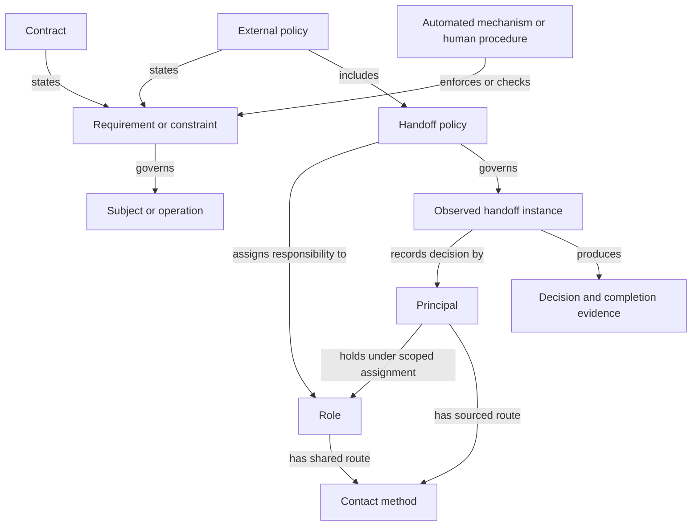
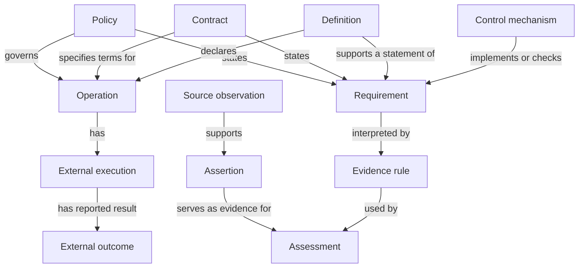

# Integration domain model review

**Status:** Versioned domain APIs and the first governance record slice are implemented. Full governance and handoff discovery remains incomplete.
**Updated:** 2026-11-02
**Scope:** Integration SDK, native record validation, identities, evidence assessments, and monitor UX.

## Recommendation

Treat the integration model as a description of the rules, agreements, responsibilities, and mechanisms that govern external policy enforcement.
Operations and execution evidence support that description. They are not the primary purpose of discovery.
Keep governing rules separate from operating controls and evidence assessments.
Do not infer a policy, contract, or control instance merely because a collector found a workflow definition.

## Design update: explain relationships before expanding the model

This update responds to the Integration coverage usability review and Fanghua (Joshua) Yu's August 16, 2026 article.
Yu distinguishes the needs of formal meaning, graph navigation, decisions, and agent capabilities.
He argues that a shared semantic foundation can support these different workloads without serving as their entire implementation.
His capability discussion includes preconditions, effects, authority, and evidence.
This is architectural guidance, not evidence that IPE implements these capabilities.
See [The Evolution of Ontology](https://medium.com/@yu-joshua/the-evolution-of-ontology-from-formal-semantics-to-knowledge-graphs-decisions-and-ai-agents-dfe8814dcc1b).

The recommendations below are IPE design decisions based on our source and observed usability gaps.
They supersede a category map as the default coverage view. They preserve the domain distinctions above.

### Assign each responsibility to a specific component

| Responsibility | IPE component and current state | Recommendation |
| --- | --- | --- |
| Define meaning and identity | Native typed records, source revisions, SDK types, and vocabulary exist. | Preserve policy, requirement, operation, execution, and observation as distinct concepts. |
| Explain connections | The host projects one retained capture through the shared coverage explanation API. | Use the same native links in the monitor and agent clients. Keep the full record map in supporting details. |
| Check evidence | V2 evidence assessments pin operation records and configured rules. They do not establish governance requirement fulfillment. | Add an explicit governance requirement binding before reporting that its requirement was checked. |
| Permit and perform reads | The native broker enforces installation grants, credentials, and budgets. | Keep capability descriptions separate from executable authority. External write execution remains outside this host. |

These responsibilities do not require separate services or a new graph database.
Retain the bounded store and current APIs until measured workloads require another representation.
Do not add OWL reasoning, causal inference, or a general decision engine merely to support this view.

### Make the connection itself explainable

For the current GitHub example, answer these questions in order:

1. What requirement does the captured environment describe?
2. Which operation does that rule name?
3. Which external run might correspond to that operation, and why?
4. Which observations belong to that exact run, attempt, and job?
5. What evidence is missing before we can check the requirement?

Each shared explanation retains endpoint identities, source and mapped revisions, supporting records, resolution status, and freshness limits.
State the relation in a sentence with its actual record names. Keep identifiers and native receipts in supporting details.
For example: “The environment rule names Publish docs as a subject.”
Then state: “This historical publish result is a possible execution of that operation; the connection is not confirmed.”

A shortened display path must retain its full supporting path for inspection.
An exact operation identity does not make the following candidate execution link exact.
An exact execution-to-fact link does not establish that the rule applied or that its requirement was met.
Shared source receipts prove collection provenance, not a business relationship or a causal effect.

The coverage UI uses the native explanation for its default question sequence.
Agent clients request the same run-specific graph from `GET /v2/integrations/:id/runs/:run_id/coverage-explanation`.
The supporting record map remains a browser projection. It does not replace unavailable native explanations.
See [coverage_explanations.rs](../crates/ipe-integration/src/host/coverage_explanations.rs), [governance-view.js](../tools/integration-host/governance-view.js), and the [host guide](INTEGRATION_HOST.md#governance-extraction-and-execution-overlay).

### Prioritize missing evidence over additional categories

| Order | Work | Acceptance condition |
| --- | --- | --- |
| Now | Keep the coverage default focused on a requirement, linked operations, and reported executions. | A reader can explain each connection without opening raw JSON. Missing, candidate, and expired evidence remain explicit. |
| Implemented | Move the relationship explanation into a shared native projection. | Human and agent clients receive the same links, reasons, revision pins, omissions, and unknowns. |
| Next | Specify governance requirement-to-check bindings. | A changed rule or mapper revision invalidates a stale binding. A matching predicate name alone cannot establish fulfillment. |
| Later | Describe additional agent capabilities when an actual workload needs them. | A capability identifies its target, inputs, effects, owner, authority checks, evidence, and any approval or recovery requirements. |

Test denied reads, partial captures, expired observations, ambiguous identities, changed revisions, and a candidate link between otherwise exact links.
Test a successful deployment with no recorded approval check. Its reported outcome must not turn an unknown requirement into success.
Use the existing synthetic handoff and ticket fixtures before claiming support for another live provider.

An agent capability description is metadata about an available operation. It is not a contract record or a grant.
For a future write capability, authorization and approval checks must occur at execution time in the owning system.
Descriptions of an approval gate or a person's contact route do not authorize deployment, approval, or messaging.

The next binding design should identify one governance requirement, its source revision, and its mapped record revision.
It must also pin the configured evidence check and the operation record it checks.
Report a missing or stale binding separately from an evidence-check result. Keep fulfillment unknown until its interpretation and authority are defined.
Existing v2 operation evidence rules do not provide this governance binding. Do not infer it from equal names or predicates.

### Limits of this recommendation

The article does not validate IPE's mappings or establish the meaning of a provider field.
Provider semantics still require source evidence and specific tests.
The UI must expose a missing allowed-branch list instead of inventing one from a branch-policy label.
Keep source restrictions, evidence-check results, requirement fulfillment, and runtime authorization separate.

## Governing rules and human handoffs

**Design direction:** Discover external policies, contracts, constraints, enforcement mechanisms, and human responsibilities with source evidence.
The current operation view is an implemented evidence view, not the complete target ontology.
Model v2 now supports a first source-backed governance slice. The broader relationships and lifecycle requirements below remain design targets.
The GitHub collector extracts environment protections and rulesets through granted provider APIs. Synthetic native tests verify its extraction paths.

Discovery must answer these questions:

1. Which policy or contract governs this subject, operation, or transition, and who established it?
2. Which requirements and constraints apply, under which conditions and source revisions?
3. Which automated mechanism or human procedure enforces them, and what evidence supports that claim?
4. Where does responsibility pass between systems, teams, or people?
5. Who must receive, decide, approve, execute, or escalate the work, and through which contact method?
6. What decision or evidence permits the receiving system to continue?

### Handoff policy and handoff instance

A **handoff policy** governs routing or transfer of work, responsibility, or a required decision between parties, roles, or systems.
It is a policy subtype, not a synonym for a workflow dependency or a message destination.
It can govern machine-to-machine, machine-to-human, human-to-machine, and human-to-human transitions.
Routing work does not itself delegate authority or release the original owner from responsibility.

Capture its trigger, applicability, sending role, receiving role, required action, and required input evidence.
Capture acknowledgment, completion evidence, continuation conditions, deadlines, escalation, and delegation rules when the source defines them.
Represent approval quorum and separation of duties explicitly when present. Do not invent defaults when the source is silent.
An **obligation** identifies the responsible party or role, required action, and governing conditions.
Keep a handoff obligation distinct from a technical prerequisite or permission request.

A **handoff instance** is an observed occurrence under a particular policy revision and execution context.
Its requested, assigned, acknowledged, decided, and completed events are observations, not assumed lifecycle transitions.
A message being delivered does not establish acknowledgment, approval, or fulfillment.
An approval decision needs its deciding principal, authority basis, scope, time, and supporting evidence.
The integration describes these events; collecting contact methods does not authorize sending messages or assigning work.

### Principals, roles, and contact methods

Model a person separately from their provider accounts. A principal is an identity within a named provider or identity authority.
Use stable provider identity and issuer scope, not a display name or email address, as its key.
Link accounts to a person only when an authoritative source establishes the relationship.
A team or role can receive a responsibility before a particular person is assigned.
Keep role assignment, group membership, delegation, and approval authority as separate, scoped, time-bounded relationships.

Distinguish policy authority, policy owner, contract party, approver, operator, execution principal, and notification recipient.
The same principal can hold several roles. A contact address or group membership alone does not establish any of them.
Do not infer a policy owner from a commit author, collector credential, workflow name, or nearby address.

A **contact method** is a source-attributed route for a person, principal, group, or role.
Examples include a provider profile, email address, team channel, ticket queue, and on-call route.
Retain its channel type, endpoint or resolvable reference, owner, purpose, source, observation time, and availability status.
Retain preference, routing order, and validity intervals only when stated by the source.
Distinguish an individual address from a shared queue. Report missing, inaccessible, stale, and unresolved routes separately.
Do not infer a missing address from a username. Preserve the source's access restrictions when displaying or exporting contact details.

### Relationships and a discovery example

For example, a source policy can require a production release to receive approval from the current release reviewer.
The handoff policy identifies the required evidence, reviewer role, decision scope, continuation condition, and any escalation rule.
A directory can identify the role's current members and contact routes. Membership alone does not prove approval authority.
A provider approval event can identify the deciding account and release attempt. Link it to the applicable policy revision using retained evidence.
If the person, authority, route, or decision binding cannot be resolved, show that specific gap.
This example is a design case, not a claim about the current GitHub capture.

### UX consequence and next implementation boundary

Organize the target UX around governing policies and contracts, their requirements, responsible parties, and enforcement or handoff paths.
Keep the focused operation graph as a drill-down into execution evidence.
Show discovered, inferred, unresolved, and inaccessible governance information separately; an uncollected policy is not an absent policy.
Provide a responsibility view that explains who owes which action, why they have that role, and how the source says to contact them.

The first governance schema slice includes synthetic API extraction for automated enforcement and a human handoff.
It must represent policy revisions, role assignments, principal references, and contact-route provenance before claiming governance coverage.
Test unresolved identity, changed membership, unavailable contact data, stale authority, unbound approval, and missing continuation evidence.
Preserve the existing v1 records and v2 evidence APIs during that extension.

### Implemented governance slice and remaining limits

Model v2 adds typed policy, contract, control, handoff, principal, role-assignment, and contact-method descriptions under `entity.kind: "governance"`.
SDK 0.7 emits them with native read receipts. References distinguish exact retained source revisions from unresolved or candidate targets.
Native validation rejects missing exact targets and preserves atomic capture. Role assignments and contact routes have bounded expiry.
The Governance view overlays governing subjects on candidate external executions, then links facts by exact execution identity.
It reports extraction support, unresolved references, candidate links, and expired temporal records separately.
See the [implemented schema and tests](INTEGRATION_HOST.md#governance-extraction-and-execution-overlay).

These are sourced descriptions, not verified authority or executable policies. No handoff-event lifecycle or automatic directory discovery is implemented.
The GitHub collector captures configured reviewers and provider profiles; it does not establish human identity, group membership, or reachable contact routes.
Escalation, quorum, delegation conditions, contact preference, and source access classifications still need explicit schema support.
The existing v1 operation record retains actor and enforcer strings for compatibility.
The standalone [GitHub projection](../crates/ipe-integration/adapters/github-contract/project.js) remains a declaration-only capture.
The [hosted collector](../testing/integration/hosted/github-actions.js) separately reads bounded environment and ruleset API samples; neither establishes complete governance coverage.

Core runtime types provide possible reuse boundaries: [Principal](../crates/ipe-core/src/rar.rs), [Approval](../crates/ipe-core/src/approval.rs), and [Relationship](../crates/ipe-core/src/relationship.rs).
Core relationships include roles, membership, ownership, and delegation. These primitives do not resolve external human identities or contact methods.
A core approval is an internal scoped grant. A discovered external approval is evidence; discovery must not automatically convert it into that grant.

The current implementation provides useful collection and assessment boundaries. Its names sometimes imply stronger semantics than its records establish.
The next model revision should separate operation identity, requirements, and evidence rules before adding more governance entities.

This review revises the earlier recommendation to preserve `Constraint → Obligation → Requirement` as the target ontology.
That hierarchy describes the current Rust representation. It does not establish three distinct domain concepts in every record.
Use the [vocabulary review](VOCABULARY_REVIEW.md#scholarly-grounding) for the research basis and [host guide](INTEGRATION_HOST.md) for implemented behavior.

## Evidence and research basis

The review uses the current workspace and committed assessment support.
It follows the [SDK types](../crates/ipe-integration/sdk/index.d.ts), [native model](../crates/ipe-integration/src/host/model.rs), and [GitHub collector](../testing/integration/hosted/github-actions.js).
It also checks the [explanation projection](../crates/ipe-integration/src/host/explanations.rs), [assessment evaluator](../crates/ipe-integration/src/host/assessments.rs), and their tests.

The following design choices are IPE recommendations, not a claim that the papers define one shared ontology:

- Separate policy from its document and authority to establish it. See [Weigand, Johannesson, and Guizzardi](https://research.tilburguniversity.edu/en/publications/a-core-ontology-of-organizational-policies/).
- Model contracts through participating parties and terms. Do not equate a captured document with an agreement. See [Griffo and colleagues](https://bia.unibz.it/esploro/outputs/conferenceProceeding/From-an-Ontology-of-Service-Contracts/991005926351201241).
- Model an obligation with its responsible party and context. See [Singh's commitment ontology](https://www.csc2.ncsu.edu/faculty/mpsingh/papers/mas/ai%2Blaw-final.pdf).
- Separate permission from duties to act. See [Ponder](https://link.springer.com/chapter/10.1007/3-540-44569-2_2).
- State which mechanism can enforce which rule, under which assumptions. See [Schneider's execution-monitoring model](https://www.cs.cornell.edu/fbs/publications/EnfSecPols.pdf).

## Findings before the first refactor

These findings describe the baseline. The [implemented first slice](#implemented-first-slice) addresses exact binding and response meaning through versioned APIs.
The stored v1 model still has the operation/control and requirement/obligation naming limits below.

| Priority | Finding and source | Consequence | Recommended model decision |
| --- | --- | --- | --- |
| P0 | `ControlId` contains namespace, resource, operation, and local ID. `jobConstraint` constructs it from a workflow job. | A job can appear to be an enforcement control although it is the operation being governed. | Separate operation identity from control identity. Classify existing job identities as operation identities in a future model version. |
| P0 | `Obligation` wraps a description and `Requirement`. The collector inserts requested permissions, environment references, dependencies, and an unresolved actor check. | The wrapper does not distinguish duties imposed on an actor from conditions or missing knowledge. | Use a named requirement for these items. Reserve obligation for a duty with explicit normative meaning. |
| P0 | Context assessment compares evidence with `Rule.expected`. Except for dependency handling, `evaluate` does not derive the comparison from the nested requirement. | `satisfied` describes the configured evidence check. It does not prove that the check fully represents the external requirement. | Represent the evidence rule as an explicit interpretation of a requirement, with its own provenance and version. |
| P0 | Evidence rules bind consumer, control, source revision, and obligation ID. Record revision digests also include the mapped model and program digest. | A mapper change can alter a requirement at the same source revision and item ID without changing the evidence-rule binding. | Bind assessments to the exact mapped requirement revision, or require explicit review of compatibility before reusing a rule. |
| P1 | `Model.claim` gives one claim status to the entire entity. A constraint contains both copied declarations and mapper-added unknowns. | One status cannot explain the basis for every nested statement. | Attach claim basis and source references at the requirement level when the record mixes bases. Preserve the aggregate status for existing records. |
| P1 | `authority` and `enforcer` are strings. Native receipts establish supporting reads; trusted producer selection is configured separately. | A source label can be mistaken for verified authority or an observed enforcement mechanism. | Distinguish reported source authority, configured trust, and identified operating control. |
| P1 | `Fact` identity uses subject and predicate; it omits authority. `Association` identity includes authority and context. | Fact authorities cannot coexist under the same subject and predicate within one installation without sharing a key. | Make the ownership rule explicit before supporting multiple authorities per installation. Preserve producer-qualified assessment lookups. |
| P1 | `ExecutionId` requires run and attempt, with optional job and step. `DefinitionId` requires a path. | Provider namespaces alone do not make these identities suitable for tickets, approvals, or non-workflow operations. | Retain these identities for the workflow model. Require a second provider example before choosing a general identity shape. |

P0 means resolve before claiming a general governance model. It does not mean the host currently authorizes unsafe operations.
Assessment responses explicitly report `authorization: false`, `publication: false`, and an unknown overall status.
The source supports the findings above. This review does not claim an exploit or a live provider failure.

### A concrete ambiguity in assessment meaning

The [cross-source fixture](../testing/integration/hosted/cross-source-assessment.json) declares ticket approval as an opaque requirement.
An operator evidence rule selects a ticket approval fact and compares it with `true`.
The evaluator can report the item as satisfied while the operation's overall status remains unknown.

That result means the configured evidence test matched.
It does not establish that all provider approval conditions were modeled, that the intended actor can proceed, or that the operation applies.
The distinction must exist in the response model, not only in explanatory prose.

The two assessment paths also have different inputs:

- `explanations.rs` checks literal fact queries within the installation and leaves unsupported requirement kinds unknown.
- `assessments.rs` uses operator-configured producers, authorities, associations, context, and expected values.

Both can remain useful. Record the assessment method and interpretation so clients can compare results without assuming identical semantics.

## Proposed conceptual boundaries

These are domain meanings, not proposed Rust names or wire fields.
Only concepts needed by a concrete integration should become new record kinds.

| Concept | Meaning | Boundary |
| --- | --- | --- |
| Policy | Rules established by an authority for a stated scope. | Distinct from its document, local executable representation, and enforcement mechanism. |
| Contract | A specification of commitments or interaction terms involving identified parties or roles. | Distinguish a service agreement from an interface specification. A catalog or schema alone does not establish agreement. |
| Control | An identified mechanism that prevents, detects, or responds to a governed condition. | A description, installation, or successful operation does not establish operating effectiveness. |
| Operation | An action offered or performed by an external system on a subject. | Distinct from an invocation, execution attempt, and control that governs it. |
| Definition | A versioned description of an interface, operation, or workflow. | Describes possible behavior; it is not an execution or evidence of enforcement. |
| Requirement | A named condition or duty attributed to a source or explicit interpretation, with applicability and scope. | A requested permission and an effective permission remain different statements. |
| Constraint | An expression that limits applicability, values, or permitted behavior. | An entire operation description need not be called a constraint. Provider expressions can remain opaque. |
| Obligation | A duty of an identified party or role to perform an action under stated conditions. | A Boolean evidence query alone does not identify who owes the duty or what action is owed. |
| Permission / prohibition | A normative allowance or restriction on an action in context. | A declaration requesting permission is neither an allowance nor proof of effective access. |
| Actor / principal | The entity acting, and the identity used for authentication or authorization. | They are related but need not be identical. Discovery identity does not establish execution identity. |
| Source observation | A bounded read from an external source at a recorded time. | It establishes what was read, not the correctness of the collector's interpretation. |
| Assertion | A statement about a subject made by a source or mapping. | It can be declared, reported, or inferred. It does not become true because its envelope is valid. |
| Evidence | Material used to support an assertion or assessment. | Evidence is a role of observations and records, not a synonym for one record kind. |
| Evidence rule | A versioned method for selecting evidence and assessing a particular requirement. | It is an interpretation configured by an operator, not an external policy or an authorization grant. |
| Assessment | A result about selected evidence, a specific requirement interpretation, context, and time. | Evidence matching, requirement fulfillment, applicability, and authorization are separate conclusions. |
| External outcome | A provider-reported result for an execution. | It is not proof that a control enforced every applicable rule. |
| Violation | A supported finding that an applicable rule was not met in a particular context. | Missing evidence, a failed collector run, or a failed job alone does not establish a violation. |
| Remediation | An action intended to address a finding or its cause. | A proposed action, authorized action, execution, and verified result are distinct. Execution remains outside the current host. |

Policy, contract, control, and handoff descriptions now have model v2 records. Normative duty instances, violations, and remediation remain design boundaries.
Do not create empty classes merely to complete this table.

## Relationships and cardinality

The proposed relationships describe meaning. They do not require a graph database or OWL implementation.

- One operation can have many requirements from different sources. A shared requirement can govern multiple operations.
- Policies and contracts can relate to many operations and requirements. Neither requires a one-to-one relationship with a control.
- A control can address several requirements. A requirement can depend on several controls, or have no observed control.
- A contract identifies participating parties or roles. Do not impose exactly two parties without choosing that contract subtype.
- Each assessment identifies one requirement interpretation and its version, one context, and an assessment time.
- An assessment can use several observations. An observation can support several assertions or assessments.
- Zero collected evidence means missing evidence. It does not mean zero applicable requirements or no operating control.

These relationships use references between concepts. A control is not a subclass or runtime instance of a policy.
The current `enforcer` string does not supply the control-to-requirement relationship shown above.

## Identity, versions, and time

Keep logical identity separate from an immutable revision and from a content digest.
The current separation between logical keys, source revisions, record digests, and review catalogs is useful and should remain.

| Object | Identity and version rule |
| --- | --- |
| Operation | Provider namespace, resource, and provider operation identity. Preserve workflow job identities during migration. |
| Requirement | Stable source-defined identity where available, plus the governing subject or operation. Record source and mapping revisions separately. |
| Evidence rule | Operator-owned identity and content digest, bound to a specific requirement interpretation. |
| Control | Provider mechanism identity and configuration revision, distinct from the governed operation. |
| Execution | Provider execution identity, including attempt semantics when the provider defines them. |
| Assessment | References to the requirement revision, evidence-rule digest, selected context, evidence revisions, and assessment time. |

For the next assessment revision, bind to the existing record revision digest as a conservative starting point.
This can invalidate rules after unrelated mapper changes. Prefer that explicit limitation to silently reinterpreting an unchanged source revision.
A narrower requirement digest can follow when its canonical inputs and compatibility rules have tests.

Preserve native observation time and finite expiry. Also distinguish provider event time, rule applicability intervals, and assessment time.
Do not renew evidence through catalog acceptance, restoration, cached bytes, or a failed read.
An assessment describes its evidence at a time; it does not remain current indefinitely after a successful result.

Producer installation and reported authority remain separate identity dimensions.
Choose either one authority per fact slot or an authority-qualified fact key before allowing multiple authorities in one installation.
Do not change fact keys during this review.

## Proposed SDK model direction

Keep three responsibilities explicit in the API design:

1. Collection helpers request bounded reads and return native receipts.
2. Mapping helpers construct typed assertions and preserve their source and interpretation.
3. Host assessment rules select trusted evidence and produce contextual results.

The current native broker already owns grants, credentials, receipts, limits, and observation timestamps. Preserve that boundary.
The SDK remains an authoring aid. A guest cannot declare itself trusted or promote an assertion into authorization.

| Current representation | Interpretation to preserve now | Proposed direction for a later version |
| --- | --- | --- |
| `ControlId` for workflow jobs | Stable identity of a declared operation | Separate operation and control identities; migrate references explicitly |
| `Entity::Constraint` | Operation declaration with conditions and named assessment items | Separate operation description from requirements attributed to that operation |
| `Obligation` | Named assessment item | Named requirement; add a normative obligation form only with a responsible actor and duty |
| `Requirement::Permission` | Requested permission declaration | Preserve requested permission separately from an effective permission assertion |
| `Requirement::Environment` | Environment reference needing interpretation | Keep the reference; model discovered protection requirements separately |
| `Requirement::Fact` | A literal evidence predicate | Represent it as an evidence check or explicitly supported requirement interpretation |
| `Requirement::Dependency` | A declared dependency on another operation | Preserve provider condition semantics and execution context |
| `Model.claim` | Record-level claim classification | Add finer claim basis where a record combines declarations and mapper-added statements |
| `Observation` SDK envelope | Model, raw data, and receipt references | Describe it as a record envelope; do not imply every emitted entity is a direct observation |
| `Rule` and assessment output | Operator-configured evidence interpretation and result | Pin mapped requirement identity and distinguish check outcome from normative conclusion |

This is a model split, not a global rename. Preserve unsupported semantics and original source during any conversion.
Do not synthesize policies, agreements, responsible actors, or operating controls from missing information.

## Acceptance cases for the model

These cases define what the next model must express. Existing tests cover only the portions identified below.

| Case | Required distinction | Current evidence or gap |
| --- | --- | --- |
| A job requests write access | Declaration of requested permission versus effective permission | Collector and explanation code preserve unknown effective permission |
| A job succeeds despite an unobserved approval gate | External outcome versus control operation and effectiveness | Candidate outcome handling exists; a control entity does not |
| An approval fact matches an opaque requirement's evidence rule | Evidence check match versus complete requirement interpretation | Cross-source fixture demonstrates the distinction; response semantics need separation |
| Mapper changes a requirement while source revision and item ID remain fixed | Source revision versus mapped requirement revision | Record digest changes; evidence-rule binding does not currently pin it |
| The same job runs again | Operation identity versus execution attempt | Authored model and contextual assessment tests cover attempt distinctions |
| Two authorities report values for the same subject | Source ownership versus subject identity | Separate installations work; same-installation fact identity needs a declared rule |
| A collector reports partial source coverage | Missing knowledge versus removal | Coverage tests preserve prior constraints |
| An accepted catalog is restored after facts expire | Review selection versus current evidence validity | Host and assessment tests preserve expiry |
| A policy imposes a duty after deployment | Duty, responsible actor, trigger, and deadline versus a precondition | Not represented as a first-class duty today |
| A ticket transition has an approval requirement | Provider operation and approval semantics versus workflow job assumptions | Ticket evidence is synthetic; ServiceNow transition validation remains open |

## Next implementation boundary

First, specify one operation and requirement model using the existing GitHub example and the synthetic ticket evidence case.
Include a mapper-change case before changing schemas.
Then add exact assessment binding and explicit evidence-check semantics in a versioned response.
Keep the v1 interface available or provide an explicit migration with tests for persisted state, SDK clients, and evidence rules.

Only add contract or control records when a collector can identify their parties or mechanisms and supporting sources.
Only generalize workflow identities after testing a non-workflow provider operation.
Use these boundaries in UX labels and navigation. Preserve stored v1 identifiers in raw record inspection.

## Implemented first slice

The host now projects stored v1 declarations through `GET /v2/integrations/:id/operations`.
Typed operation descriptions contain named requirements, a declared enforcer label, and the exact mapped record revision.
The projection uses the selected review catalog and does not create policy, contract, or operating-control records.

`POST /v2/integrations/:id/assessments` requires exact request and evidence-rule revision pins.
Its evidence check reports `matched`, `not_matched`, or `unknown`. Requirement fulfillment and provider applicability remain explicitly unknown.
The response identifies the configured evidence-rule method and preserves provenance, context, and assessment time.
Mapper changes at the same source revision cannot silently reuse a pinned interpretation.

SDK 0.6 exposes operation and named-requirement types, v2 request/response types, and the compatible `operationKey` helper.
Those operation records retain schema v1; separate governance records use schema v2. Existing `control:` key encoding, v1 type names, routes, and unpinned rule configuration remain supported.
When a rule includes the new pin, both API versions enforce it. V2 requires a pin; v1 still accepts legacy unpinned rules.
See [rule migration and result semantics](INTEGRATION_ASSESSMENTS.md#versioned-domain-apis) for the workflow and limits.

There is no automatic persisted-state migration or new guest network capability.
Requirements remain embedded in the stored operation declaration; claim basis is still record-level.
Fact authority identity, general non-workflow operations, normative duty instances, and handoff events remain follow-up design work.
The monitor exposes Operations as a primary view. Live evidence checks use the v2 domain APIs and exact mapped revision pins.
Its [collector-run graph](INTEGRATION_HOST.md#collector-execution-and-model-view) focuses on one operation, one observed execution, and supporting facts.
Collection reads and source records remain available in supporting details.
This graph exposes provenance and missing model references. It does not claim that external execution fulfilled a policy or requirement.

## Validation and limits

The initial review inspected source and existing test cases. The first refactor adds APIs without rewriting stored records or monitor interactions.
Tests cover selected catalog projection, mapper changes, revision pins, expired evidence, untrusted sources, and separate evidence-check and fulfillment status.
HTTP tests check authentication, strict decoding, request bounds, v1 compatibility, and unchanged stored state.
SDK tests preserve key encoding and emitted models; TypeScript fixtures cover old and new type names.
These checks do not establish production readiness or live provider semantics.
Future implementation must retain strict decoding, finite expiry, producer trust checks, bounded joins, and independent policy activation.
