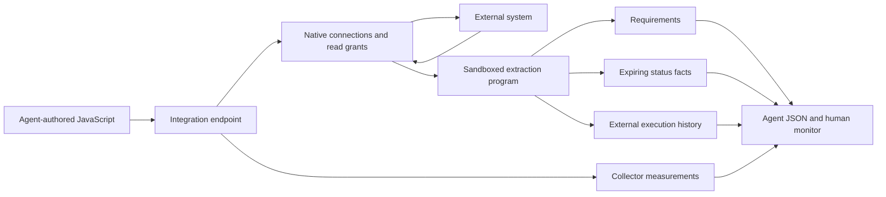

# Hosted integration programs

The integration endpoint hosts operator-installed JavaScript programs. An agent can author the program and submit its source through the API.
The program selects permitted reads, follows external references, and maps source observations into records.
Shared Rust code manages connections, secrets, grants, scheduling, retries, execution limits, and local storage.

This is a local MVP. It stores records for inspection and reasoning. It does not publish facts to enforcement nodes or activate policies.



## Run the GitHub example

Build the host:

```sh
cargo build --locked -p ipe-integration --bins
```

Run one manual extraction and one scheduled extraction:

```sh
python3 tools/integration-host/demo.py --prove-schedule
```

The host obtains the GitHub token from the local Git credential helper. The demo needs no token environment variable.
The example pins the IPE docs workflow and limits reads to eight repositories.
It installs [the JavaScript program](../testing/integration/hosted/github-actions.js) through the endpoint. The CLI does not perform extraction itself.

Outputs in `target/integration-host-demo` include:

- `snapshot.html`: a standalone human review view with embedded evidence.
- `snapshot.json`: the same records and history for agents.
- `host-config.json`: named native connection and operation configuration, without credentials.
- `open-monitor.html`: private local launcher for the live monitor. Do not share this file.
- `operator.env`: the private local operator credential. Do not share this file.
- `state/`: private installation source, current records, and bounded run history.

Add `--serve` to keep the endpoint active at `http://127.0.0.1:8767`.
Add `--open` to open the live monitor automatically. You can also open the private `open-monitor.html` file locally.
The launcher submits the operator token in a POST body and redirects to the monitor.
The host sets an HttpOnly, SameSite cookie. Monitor API requests require a custom header and the configured local host address.
The monitor preserves open evidence panels and keyboard focus during refresh.
The monitor checks the browser session automatically. It refreshes the installed program, run history, and records every three seconds.
Keep `open-monitor.html` private; it contains the operator credential. Share `snapshot.html` instead.
Manual token entry remains available for API operators. The GitHub helper credential is separate from the local operator credential.
Use Ctrl-C to stop the host. Without `--serve`, the demo stops it after capture.
Do not combine `--serve` with the two-second proof schedule for normal use. The default schedule is 300 seconds.

## Versioned record types

| Record | Meaning | Agent use | Human view |
| --- | --- | --- | --- |
| `definition` | Versioned workflow or action interface | Resolve source revisions and declared inputs | Review declared interfaces |
| `evidence` | Source excerpt or lexical clue | Support an inference without treating it as a rule | Inspect raw source separately |
| `constraint` | Operation requirement with explicit applicability and obligations | Identify prerequisites and uncertainty | Review actor, permissions, dependencies, and enforcer |
| `invocation` | A call site and its input bindings | Distinguish repeated calls and defaults | Follow calls to captured definitions |
| `fact` | Provider-reported status with finite expiry | Supply evidence for a later authorized evaluation | Inspect current and expired observations |
| `outcome` | Execution result with structured attempt identity | Compare actual attempts | Inspect status, duration, and step results |

Each emitted observation contains `model`, `data`, and `receipts`.
`model.schema_version` is 1. The host validates the typed entity and derives its key and revision digest.
`data` retains raw provider material for inspection. It does not implicitly add executable constraints.
Use authenticated `GET /v1/host/record-schema` to obtain JSON Schema generated from the Rust model types.
Native validation also checks grants, receipt ownership, bounded values, duplicate identities, and resolved definition links.

Logical control identity excludes source revision. Record identity and revision digests preserve different source versions and mapping versions.
Invocation identity includes its parent definition and call-site pointer. Execution identity includes provider, resource, run, attempt, job, and step.
Facts with an execution reference must use that execution's canonical subject identity.
A display-name correlation remains a candidate. It cannot become a resolved declaration link.

Stored records without a v1 model remain labeled as legacy untyped evidence.
The outcome export keeps these under `legacy_untyped`; they do not count as new typed executions.
Old programs must emit v1 observations before they can run successfully on the updated host.
New installations cannot request the obsolete `contract` output kind.

A declared permission is not proof of effective permission. An action input declaration is not proof of runtime validation.
The GitHub program leaves expression evaluation, environment protection, and actor authorization unresolved.
A job name can suggest a declaration match. It does not establish a unique match for matrix jobs or dynamic names.

Each record includes its adapter digest, run identity, native observation time, and successful read receipts.
Native source evidence includes operation parameters, source digest, observation time, and truncation status.
Receipts establish which reads supported a record. They do not prove that the program interpreted those reads correctly.

The host updates current requirements and facts only after a successful extraction. A failed extraction does not remove requirements or refresh facts.
Facts retain their original expiry after failure. Missing evidence must not become an allow decision.
Current records are upserts by kind and key unless the host verifies a complete declaration scope.
A YAML read operation can define `snapshot_source` with `namespace`, `resource_parameter`, `path_parameter`, and `revision_parameter`.
These parameter names must refer to native operation parameters. Only a full YAML document can establish this authority.

The program can return `collections` in its completion output. Each claim contains `schema_version: 1`, `scope`, `kind: "constraint"`, and a native `receipt`.
The host verifies the receipt, successful read status, source identity, and absence of truncation.
It replaces constraints only within that source definition and scope. A verified empty collection can remove prior constraints.
Missing claims, partial reads, and failed runs preserve prior constraints. A failed run does not publish a partial catalog.
Complete declarations do not establish complete effective policy coverage. Permissions, environment protection, and actor authorization can remain unknown.

Native read evidence reports observed, unavailable, or pending status, including a sanitized failure code.
Link pagination, provider truncation flags, record limits, and provider counts identify incomplete collections.
A failed mapper retains native read evidence for diagnosis. Fact expiry starts at the earliest supporting native observation time.
The coverage API lists the latest reads, verified declaration scopes, and retained constraints that were not observed in the latest run.

Outcomes are separate from collector telemetry. A durable archive retains each execution independently of the eight collector logs.
Repeated polling updates its observation time without adding an execution or an unchanged payload to its change history.
The archive retains up to 256 execution identities and 16 changed payloads per identity, within 4 MiB.
It reports omitted change counts. When identity or byte capacity is exhausted, the capture fails without replacing existing records.
Use `GET /v1/integrations/:id/outcomes` to export the archive, including native evidence.
The GitHub key includes repository, workflow run, attempt, and job identity where applicable.
This permits tracking real executions without counting each poll as another execution.

## Review catalogs and operation explanations

Each successful capture creates an immutable review catalog when its content or collection context changes.
The manifest records typed declarations, native source evidence, coverage, SDK version, installed JavaScript, input, grants, and native operation digest.
Repeated observations of the same content reuse its revision identity. Their latest timestamps remain in current observations.

The host retains up to eight revisions within 4 MiB. It can evict an unaccepted revision.
Accepted revisions remain available for restoration. If accepted revisions fill the archive, new captures fail atomically with `revision_capacity`.
Export retained manifests before clearing or replacing the local state directory. This MVP has no revision deletion endpoint.

Acceptance selects the catalog used for local review and operation explanations. It does not activate enforcement or replace collector code.
Restoration selects a previously accepted catalog. Current facts and external outcomes stay separate, with their original timestamps and expiry.
New captures update the candidate catalog without replacing the accepted selection.

The diff uses logical identities. It distinguishes added or removed declarations, requirement changes, source changes, mapping changes, changed evidence, and evidence refreshes.
Conditions, dependencies, input defaults, and call bindings remain part of the requirement comparison.
A source revision change alone does not become a changed requirement. The diff also reports collection context changes.
Opaque provider expressions remain opaque; this is not a proof of equivalent provider behavior.

The monitor and `/explanations` use the same native projection. Each operation includes its condition, actor context, prerequisites, source evidence, unknowns, and candidate outcomes.
Fact requirements compare the exact subject and predicate against fresh facts. Missing, expired, or conflicting facts produce an unknown assessment.
Requested permissions, environment protection, and execution actor authorization remain unknown without supporting observations.
The projection returns only follow-up operations granted to the current installation. It does not run them automatically.
Historical outcomes match the source revision and declared control candidates. Candidate links never establish exact execution authorization.

The monitor provides operation selection, readable requirement summaries, coverage details, and accept/restore controls.
It retains raw records for inspection. Static snapshots disable actions that change the host.

To repeat the live review proof:

```sh
python3 tools/integration-host/demo.py --out target/integration-review-proof --port 8768 --prove-review
```

This proof captures GitHub twice with different collector source revisions. It accepts both catalogs and restores the first.
It verifies unchanged observed records and expiry after restoration. Deterministic tests cover changed requirements and external source revisions.

## Performance evidence

The host measures collector elapsed time, HTTP attempts, retries, bytes, read failures, and operation latency.
Operation latency includes retry waits. These measurements describe extraction performance.

GitHub supplies external status, conclusion, and timestamps. Job and step duration use `completed_at - started_at`.
Workflow created-to-start time uses `run_started_at - created_at`. This interval is not a measured scheduler queue duration.
The workflow API supplies no authoritative completion timestamp in this example. Workflow execution duration remains unknown.
`updated_at` is not substituted for completion time.

The sample includes up to three workflow runs and six jobs per attempt at the selected commit.
It does not establish a population success rate, latency percentile, or service-level objective.
Large action bundles, incomplete traversal, and rejected reads remain explicit extraction gaps.
They are not counted as external control failures.

## Endpoint and SDK

Start an existing configuration with `ipe-integration <config-path> --host`.
The endpoint binds only to a loopback address. API routes require a bearer operator token of at least 32 bytes.

| Method and route | Behavior |
| --- | --- |
| `GET /v1/host/record-schema` | Return the versioned model JSON Schema |
| `GET /v1/host/capabilities` | Return named operations, parameter constraints, record kinds, and limits |
| `PUT /v1/integrations/:id` | Validate and durably install JavaScript source, input, operation grants, schedule, TTL, and record grants |
| `GET /v1/integrations/:id` | Return installed JavaScript, input, operation grants, schedule, and TTL |
| `GET /v1/integrations` | List installations, schedules, latest status, and expired fact counts |
| `POST /v1/integrations/:id/runs` | Start a manual extraction; reject overlap |
| `GET /v1/integrations/:id/runs` | Return retained collector runs and independent archived external outcomes |
| `GET /v1/integrations/:id/outcomes` | Export execution identities, changed outcomes, first/last observation times, and evidence |
| `GET /v1/integrations/:id/coverage` | Return native read status, verified declaration scopes, and retained constraint provenance |
| `GET /v1/integrations/:id/revisions` | List immutable catalogs and diff current observations against the accepted catalog |
| `GET /v1/integrations/:id/revisions/:revision` | Export a retained manifest |
| `POST /v1/integrations/:id/revisions/:revision/accept` | Select a catalog for local review |
| `POST /v1/integrations/:id/revisions/:revision/restore` | Select a previously accepted catalog |
| `GET /v1/integrations/:id/catalog` | Return the selected declarations and separate current facts |
| `GET /v1/integrations/:id/explanations` | Explain operation requirements, evidence, unknowns, outcomes, and permitted next observations |
| `GET /v1/integrations/:id/records` | Return current requirements and facts, including expiry flags |

The installation body contains `source`, `operations`, `input`, `interval_seconds`, `enabled`, `fact_ttl_seconds`, and `output_kinds`.
See [demo.py](../tools/integration-host/demo.py) for complete configuration and API requests.

SDK 0.3 adds typed `ipe.observation` output. SDK 0.2 introduced `ipe.call`, `ipe.exchange`, and `ipe.timestamp`.
`ipe.call` names an approved operation. Native parameter constraints authorize the read.
`ipe.exchange` returns requests, continuation state, and records with successful receipt references.
`ipe.timestamp` parses an explicit timestamp. Guest code has no ambient clock, network, filesystem, or secrets.
Existing ServiceNow adapters retain their operation restrictions and reject hosted observation output.

Native connection configuration supplies fixed origins and host-owned credential sources.
For local GitHub access, configure:

```json
{
  "id": "github",
  "origin": "https://api.github.com/",
  "git_credential_url": "https://github.com"
}
```

The host invokes `git credential fill` with the credential URL on standard input.
Git selects helpers from the host's Git configuration, including repository configuration in its working directory.
The helper's password becomes the connection's bearer token. This mode requires a helper that returns an API-compatible token.
The operator explicitly maps the credential lookup URL to the API origin. Installed programs cannot change either address.
Paths in the lookup URL follow Git's `credential.useHttpPath` setting.

The host disables terminal prompts and asks supported helpers to avoid interactive login.
Lookup has a five-second deadline and a 16 KiB output limit. Errors contain fixed codes, without helper output or diagnostics.
Missing credentials fail startup. The host does not fall back to anonymous access or invoke `approve` or `reject`.
Credentials remain in native memory. They do not enter installation source, guest responses, durable records, or capabilities.
The host rejects response content that contains a configured credential.

Credentials are resolved at startup and cached until shutdown. Restart the host after a token expires or changes.
Automatic refresh during a running host remains unimplemented.
Existing `credential_env` configurations still work. A connection cannot specify both credential sources.
Neither source is permitted for plain HTTP connections.
See [Git's credential interface](https://git-scm.com/docs/git-credential) for helper selection and the credential protocol.

Operation configuration supplies path templates, parameter constraints, query templates, decoders, and JSON field projections.
The shared broker supports JSON, bounded YAML, and text. GitHub traversal and interpretation remain in the installed program.

## Limits and failure behavior

- Four installations, two concurrent workers, and one active run per installation.
- At most 128 steps, 96 HTTP attempts, 8 MiB received, and 180 seconds per run.
- At most three attempts per read. Retry transport failures, HTTP 429, and server errors within the budget.
- Reject redirects. Accept numeric `Retry-After` values up to two seconds; report other values as budget errors.
- Reject duplicate JSON keys, invalid YAML structures, forged receipts, and operations outside native grants.
- Retain at most 256 current records, 256 records per run, and eight runs per installation.
- Limit the durable store to 16 MiB. Reject excess capacity without replacing current records.
- Store source and records in a private directory with one writer and atomic file replacement.
- Sync the state file before replacement. Unix also syncs the directory entry; Windows does not provide this directory sync through the standard file API.
- Restore interrupted runs as interrupted. Do not replay missed schedule intervals.

This host has one operator scope. It is not a multi-tenant service or a long-term metrics database.
OAuth refresh, distributed scheduling, archival export, policy activation, and enforcement fact publication require further work.
