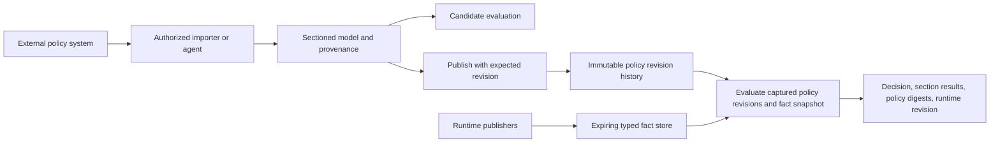

# Runtime data workflow

IPE's experimental version-2 runtime supports authenticated push writes and a
configured HTTPS JSON pull connector in the same server. Policies check a local
snapshot of typed facts. Every fact has a finite TTL, and unavailable evidence
produces a denial with an `indeterminate` status.

This is the implemented first slice of [RFC-009](../rfcs/009-runtime-facts-and-policy-language.md).
The RFC describes the broader target; it is not a claim that all its release gates
are complete. The server uses the new runtime modules and does not call the legacy
compiler, policy store, tiered evaluator, or JIT.

## Run the external acceptance workflow

```sh
cargo build --locked -p ipe-server
python3 scripts/accept-runtime-data.py
```

The script creates a temporary database, scoped credentials, and a local HTTPS
snapshot source with its own CA. It starts the actual server and sends only HTTP
requests. Results go to `target/runtime-data-acceptance.json`; failures produce a
nonzero exit status. See the [acceptance guide](../acceptance/runtime-data/README.md)
and [executable fixture](../scripts/accept-runtime-data.py) for the complete
bootstrap configuration and requests. The fixture removes its credentials and
database after the run. Rust/Cargo, Python 3.10 or newer, and `openssl` are required.

## Bootstrap and credentials

Start the server with `IPE_RUNTIME_CONFIG` pointing to a JSON configuration file.
It declares `database_path`, a loopback `bind` address, `input_schema`, scoped
`collections`, scoped policy source strings, `credentials`, and `connectors`.
Collection definitions and bootstrap source policies are static for the process lifetime.
Managed policy documents support live, revisioned publication through a separate
policy API (see below). Bootstrap policies are parsed and type-checked before the listener starts. Invalid policy/configuration prevents
startup. Changing a persisted collection schema/owner requires explicit migration
to a new collection or database; a restart does not silently reinterpret facts.

Each credential references a secret environment variable through `token_env`,
an exact `{tenant, environment}` scope, and independent grants:

- `source_id` and `write_collections`: publish only into owned push collections.
- `evaluate`: submit input and evaluate all configured policies in that scope.
- `inspect`: inspect fact values, schemas, compiled ASTs, policy revisions, and connector status.
- `manage_policies`: publish and activate policy document revisions in the credential’s scope.
  This is an enforcement-administration grant, independent from fact writing.
  Candidate testing requires both `inspect` and `evaluate`.

Use independently generated random bearer secrets of at least 32 bytes. A writer
without `inspect` can read a key's revision/status for conditional updates, but
cannot read stored values. API keys are loaded once at startup; rotate them by
restarting with updated secrets. Never put secrets in URLs or policy input.

The HTTP listener refuses non-loopback addresses. This initial profile uses bearer
authentication, not native mTLS or JWT. Remote use requires a correctly configured
local TLS-terminating proxy; loopback binding alone does not authenticate clients.
The `evaluate` grant trusts a workload to attest **all input fields**, including
principal identity, within its scope. It does not authenticate an end user or
validate a delegation token. Policies must read authoritative facts where caller
assertions are insufficient. Do not give this grant to untrusted end users.

## Public API

All scoped endpoints require `Authorization: Bearer <secret>`. JSON is limited to
1 MiB; duplicate object keys and trailing input are rejected. Unsupported values
are rejected rather than dropped.

| Method and path | Purpose |
| --- | --- |
| `GET /health` | Process liveness; no credentials |
| `GET /ready` | Compiled catalog loaded and runtime clock acceptable; no credentials |
| `POST /v1/scopes/{tenant}/{environment}/facts/{collection}/commit` | Atomic mutations within one scoped collection |
| `GET /v1/scopes/{tenant}/{environment}/facts/{collection}/{key}` | Authorized inspection or writer revision lookup |
| `POST /v1/scopes/{tenant}/{environment}/evaluate` | Evaluate every configured policy in the scope |
| `GET /v1/scopes/{tenant}/{environment}/catalog` | Input/fact schemas and compiled policy ASTs |
| `GET /v1/scopes/{tenant}/{environment}/connectors` | Last pull attempt status |

The old `/evaluate` endpoint is not served. Existing deployments must supply the
new configuration and use the scoped endpoint. The former standalone metrics
listener is also not provided in this profile.

A put request has this shape (timestamps are integer Unix seconds):

```json
{
  "mutations": [{
    "operation": "put",
    "key": "deployment-42",
    "value": {"active": true, "priority": 7},
    "expected_revision": null,
    "source_revision": 1,
    "observed_at": 1792173600,
    "ttl_seconds": 60
  }]
}
```

Use the current observation time, not the example timestamp. `expected_revision:
null` creates a key with no history; an update names its previous local revision.
Deletes use `operation: delete`, a key, expected revision, newer source revision,
and observation time, with no TTL/value. Deletes retain ordering history. Errors
include `401` unauthenticated, `403` unauthorized, `409` revision/replay conflict,
`422` invalid JSON/schema/TTL, `413` oversized request, and `503` unavailable clock
or storage. The bounded database returns `507` when its capacity is exhausted.

An identical source mutation retry returns its original record/expiry without
renewal. Changing the payload with the same source revision is a conflict. This
is source-sequence retry handling, not the RFC's general `Idempotency-Key` API.
The header is not interpreted. A new observation must advance the source revision
and observation time. Expired keys retain revision history after payload cleanup.
Observation timestamps have whole-second resolution; replacing a key with a new
put requires an observation at least one second later than its previous one.

## Supported shapes and queries

Schemas use `{ "type": "bool" }`, `int`, `string`, `array` with `items` and
`max_items`, or `record` with named `fields`. Each field has `schema` and an optional
`optional` flag. Unknown record fields, missing required fields, nulls, floating
point values, mixed typed arrays, and out-of-range integers are rejected. Nested
records and lists of records are supported. Missing optional fields can be stored,
but optional-field access is rejected at policy compilation until explicit option
matching is implemented.

```text
language 2
policy Approved: "Two different senior approvers"
  triggers when input.action.operation == "Deploy"
  facts
    approvals = data.approvals[input.resource.id] fresh within 5m
  requires
    approvals.value.active == true
    and count_distinct(
      a.principal_id for a in approvals.value.approvers
      where a.role == "senior"
    ) >= 2
```

`input` is caller input; `data` names configured collections. Fact bindings resolve
after a true trigger and before requirements, including bindings that a boolean
short circuit would otherwise avoid. Comparisons and boolean operators are strict;
membership and `any`, `all`, `count`, and `count_distinct` work on bounded lists.
Collection schemas are pinned in the compiled AST. The evaluator checks them
against the captured snapshot.

A fresh empty list has count zero. A missing/expired/stale fact has no usable value
and yields indeterminate; negation cannot turn missing evidence into an allow.
All applicable policies are combined: deny overrides indeterminate, indeterminate
overrides allow, and no applicable policy denies by default. Consumers must grant
access only for an explicit `decision: allow`.

## Pull connector

Each connector config binds an exact scoped collection and source to a fixed HTTPS
URL. It includes a polling interval, deadline, body limit, optional bearer-secret
environment variable, and optional CA certificate path. Certificate verification
stays enabled. Redirects and ambient proxy configuration are disabled. URLs cannot
come from requests or policies. The bootstrap administrator controls allowed
destinations; there is no separate network egress firewall in this implementation.

The upstream publishes a complete snapshot:

```json
{
  "source_revision": 12,
  "observed_at": 1792173600,
  "ttl_seconds": 60,
  "items": [
    {"key": "deployment-42", "value": {"active": true, "priority": 7}}
  ]
}
```

Each accepted generation atomically replaces the collection's current keys. One
invalid item, duplicate key, HTTP error, timeout, or malformed response rejects the
entire generation. Repeated identical source revisions are no-ops; changed content
at the same revision conflicts. A new generation must have a newer observation.
An empty complete snapshot removes existing keys while retaining ordering history.
`304` responses and failed polls never extend TTL. Polling is sequential at a fixed
interval; jitter/backoff and upstream-specific adapters remain future work.

## Expiration, consistency, and limits

Expiry is the earlier of acceptance time plus TTL and observation time plus the
collection's maximum observation age. Future observations are rejected. A policy's
freshness clause can impose an earlier deadline. Expiry equality is invalid.
Evaluation uses one immutable scoped snapshot/time and rechecks its earliest
evidence deadline before returning an allow. No network requests occur during
evaluation, and no decision cache is enabled.

The initial store synchronously persists one bounded serialized state in RocksDB
before publishing it in memory. Writes serialize; a new local snapshot after a
successful write sees that write or a later one. Multi-key commits within a
collection are atomic. Snapshots taken earlier may finish against their earlier
state. There is no replication, convergence bound, external-action fencing, or
atomic check-and-act guarantee. The returned revision is local database metadata,
not a portable consistency token; `min_revision` is not implemented.

Storage is capped at 10,000 keys/collections and 16 MiB encoded state, with a 1 MiB
per-value limit and nesting limits. Expired payloads are reclaimed every 30 seconds;
ordering metadata remains, so an unbounded stream of new keys can still exhaust
capacity. Writes and snapshots copy bounded state; this is not a high-volume
indexed store. There are instruction and collection-visit budgets, source/depth
limits, and at most 100 policies per scope. Performance under production load has
not been characterized.

The process uses a monotonic clock anchor/high-water and rejects large clock
discontinuities. Correct time at restart remains an operational requirement: a
persisted clock high-water and trusted-time attestation are not implemented. Native
timestamp/duration values, relation traversal, live schema publication,
cross-collection transactions, full audit persistence, global execution wall-time
budgets, and legacy language migration remain RFC work. Legacy embedded APIs keep
their previously documented limitations and are not covered by the runtime-2
acceptance claim.


## Separate policy data from runtime evidence

The runtime now has three distinct inputs:

| Namespace | Ownership and lifetime | PR landing example |
| --- | --- | --- |
| `input.*` | Assertions from the authenticated evaluating workload | Operation and exact head commit being checked |
| `policy.*` | Typed parameters fixed within one immutable policy revision; no fact TTL | Minimum approvals and required check names |
| `data.*` | Authoritative runtime observations with mandatory TTL and freshness | Approvers and passed checks for that exact commit |

A policy document groups named sections and their language-2 rules with shared
policy data. Section results identify the rule and its source pointer. Local
policy data does not expire. An **observation of external policy does expire**:
its source may change even though IPE retains an immutable record of what was
imported. Expired or future-dated external observations yield indeterminate.
Unsupported external rules are explicit sections and also yield indeterminate;
they cannot silently disappear into an allow.



The policy catalog is a separate RocksDB database under
`<database_path>/policy-catalog`. It never writes fact records or advances their
revision. Publication durably appends a revision and atomically activates it for
that document. Earlier revisions remain available; there is no update-in-place
or delete API. A decision captures the active document revisions once and one
runtime snapshot. Concurrent updates do not change that captured execution.
The two stores do **not** provide a joint transaction or distributed consistency.

Each revision pins its input and referenced collection schemas. Startup validates
persisted revisions against the configured schemas and rejects incompatible
changes. Decisions include document revision numbers and content digests;
revision inspection includes the publisher's configured credential identifier,
publication time, complete document, and schema pins. The document digest covers
the document JSON serialized by IPE, not the runtime snapshot or source-system
bytes. Historical fact payloads are not archived by the policy catalog.

### Document and section representation

The executable PR example is
[`acceptance/policy-data/pr-landing.json`](../acceptance/policy-data/pr-landing.json).
Its documents contain:

- `id`, `title`: stable document identity and display title.
- `data`: a `schema` and schema-validated `value`, resolved through `policy.*`.
- `external`: `null` for local policy, otherwise the provenance fields below.
- `sections`: unique `id`, `title`, `source_pointer`, and `rule` for each rule.

A modeled section uses `rule: {"kind":"modeled", "source":"language 2 ..."}`.
An unsupported section uses `rule: {"kind":"unsupported", "reason":"..."}`.
Each modeled section has its own trigger and required runtime bindings. All
applicable sections/documents and bootstrap policies combine with deny taking
precedence over indeterminate, then allow. An entirely inapplicable or empty
catalog denies. An unsupported section blocks the document conservatively,
without attempting to infer when the unknown external rule applies.

For example, a review section can require:

```text
language 2
policy Reviews: "Enough distinct reviewers on this commit"
  triggers when input.operation == "merge"
  facts
    pr = data.pull_requests[input.commit] fresh within 5m
  requires
    count_distinct(a for a in pr.value.approvers) >= policy.review.minimum
```

`policy.*` supports the same typed scalars, nested records, lists, and aggregate
queries as the runtime language. It can also appear in triggers and fact keys.
`policy` is reserved and cannot be shadowed by a binding or aggregate variable.
Runtime payloads and request input cannot replace policy-owned parameters.

### External provenance and agent import contract

An external document requires:

```json
{
  "system": "example-forge",
  "locator": "https://forge.example/repos/acme/app/rules/main",
  "source_revision": "rules-7",
  "source_digest": "f5c40ab0bc0e6e38c6b5fe418170abc0038c9253719d24a4b35b8e513ac24378",
  "observed_at": 1792173600,
  "valid_until": 1792173900
}
```

These values are illustrative. The locator identifies the external policy
resource. Each external section also requires a valid JSON Pointer into the
observed source, such as `/review/minimum`. The source digest is a SHA-256 of the
exact source bytes. The source revision is an opaque upstream revision/ETag;
IPE's numeric document revision is separate.

An importer reads the external system using its own authenticated connection,
models its rules and parameters, retains unsupported rules as explicit sections,
and supplies provenance. It can test the candidate before publishing. Importing
new policy or refreshing the same source revision creates a new local revision.
The observation time must advance; authority (`system`, `locator`) and local vs.
external origin cannot change for an existing document. Changed source bytes
cannot reuse the immediately preceding source revision. A conflicting local
`expected_revision` returns 409 without publishing. Invalid or expired imports
return 422 and leave the previous revision active; that previous observation
still expires at its original deadline.

The provenance is **asserted by the authorized importer**. IPE validates its shape
and publication ordering; it does not fetch the locator, verify the digest against
remote bytes, prove model completeness, authenticate the upstream revision, or
validate the semantic translation. The importer must account for repository,
branch, organization, and bypass rules when modeling a real forge. The included
fixture models a small example source; it is not a GitHub/GitLab rules adapter.
No external-system writes occur in this workflow.

### Policy management and candidate testing API

All routes use the existing scoped bearer authentication and strict JSON decoder.
Publication activates the revision immediately; it is not a draft-save endpoint.

| Method and scoped path | Grant | Request/result |
| --- | --- | --- |
| `POST /v1/scopes/{tenant}/{environment}/policies/{id}/revisions` | `manage_policies` | `{ "expected_revision": null, "document": {...} }` for creation; use the current numeric revision to update |
| `GET /v1/scopes/{tenant}/{environment}/policies/{id}/revisions/{revision}` | `inspect` | Complete immutable revision and provenance |
| `POST /v1/scopes/{tenant}/{environment}/policies/test` | `inspect` and `evaluate` | `{ "document": {...}, "input": {...} }`; evaluates the candidate alone against current scoped runtime facts without publication |
| `GET /v1/scopes/{tenant}/{environment}/catalog` | `inspect` | Includes active `policy_documents` alongside bootstrap policies and runtime collection schemas |

Ordinary `evaluate` cannot submit arbitrary candidates: a candidate could reveal
facts by probing their values. The test response is marked `simulation: true` and
must not be used as an enforcement decision. Production `/evaluate` includes all
active policy documents, bootstrap policies, revision/digest identifiers, section
results, and external provenance. It rechecks the earliest fact or external-policy
deadline before returning an allow.

A new installation can bootstrap with `policies: []` if a policy management
credential exists. Until a document is published, evaluations deny by default.
The catalog is bounded to 100 documents per scope, 100 sections per document,
10,000 total historical revisions, and 16 MiB of stored catalog state. Each
document is limited to 256 KiB and its typed policy data to 64 KiB. Full catalogs
reject publication with 507; they do not discard historical policy. Retention,
source-specific authority grants, separate staging/approval/activation, signed
provenance, provider-specific discovery, and external write-back remain future
work. Management credentials are trusted policy administrators for their scope.

### Reproducible policy execution tests

```sh
make policy-acceptance
```

This runs two complementary checks:

1. Fifteen deterministic scenarios select immutable document fixtures, seed
   isolated mutable runtime facts, and specify evaluation/completion clocks.
   Cases cover policy revision changes, runtime changes, duplicate approvals,
   commit identity, missing facts, TTL/freshness boundaries, unsupported rules,
   and expired external-policy observations.
2. The HTTP acceptance suite reads a local HTTPS source as an importer, publishes
   the model, writes runtime facts with a separate credential, tests candidates,
   refreshes the external policy, checks immutable history and conflicts, rejects
   unauthorized writes, and restarts the server to verify persistence.

Reports are written to `target/policy-data-scenarios.json` and
`target/policy-data-acceptance.json`; any failed expectation exits nonzero.
To run a custom suite:

```sh
cargo run --locked -p ipe-core --features approvals --example policy_scenarios -- \
  acceptance/policy-data/pr-landing.json target/policy-data-scenarios.json
```

Each case is isolated and currently seeds push collections. The fixture's `now`
and `completed_at` provide deterministic time travel only in this offline runner;
public evaluation and candidate-test APIs always use the server clock. Test
fixtures are trusted local files. Captured in-memory snapshots can be compared
across updates; durable replay of arbitrary historical runtime snapshots is not
implemented.
