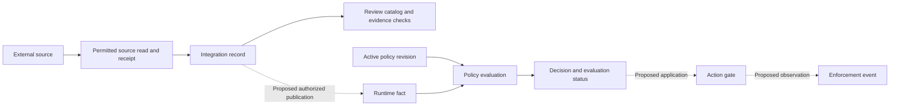

# IPE domain model and mappings

This guide maps the current vocabulary to representative code and API fields.
Use the [project vocabulary](vocabulary-guide.md) for definitions and the [ontology audit](../docs-cms/memos/memo-008-ontology-audit.md) for findings and open decisions.
The map is a review aid, not a new storage schema or a claim that all proposed roles are implemented.

## Roles and evidence flow

The dashed connections are proposed. The current integration host does not publish runtime facts.
A review catalog, evaluation result, external execution outcome, and actual enforcement event have different meanings.
A source declaration, native receipt, and matched evidence check do not establish that an external requirement was fulfilled.

## Domain-to-implementation map

| Concept | Current representation | Identity, boundary, and interpretation |
| --- | --- | --- |
| Integration installation | Host `Installation` under an integration ID. | Local hosted program, input, operation and output grants, schedule, and fact TTL. It is not a tenant or a separate deployment. [Host code](../crates/ipe-integration/src/host/mod.rs) |
| Source definition | `DefinitionId { namespace, resource, path }` and `Source { definition, revision, pointer }`. | Logical definition identity excludes source revision and content digest. A source reference identifies the revision and source pointer. [Model](../crates/ipe-integration/src/host/model.rs) |
| Operation description | V1 `Entity::Constraint`, projected by v2 `OperationDescription`. | V1 `control: ControlId` is an operation identity, not proof of a control mechanism. V2 uses `operation`, `source`, `record_revision`, `declared_enforcer`, and `requirements`. [Projection](../crates/ipe-integration/src/host/domain.rs) |
| Named operation requirement | V1 `Obligation` wrapper; its `requirement` is a tagged `Requirement` specification. | A named source condition is not automatically a party's duty. Preserve the v1 fields `obligation` and `control` in wire examples. [Model](../crates/ipe-integration/src/host/model.rs) |
| Governance policy, contract, control, handoff, principal, role assignment, contact method | V2 `Entity::Governance { record: GovernanceRecord }` with a nested `type`. | Source-backed descriptions and references. A nested governance `contract` is distinct from the rejected legacy top-level `contract` output kind. None grants authority. [Governance](../crates/ipe-integration/src/host/governance.rs) |
| Integration fact | V1 `Entity::Fact` in a host `Record`. | Subject, predicate, value, authority, and optional execution; host record holds observation and expiry. The logical fact key uses subject and predicate inside its installation. It is not a runtime fact. [Model](../crates/ipe-integration/src/host/model.rs) |
| Association | `Entity::Association`. | Subject, predicate, target, context, authority, and resolution. Its logical identity includes all five; expiry belongs to the host record. A candidate is not a resolved link. [Model](../crates/ipe-integration/src/host/model.rs) |
| Evidence and receipt | `Entity::Evidence` is a typed record. Host `Record` also retains `receipts` and `source_evidence`. | Evidence supports a claim. A native receipt establishes a permitted read was recorded, not the correctness of every inferred relationship. [Host](../crates/ipe-integration/src/host/mod.rs) |
| Evidence check and fulfillment | V2 assessment maps V1 check values into `matched`, `not_matched`, or `unknown`; `fulfillment.status` remains `unknown`. | A caller's context selects evidence. It does not itself provide evidence or grant authorization. [Assessments](../crates/ipe-integration/src/host/assessments.rs) |
| Runtime fact | Scoped collection/key plus `FactRecord`. | Value, observation and expiry times, source revision, and local revision. Owner and ingestion mode are collection configuration, not fields of `FactRecord`. [Fact store](../crates/ipe-core/src/runtime_facts.rs) |
| Policy document and revision | `PolicyDocument`, `PolicyRevision`, and its external provenance where present. | Policy document ID and scoped revision identify the published version; the document contains modeled and unsupported sections. Source revision and digest refer to external source material, not the runtime revision. [Policy code](../crates/ipe-core/src/policy_document.rs) |
| Per-policy evaluation result | `PolicyOutcome` and document `ExecutionStatus`. | `allow`, `deny`, `indeterminate`, or `not_applicable` describe individual evaluation results. [Evaluator](../crates/ipe-core/src/runtime_policy.rs) |
| Aggregate HTTP decision | `decision` and `evaluation_status` in `POST /v1/scopes/{tenant}/{environment}/evaluate`. | `decision` is `allow` or `deny`. `evaluation_status` can be `indeterminate` while `decision` is `deny`. [Server](../crates/ipe-server/src/runtime.rs) |
| External outcome | Host `Entity::Outcome`, keyed by `ExecutionId`. | A provider-reported result for an external execution; it is not an IPE evaluation result or proof that a requirement was fulfilled. [Model](../crates/ipe-integration/src/host/model.rs) |
| Review catalog | Integration host retained candidate/accepted catalog. | Selecting a catalog supports local review. It is not the runtime policy catalog and does not activate enforcement. [Host guide](integration-host.md#review-catalogs-and-operation-explanations) |

## Proposed roles and records

[RFC 018](../docs-cms/rfcs/rfc-018-evidence-system-map.md) defines integration point, modeling activity, evaluation service, enforcement point, evidence dependency, policy exception, and access grant as proposed logical concepts.
An enforcement point applies a result to an action. An evaluator computes a result. Co-location does not make the roles identical.
A declared enforcer is a source claim, not proof of an active enforcement point.
Do not map a proposed role to a current API or imply deployment identity until an implementation design and tests define that mapping.

The sample [product qualification data](../tools/product-ship-mocks/data.json) uses `controls` for checklist conditions.
That is a prototype-specific shape. Do not treat it as the governance `Control` schema or proof of an enforcement mechanism.

## Applying the model

1. State the component, scope, authority, and time basis before using an ambiguous noun.
2. Choose the vocabulary term for prose and the actual schema name for code, payloads, and examples.
3. Record whether a claim is declared, provider-reported, inferred, unknown, or an observed IPE result.
4. Preserve source revision, mapped record revision, runtime revision, and policy revision as distinct values.
5. Review schema and wire compatibility before renaming public fields. Add boundary and failure tests for behavior changes.
6. Label proposals and sample data. Update this map and the vocabulary when an implemented meaning changes.
