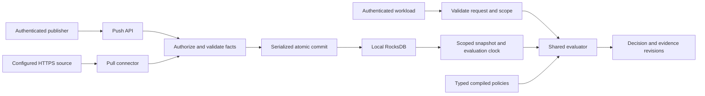

# RFC-009: Runtime Facts and Policy Language

**Status:** Draft
**Created:** 2026-10-16
**Related:** [RFC-001](001-sidecar-service-architecture.md), [RFC-002](002-sse-json-protocol.md), [Scope and TTL proposal](../docs/rfcs/0002-scope-and-ttl-model.md)

## Summary

An experimental subset is implemented and described in the [runtime workflow guide](../docs/RUNTIME_DATA.md).
The implemented extension also adds immutable sectioned policy documents, typed
`policy.*` data, external-source provenance, and candidate/scenario testing; see
[the policy-data contract](../docs/RUNTIME_DATA.md#separate-policy-data-from-runtime-evidence).
Provider-specific semantic discovery and external policy write-back are not implemented.
That guide specifies the actual API, bearer/loopback deployment profile, supported
types, and deferred features. This draft remains the target design; its complete
release gates have not been met.

IPE will evaluate policies against authenticated request input and a local, typed fact database. Authenticated push writes and one HTTPS JSON pull connector will ship together, using the same authorization, validation, expiration, and commit path. Every policy-resolvable fact must have a finite expiry. Evaluation performs no network requests.

The language will explicitly separate `input` from `data`, declare fact dependencies and freshness requirements, and support typed records, lists, membership, and bounded aggregates. Missing or expired evidence cannot silently become a negative value or an empty list. Evaluation correctness repairs precede these additions.

All APIs, syntax, and guarantees below are proposed. This RFC fills the dynamic-data slot reserved as RFC-009. It replaces the earlier scope/TTL proposal's optional-expiration approach for policy-resolvable facts; it does not mark either proposal implemented. The initial deployment is one IPE instance with local durable storage. Replication is outside this release.

## Platform prerequisites

The current implementation has several independent execution paths. They must converge before a new data layer becomes an enforcement dependency.

| Existing issue | Required change | Acceptance evidence |
| --- | --- | --- |
| [Compiler](../crates/ipe-core/src/compiler.rs) ignores triggers and returns true after evaluating `requires` | Compile applicability and actual condition results; fix conjunction stack order | Parse, compile, and evaluate passing and failing examples, including false triggers and multiple requirements |
| [Policy store](../crates/ipe-core/src/store.rs) builds empty field paths | Emit a versioned compiled artifact containing bytecode, typed field bindings, schemas, and fact dependencies | Source-to-decision tests through the store, not only hand-built bytecode |
| [Engine](../crates/ipe-core/src/engine.rs) and store combine results differently | One shared evaluator and combination contract | Identical decisions through embedded and HTTP entry points |
| [Tiering](../crates/ipe-core/src/tiering.rs) contains an allow placeholder; [JIT](../crates/ipe-core/src/jit.rs) interprets field IDs as memory offsets | Route supported execution through the real interpreter; gate JIT until parity tests pass | No reachable placeholder allows; differential interpreter/JIT tests before promotion is enabled |
| Concurrent policy workers can replace updates based on the same old snapshot | Serialize commits and check expected revisions | Concurrent additions survive; conflicting replacements fail explicitly |
| Action fields, arrays, and request fields are incompletely exposed | Shared typed value and field-access implementation | Each supported field and type tested across parser, compiler, interpreter, and transport |
| [Relationship traversal](../crates/ipe-core/src/relationship.rs) searches all scopes | Require exact scope on every lookup, traversal, and cache key | Equal entity IDs in different tenants never create a shared path |
| [HTTP server](../crates/ipe-server/src/main.rs) starts empty, silently drops values, and lacks policy management | Authenticated policy loading, strict decoding, readiness tied to active policies/schemas and working storage | Invalid input rejected; restart recovery and unready startup tested |

Bytecode validation must verify operand types, stack behavior, field and constant IDs, call signatures, and branch targets. Add evaluation budgets for instructions, collection visits, graph depth, memory, and elapsed time. Budget exhaustion is an error that cannot allow. No public execution tier may bypass these contracts.

## Architecture and trust boundaries



Three identities remain distinct: the workload requesting a decision, the principal whose action is being checked, and the source publishing a fact. A workload may assert a different principal only under an explicit delegation grant. Resource attributes supplied for evaluation remain caller assertions; a policy that needs authoritative classification reads `data` for that classification.

The runtime injects an authorized `(tenant, environment)` scope. Neither policy code nor fact payloads can switch it. Use structured, length-prefixed storage keys, not delimiter concatenation. There is no implicit global-scope fallback. Initially, shared reference data must be published separately into each authorized scope.

Bootstrap configuration controls authentication, publisher grants, collection ownership, schemas, and connector settings. A publisher cannot grant itself permissions by writing facts. Embedded storage mutation stays behind the same validation service; trusted in-process bootstrap APIs are a documented privilege boundary.

## Fact model and schemas

A logical fact is identified by `(scope, collection, schema_version, key)`. Each scoped collection has one configured authority, one ingestion mode, and one schema per active version. Multiple credentials may represent that authority, but unrelated sources cannot race to own the same collection. Policies can explicitly compare separately named collections when corroboration is needed.

| Field | Authority and meaning |
| --- | --- |
| `scope`, `collection`, `schema_version`, `key` | Authorized address; key shape is declared by the collection |
| `value` | Schema-validated typed value |
| `source_id`, `publisher_id` | Derived from server configuration and authenticated identity |
| `source_revision` | Monotonically increasing observation/mutation sequence within the source's declared revision domain |
| `observed_at` | Time the authority last verified the value; required and checked against configured clock tolerance |
| `received_at`, `expires_at` | Server-recorded acceptance time and computed expiry |
| `revision` | Local commit token assigned by IPE |
| `schema_digest` | Exact schema used for validation |

Supported values in the first release: `bool`, signed `int64`, UTF-8 `string`, typed timestamp and duration, homogeneous lists, and named records with required or optional fields. JSON objects decode only into declared records; reject unknown fields, duplicate JSON keys, invalid timestamps, mixed lists, out-of-range integers, and unsupported numeric forms. Optional fields use a typed option and require explicit matching before access. No implicit string/number conversions, float arithmetic, arbitrary JSON traversal, or implicit truthiness.

Collections define key type, value schema, maximum encoded size, nesting depth, list cardinality, maximum TTL, maximum observation age, source ownership, and permitted operations. Example registry entry, using illustrative schema notation:

```text
collection deployment_approvals version 1
  key: string
  value: record {
    deployment_id: string,
    approvers: list<record {
      principal_id: string,
      role: string,
      team: string
    }>
  }
  authority: approval-service
  ingestion: push
  max_ttl: 15m
  max_observation_age: 15m
  max_bytes: 65536
  max_items: 100
```

This fact is the authority's complete approval list for one deployment. `approvers: []` means a known empty list while the fact is valid. A missing list fact means unknown. The value's `deployment_id` must equal its key, enforced as a collection constraint. Trusted publishers remain responsible for the business truth of their assertions; schema validation cannot establish that a human really approved an action.

Approvals and relationship edges migrate into this model, with the same TTL rules. A derived fact must carry dependency revisions and expire no later than its earliest dependency; derivation cannot renew evidence. Initial collection aggregates operate over a complete list in one fact, avoiding unbounded database scans and ambiguous partial sets.

## Expiration and freshness

Each mutation supplies a positive `ttl_seconds`; omission, zero, overflow, or a TTL above the configured maximum is rejected. No forever sentinel exists. An optional source `valid_until` may shorten the lifetime. For acceptance time `t`, observation time `o`, TTL `d`, and collection observation-age limit `a`:

```text
expires_at = min(t + d, o + a, source_valid_until_if_present)
```

Reject writes already expired at acceptance. A source timestamp beyond the allowed future-clock tolerance is rejected. Within tolerance, use `min(observed_at, received_at)` as the effective observation time so future skew never increases freshness. TTL is the maximum period a local assertion can remain usable; it is not evidence that the upstream system remained unchanged.

A policy may demand a shorter age using `fresh within 5m`. At evaluation time `now`, a fact is usable only when:

```text
now < expires_at
and now < effective_observed_at + policy_max_age   # when specified
```

The earlier boundary wins; equality at a boundary is expired or stale. Capture one evaluation clock for all lookups. Before returning an allow, verify that the earliest consumed evidence deadline has not passed. If it has, return an indeterminate result; do not extend the decision's validity to finish processing.

Use an injectable clock in tests. In production, maintain a nondecreasing effective clock using wall time and a monotonic elapsed-time anchor. Detect clock discontinuities and stop allowing fact-dependent requests until time is trusted. Persist a clock high-water mark and check it at restart; this prevents obvious rollback but cannot prove correct elapsed time during downtime. Startup therefore requires trusted synchronized time. A bad clock outside the configured trust assumptions invalidates freshness guarantees.

Expiration is enforced by the resolver on every policy read, including graph edges and cached values. Cleanup runs separately over an expiry index, with revision checks before deletion so cleanup cannot remove a renewed fact. Compaction and cleanup reclaim space; their schedule does not determine validity. Administrative inspection may expose expired records with explicit status, but cannot feed those records into the policy resolver.

Renewal is an authenticated new observation with a newer source revision and observation time. Transport retries, connector failures, repeated old payloads, and generic health checks do not renew facts. There is no blind “extend all TTLs” endpoint. Deletion/revocation invalidates the current value and retains ordering metadata to reject delayed resurrection.

Ordering watermarks, schemas, audit records, and tombstones are internal control metadata, not resolvable policy facts. They need not expire with a fact. This distinction allows finite fact lifetimes without losing replay protection.

## Authenticated push API

The control listener requires TLS and authenticated service identity. Initial deployments use mTLS identities mapped to static grants. A JWT adapter may follow without changing ingestion semantics; it must validate configured algorithms, issuer, audience, token type, lifetime, and subject, using configured trust/key endpoints rather than token-supplied URLs. These checks follow [JWT best practices](https://www.rfc-editor.org/rfc/rfc8725.html).

Grants bind identity to exact scopes, collections, source identity, operations, key constraints, and TTL/size ceilings. Distinguish fact writers, policy publishers, schema administrators, evaluation callers, and audit readers. Apply authentication and body-size limits before expensive parsing; authorize before database access. Rejected writes are audited without logging secrets or complete sensitive values.

The initial transport is ordinary versioned HTTPS JSON alongside the current server. RFC-002 streaming is not required for ingestion correctness; a later adapter must call the same service.

```http
POST /v1/scopes/acme/prod/facts:commit
Content-Type: application/json
Idempotency-Key: approval-service-deploy-42-18

{
  "mutations": [{
    "operation": "put",
    "collection": "deployment_approvals",
    "schema_version": 1,
    "key": "deploy-42",
    "expected_revision": "instance-a/epoch-7/103",
    "source_revision": 18,
    "observed_at": "2026-10-16T18:00:00Z",
    "ttl_seconds": 600,
    "value": {
      "deployment_id": "deploy-42",
      "approvers": [
        {"principal_id": "alice", "role": "senior-engineer", "team": "security"},
        {"principal_id": "bob", "role": "senior-engineer", "team": "platform"}
      ]
    }
  }]
}
```

`expected_revision: null` means create only if no prior key history exists. Updates and deletes require the last key revision, including an expired or deleted key's watermark revision. A bounded, authorized metadata lookup exposes that revision without returning another scope's data. `source_revision` increases per key for push collections; `observed_at` cannot move backward. Concurrent updates with the same expected revision yield one success and one conflict.

One commit is bounded, restricted to one scope, and atomic across its mutations. Reject duplicate keys within a batch. A delete supplies key, schema version, expected revision, and a newer source revision; it has no value or TTL and writes a tombstone. A denial/status assertion is a new expiring fact, not a delete: deletion means the value is unavailable.

Success returns the commit token and each key's revision/expiry. The idempotency key is scoped to caller and scope, bound to a canonical request digest, and stored atomically with the result. A same-key/same-body retry returns the original result and expiry; a different body conflicts. Retain deduplication results for at least the advertised retry window, initially 24 hours. Permanent source watermarks still prevent stale replay after that window. Retired source epochs cannot be reused; reset requires an explicit administrative rebootstrap.

Use `401` for unauthenticated, `403` for unauthorized, `409` for revision/idempotency conflicts, `422` for schema/TTL/source-order validation, `413` for size limits, `429` for backpressure, and `503` when durable commits are unavailable. No partial acceptance. Fact-write failure never reports success. Publish an OpenAPI contract and structured errors before client integration.

## First pull connector

Ship a configured HTTPS JSON snapshot connector in the same release as push. Each connector owns one scoped collection/version and uses a separate local service identity with the same ingestion grants. Bootstrap configuration supplies a fixed endpoint, credential reference, polling interval, deadline, byte/item limits, and permitted destination. Policies and evaluation input cannot provide fetch URLs. Validate TLS; disable redirects initially and restrict outbound destinations to configuration.

The upstream response contains a strictly increasing `source_revision` for the entire collection, `observed_at`, finite `ttl_seconds`, and a complete list of `{key, value}` items. Example for a `deployment_risk` collection:

```json
{
  "source_revision": 91,
  "observed_at": "2026-10-16T18:00:00Z",
  "ttl_seconds": 120,
  "items": [
    {"key": "deploy-42", "value": {"status": "clear", "score": 12}}
  ]
}
```

Every item receives the snapshot observation and expiry envelope; the collection generation itself has the same finite deadline. The source must assert completeness and fresh observation, not merely return an old export with a new HTTP receipt time. A source unable to do that must not be configured as an authoritative complete snapshot feed.

Fetch and validate the entire bounded response into an inactive generation, then atomically activate it. One malformed record, duplicate key, timeout, or oversized response rejects the whole generation. Keys omitted from an accepted complete snapshot become unavailable atomically. An empty complete snapshot is a valid empty collection; it does not turn individual missing keys into negative facts. Staged or abandoned generations are invisible and reclaimed later.

Only one poll per connector may be in flight. Persist the last accepted source revision, digest, and active generation. A repeated revision with identical contents is a no-op; different contents conflict; an older revision is rejected. `304 Not Modified` does not renew TTL in v1. Even unchanged values require a newer authoritative observation to extend their validity.

Poll with jitter and bounded retry/backoff, configured to attempt renewal comfortably before expiry. Failures leave the previous generation usable only until its original deadline. Report last success, next attempt, source revision, and expiry margin. There is no convergence deadline during an upstream outage. Connector failure must not pause evaluation or switch to network lookup on a miss.

## Local consistency and durability

Use one local database for facts, indexes, source watermarks, idempotency results, and the active policy/schema catalog. Compile and validate outside the commit lock. Inside a single commit coordinator, recheck permissions/catalog version and expected revisions, then atomically write the mutation batch and advance the local revision. Storage failures abort the commit.

RocksDB supports atomic `WriteBatch` updates, explicit snapshots, and synchronous writes. Use WAL-enabled synchronous writes for acknowledged durable commits; a batch alone does not make a preceding read/check atomic, so serialization remains necessary. See [RocksDB basic operations](https://github.com/facebook/rocksdb/wiki/Basic-Operations).

Evaluation briefly takes the same publication guard to capture a database snapshot, matching immutable compiled policy/schema catalog, scope, and commit token. Release the guard before evaluating. Successful commits publish the matching in-memory catalog before releasing the guard. If publication fails after a durable commit, stop serving and recover the committed catalog before readiness. On restart, rebuild/verify compiled artifacts against persisted schema digests before accepting evaluations.

| Contract | First release |
| --- | --- |
| Read after acknowledged local write | A newly acquired local snapshot includes that commit or a later state; concurrent replacements may supersede its values |
| Evaluation consistency | All facts and policies come from the captured local revision; all temporal checks use the captured clock |
| Batch visibility | All mutations become visible together |
| Concurrent writers | Expected-revision conflicts are explicit; no lost updates |
| In-flight revocation | An evaluation already holding an earlier snapshot may finish under that snapshot, within its evidence deadline and execution budget |
| Cross-instance reads | No guarantee; tokens identify instance and storage epoch |
| Upstream freshness | Limited by authoritative observation age, TTL, and policy freshness requirements; never stronger than source truth |

Evaluation may require `min_revision` for the same instance/epoch. Capture a snapshot at or beyond that token, or return unavailable after a bounded wait. Reject foreign tokens instead of interpreting them as timestamps. A token is a local visibility barrier, not proof that a particular fact remains present or unexpired.

Return policy version, local revision, evaluation time, and a restricted evidence trace with consumed keys/revisions, source identity, and freshness status. Avoid exposing other scopes or full sensitive values. No decision cache in v1. Decisions authorize a check at a particular snapshot; they are not transferable leases guaranteeing an action remains authorized later. Applications needing atomic check-and-act must coordinate with the resource owner.

## Policy language

Use a versioned language mode. `input` holds the validated request; `data` resolves named local collections in the runtime's authorized scope; `facts` declares dependencies. Collection/schema versions are pinned in the compiled policy manifest. A policy cannot accept arbitrary collection names from the request.

Proposed syntax, not accepted by the current parser:

```text
language 2

policy ProductionDeployment: "Fresh independent approvals and a clear risk assessment"
  triggers when
    input.resource.type == "Deployment"
    and input.resource.environment == "production"
    and input.action.operation == "Deploy"

  facts
    approvals = data.deployment_approvals[input.resource.id] fresh within 5m
    risk = data.deployment_risk[input.resource.id] fresh within 1m

  requires
    risk.value.status == "clear"
    and risk.value.score < 30
    and count_distinct(
      a.principal_id for a in approvals.value.approvers
      where a.role == "senior-engineer"
        and a.team != input.principal.team
        and a.principal_id != input.principal.id
    ) >= 2
```

The named resource type maps through a registered schema to the internal resource ID. Compiler diagnostics reject unknown paths, wrong key types, unregistered collections, incompatible comparisons, unsupported functions, and schema mismatches. `input.principal.team` is authoritative only if the authenticated workload is permitted to attest it; otherwise obtain the principal profile from its owning collection and compare that value.

Fact binding returns `Fact<T>` with `.value` and typed metadata. Bindings are required dependencies: once the trigger is true, resolve all bindings before requirements. An unresolved binding makes the policy indeterminate even if an `or` branch could otherwise pass. Bindings cannot refer to other bindings in v1; keys are bounded pure expressions over input/constants. This makes dependency planning and failure behavior predictable.

Support strict boolean `and`, `or`, `not`; typed equality/ordering; membership in typed lists; and bounded `any`, `all`, `count`, and `count_distinct`. Aggregate form is `function(expression for variable in list [where boolean])`. `any`/`all` expressions must be boolean; `count` counts selected items; `count_distinct` counts distinct selected scalar values. `any([])` is false, `all([])` true, and counts are zero, but only a successfully resolved list can be empty. Documentation must pair `all` with a nonempty check when existence matters.

Resource limits stop execution with a structured error; they never truncate a list and return a partial count. Introduce bounded scoped relationship traversal only after it uses the same resolver, snapshot, TTL checks, and budget. No arbitrary functions, network I/O, mutations, recursion, or database-wide scans in v1.

Minimal grammar additions:

```text
fact_section := "facts" fact_binding+
fact_binding := identifier "=" "data." collection "[" key_expr "]"
                ["fresh within" duration]
aggregate    := aggregate_name "(" expression "for" identifier "in" list_expr
                ["where" bool_expr] ")"
```

Legacy `resource`, `action`, and `request` names require an explicit language-1 compatibility mode. Never silently reinterpret an existing policy under language 2. New bytecode has a new format version and includes source spans and dependency metadata. Unsupported versions fail during load, before publication.

## Missing evidence and decision semantics

The resolver reports `Found`, `Missing`, `Expired`, `Stale`, `SchemaMismatch`, or `Unavailable`. Invalid or absent evidence has no usable `.value`. Authentication and scope failures are separate boundary errors and must not disclose whether an out-of-scope key exists.

| Situation | Policy outcome |
| --- | --- |
| Trigger false | `NotApplicable`; no fact reads |
| Trigger invalid or cannot be evaluated | `Indeterminate` |
| Trigger true, required evidence unavailable | `Indeterminate` with structured reason |
| Trigger true, all requirements true | `Allow` |
| Trigger true, a requirement false | `Deny` |
| Trigger true for explicit `denies` policy | `Deny` |

Combine policies with one rule everywhere: any deny wins; otherwise any indeterminate yields indeterminate; otherwise at least one allow yields allow; otherwise deny. The enforcement response keeps `decision: allow|deny`; indeterminate maps to deny with `evaluation_status: indeterminate` and stable reason codes. Consumers grant access only on an explicit allow. Unauthenticated/invalid requests and service failure return structured transport errors, never fabricated successful decisions.

Missing evidence does not mean `false`, `0`, `null`, or `[]`. Consequently, `not data.revocations[key]` is not a valid absence-based authorization check. Require a fresh status fact such as `{revoked: false}`, or evaluate membership in a fresh complete set stored as a fact. If a set is too large for configured bounds, a later indexed-query design must carry an expiring completeness manifest. An index miss alone cannot prove an authoritative negative.

## Implementation sequence and release gates

| Stage | Deliverable | Gate |
| --- | --- | --- |
| 0. Correct execution | Shared interpreter/combiner, trigger semantics, compiled bindings, publication serialization, execution budgets, disabled unsafe/incomplete tier paths | End-to-end regression cases for the failures identified above pass through library and HTTP |
| 1. Runtime foundation | Typed schemas/values, fact envelope, exact scope, injected clock, durable store and snapshot resolver | Boundary-time, restart, concurrent-write, replay, cleanup/renewal, and cross-tenant tests pass |
| 2. Both ingestion paths | mTLS push API and HTTPS JSON snapshot connector, grants, audit, atomic generations, source ordering | Unauthorized writes fail; partial pulls never publish; retries do not extend TTL; push and pull produce equivalent resolver outcomes |
| 3. Language and service integration | Language-2 dependencies and aggregates, strict type checking, policy/schema loading, readiness, traces | Complete source-to-decision examples for approvals, risk, empty sets, missing/stale facts, and budget failures pass |
| 4. Migration and release | Legacy adapters, explicit schema/source configuration, docs and measured performance | Production mode cannot resolve a non-expiring fact or reach placeholder execution; push and pull ship together |

These are dependent stages in one initial release, not a push-only release followed by pull. Keep storage interfaces in `ipe-core` (`FactReader`, `FactWriter`, `Clock`, `SchemaRegistry`, scoped `EvaluationView`); place HTTP identity handling and connector scheduling in `ipe-server` or a focused runtime crate. The evaluator receives a read-only view and cannot access ingestion credentials.

Migration must inventory approval/relationship records without expiry. Do not assign them a new lifetime merely because they were imported: the authority must re-attest them, or they become unresolved. Preserve existing valid expiry bounds. Stage schema versions alongside existing versions, validate policies and data before atomic activation, and retain the previous catalog for rollback. Rollback cannot restore expired data or reset source watermarks. Legacy write APIs must route through the new validator or become unavailable in enforcement mode.

Required acceptance scenarios include:

1. Priority `1` fails a compiled `requires priority >= 5`; false triggers do not read missing facts.
2. A two-policy allow/deny conflict gives the same denial through every execution entry point.
3. A fact is usable immediately before its deadline and unusable exactly at it, even before cleanup; expiry during evaluation prevents an allow response.
4. A known empty approval list yields count zero; missing/expired lists yield indeterminate and never satisfy negation.
5. Two racing writers cannot both update one expected revision; replay after deletion or restart cannot resurrect an old value.
6. A failed or malformed pull retains the prior generation only until its original expiry; successful replacement exposes no mixed generations.
7. Snapshot consistency holds while facts, schemas, and policies update; recovery publishes the last durable catalog before readiness.
8. Identical keys and relationship entity IDs in separate tenants remain isolated through direct reads, traversal, indexes, and caches.
9. Permission reduction during validation is rechecked before commit; an unauthorized caller cannot claim another publisher/source identity.
10. Injected clock rollback, source timestamp skew, storage failures, and each resource budget produce explicit non-allow outcomes.

Use a controllable clock and barriers rather than sleeps for expiry/concurrency tests. Add property tests around typed serialization, source-order transitions, and aggregation, plus fuzzing for parser/bytecode validation. Benchmark end-to-end evaluation with 0, 1, 10, and 100 facts and bounded lists under concurrent ingestion. Report p50/p95/p99, allocations, write latency, and snapshot retention; set release budgets from representative workloads instead of inheriting unverified microsecond claims.

## Tradeoffs and remaining product decisions

Local materialization makes decisions reproducible and avoids upstream latency on the evaluation path. It trades immediate upstream visibility for explicit expiration and refresh behavior. Direct network lookups, arbitrary JSON, and missing-as-false semantics are excluded because they make those contracts difficult to enforce. Complete list facts simplify negative and aggregate checks at the cost of a bounded item count.

The first release deliberately offers no replica convergence guarantee, distributed lease ownership, fencing token for external actions, or atomic check-and-act. Local revisions and fact expiry must not be marketed as those capabilities. A later replication RFC must define source ordering, snapshot application, token routing, outage behavior, and maximum accepted staleness.

The remaining deployment choices are the first real upstream endpoint/credential mechanism, collection-specific TTL/freshness/size budgets, and whether existing deployments require a time-limited language-1 compatibility window. The connector wire format and conformance fixture can be implemented before choosing that upstream. Authentication integration beyond the initial mTLS adapter can be added behind the identity interface.
