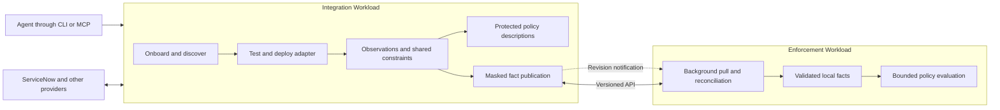

# RFC 010 Integration architecture and end to end MVP

**Status:** Draft discovery
**Created:** 2026-10-18
**Updated:** 2026-10-18
**Foundation:** [RFC 009](009-runtime-facts-and-policy-language.md)
**Review gates:** [Adversarial review](010-adversarial-boundary-review.md)

## Architecture

Use two workloads. The **Integration Workload** owns credential-isolated connections,
first-class discovery, agent-authored adapters, shared domain models and publication.
The **Enforcement Workload** synchronizes selected facts and evaluates explicit local
policies. Evaluation never waits for discovery, an adapter, a network refresh or
security elevation.

External constraints project through the shared domain model into policy descriptions.
Importing a description does not activate an IPE rule. Facts, constraints, and external
outcomes stay distinct. Need-to-Know Policy Access protects descriptions and action
information; stable opaque references replace topology and secret-bearing links.
Masking changes disclosure, never whether an applicable rule is enforced.

Agent packages contain provider-specific descriptors and semantic mappings. The
native platform owns authentication, transport, retries, checkpoints, sandbox limits,
release controls and publication. Package deployment does not require rebuilding
the workload when it uses existing native capabilities.

## Design ownership

Each contract has one design owner below. These are review boundaries, not new services.
Area roadmaps use the same MVP milestones; later work is not a prerequisite for the MVP.

| RFC | Functional area | Owns |
| --- | --- | --- |
| [011](011-agent-integration-toolkit.md) | Agent toolkit and lifecycle | CLI/MCP/API affordances, replay/shadow tests, stage/plan/apply, upgrade/rollback |
| [012](012-integration-runtime-and-discovery.md) | Runtime and discovery | Credential onboarding, broker, metadata discovery, adapter execution and package contract |
| [013](013-domain-constraints-and-projections.md) | Domain and projection | Observation/constraint/outcome schemas and shared policy descriptions |
| [014](014-fact-publication-and-synchronization.md) | Synchronization | Push notifications, pull, revisions, expiry, recovery and enforcement isolation |
| [015](015-policy-access-and-identities.md) | Access and identity | Opaque references, permitted fields, masking and elevation requirements |
| [016](016-integration-signals-and-audit.md) | Signals and audit | Health, delivery visibility, protected evidence and forensic reconstruction |

## First integration and MVP proof

**Start with ServiceNow credential onboarding and discovery.** The agent should not
need to know the application or remediation table in advance. An operator supplies
an authorized connection through a protected path; the agent receives an opaque
reference and discovers what that credential can inspect. Metadata denial is unknown
visibility, not evidence that no constraints exist.

Use a lightweight HTTPS ServiceNow-style stand-in for the initial executable proof.
It supports synthetic metadata, access gaps and fault scenarios. The same workload
and clients must support an operator-configured real HTTPS connection. Stand-in
success is not live ServiceNow validation and must be labeled accordingly.

After discovery, choose one accessible tracked remediation record and one evidence
relationship. Model a supported constraint where source semantics are accessible;
retain all unavailable/scripted conditions as opaque. Publish only facts needed for
one deliberately authored local guard, such as requiring current verification
and approval evidence before a proposed remediation action. This is an IPE policy
check, not a claim that ServiceNow will accept a transition.

| Milestone | End-to-end demonstration | Required proof |
| --- | --- | --- |
| M1 onboarding and discovery | Deploy standalone Integration Workload plus stand-in; CLI and MCP check an opaque connection and discover metadata | Same authorized results through both clients, explicit coverage gaps, bounded requests, no credential/topology leakage |
| M2 agent iteration | Agent scaffolds a package, changes a mapping, runs replay tests and stages shadow reads | Identical runtime mechanics; private sinks/checkpoints; no native rebuild for supported package changes |
| M3 evidence to decision | Deploy tested package; observe a selected ServiceNow record; project a description; notify/pull facts into separate Enforcement Workload | Expected local allow/deny/indeterminate cases; catalog-only changes do not change enforcement; missed notification and expiry handled |
| M4 operational proof | Upgrade and compatible rollback, restart both workloads, terminate integration, inspect masked audit record | Single publisher, stable identities, no expiry renewal, local decisions remain bounded, authorized reconstruction and scoped elevation expiry |

M1 is the initial vertical slice. The end-to-end MVP comprises M1–M4; do not describe
M1 as having guest deployment, policy synchronization or forensic retention until
those milestones exist. The live M3 trial requires a credential with sufficient
record access and an explicitly selected resource after M1 discovery. If only
metadata is accessible, report that limitation and retain the stand-in proof.

## Acceptance evidence and scope

Keep repeatable commands and machine-readable reports for each milestone, recording
artifact/runtime versions, test mode, fixture identity, assertions and failures.
The deployment demonstration starts the real standalone binary and exercises CLI
and MCP, not mocked client handlers. Live reports identify scope through opaque IDs.

The security proof covers authentication, resource bounds, hostile upstream payloads,
partial discovery and masked errors. The reliability proof covers restart, duplicate
notifications, source failures and expiration. Before M3, fix workload size, sample
count, admitted write rate, absolute p99 latency and availability budgets; M4 reports
measured values and relative regression against a disabled-integration baseline.
No latency or security guarantee follows merely from drawing two workloads.

The MVP excludes upstream remediation writes, automatic ticket closure, universal
SAP/BPM translation, arbitrary guest HTTP, multi-region synchronization, arbitrary
checkpoint migrations, and a general workflow engine. These exclusions do not relax
isolation, expiry or information-release controls. Enterprise identity-provider
integration may follow the minimal scoped elevation proof.

## Implementation grounding

The initial M1 implementation is [ipe-integration](../crates/ipe-integration/src/lib.rs),
with [CLI/MCP access](../scripts/integration-toolkit.py), a reusable HTTPS stand-in,
and [deployment/acceptance commands](../docs/INTEGRATION_DISCOVERY.md). It proves
bounded credential-first metadata discovery locally. It uses a fixed native recipe,
one operator scope, and secret-keyed opaque identity derivation; it does not yet
provide an adapter sandbox, dynamic deployment, source finding retrieval, fact
synchronization, a general identity vault, or durable forensic audit. M2–M4 remain
design work. No live ServiceNow tenant validation is claimed.

Verified against the repository on 2026-10-18. [Runtime data documentation](../docs/RUNTIME_DATA.md)
remains the reference for implemented behavior. The capabilities above are proposed.

| Current implementation | Design consequence |
| --- | --- |
| [FactStore](../crates/ipe-core/src/runtime_facts.rs): typed scoped facts, finite TTL, conditional writes and complete snapshots | Reuse validation semantics; add original-deadline and stream position/epoch durability contracts |
| [Server runtime](../crates/ipe-server/src/runtime.rs): fixed HTTPS polling in server tasks; local evaluation | New integration execution belongs in the Integration Workload, not these tasks |
| FactStore snapshot cloning and synchronous persistence share a state mutex | Separate workloads still need bounded ingestion and contention measurements; investigate immutable published views |
| [PolicyDocument](../crates/ipe-core/src/policy_document.rs) models executable sections; active documents participate in decisions | Add distinct domain constraint and description types outside the enforcement catalog |
| Managed document evaluation prepares revisions and reaches compilation | Investigate preparing immutable revisions at publication/recovery; discovery growth must not increase evaluation work |
| External provenance contains `locator`; evaluation returns that provenance | Version and migrate outward projections, including stored documents and trace paths, before claiming topology protection |
| [ipe-wasm](../crates/ipe-wasm/Cargo.toml) uses wasm-bindgen | It is not a guest adapter host; engine choice remains open |
| Existing inspection is scope-level; historical facts and complete audit retention are not provided | Need-to-know projection, elevation, protected evidence retention, and audit spool require new contracts |

Preserve existing executable-policy semantics during migration. Do not silently
reclassify imported executable documents as descriptions. Retain restricted audit
originals where permitted, while sanitizing outward access. No source or credential
may be granted broader authority merely to make migration convenient.

## Review and iteration

Review the area contract before its implementation slice; resolve cross-area changes
in this overview only when ownership or MVP behavior changes. Keep detailed schemas,
roadmaps and acceptance criteria in the owning RFC. The adversarial gate register
links each risk to an owner; a design mitigation alone does not close a gate.
