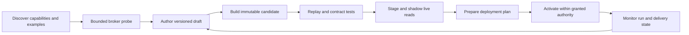

# RFC 011 Agent integration toolkit and deployment lifecycle

**Status:** Draft discovery
**Created:** 2026-10-18
**Depends on:** [RFC 010](010-remediation-adapters-and-external-policy-discovery.md)

## Purpose and boundary

**Initial implementation:** the [discovery toolkit](../docs/INTEGRATION_DISCOVERY.md)
exposes capability listing, connection checks and metadata discovery through a
[Rust CLI and MCP stdio client](../crates/ipe-integration/src/bin/integration-toolkit.rs).
The Rust acceptance/deployment harness uses a TypeScript HTTPS test facade. Discovery
executes a hosted WASM metadata mapping; artifact selection is operator configuration
at startup, not an agent deployment tool. The remaining lifecycle operations in
this RFC are proposed, not
advertised as available tools by that slice.

**Stack grounding:** the toolkit now uses official `rmcp` 3.5.1 for MCP protocol
and typed tool handlers with generated schemas. A small transport guard retains
bounded framing, duplicate-key rejection and sanitized diagnostics. Streamable
HTTP remains proposed. `clap` and secret wrappers are the next reuse candidates;
see the [stack and crate reuse audit](../docs/INTEGRATION_STACK.md) for ownership,
compatibility constraints and regression gates.

Provide an agent-neutral **Integration Toolkit** for discovering capabilities,
probing connections, authoring adapters, testing, staging, deploying, upgrading,
and observing integrations. The toolkit runs inside the Integration Workload and
uses its sandbox, native broker, registry, and publication controls. Agents can
iterate at runtime without rebuilding the workload for each supported provider.

Expose one versioned typed API through generated SDK/CLI bindings and an MCP tool
surface. All entry points use the same authorization, execution, and audit paths.
An agent may run externally or in a hosted authoring sandbox; it never gains the
host's ambient credentials. The integration service owns durable execution, so
runs and deployments survive an agent disconnect and another authorized agent can
resume work from IDs and recorded state.

The Enforcement Workload remains a consumer of RFC 010's sanitized publication
feed. Authoring tools cannot activate executable policies, invoke adapter code on
evaluation, or change enforcement access rules. Live integration means authorized
observation and publication; changing upstream business records remains a separate
executor capability.

This RFC proposes affordances and lifecycle semantics, not existing tool names or
implemented APIs. It specializes RFC 010 rather than replacing its contracts.

## Design grounding

| Grounding | Implication |
| --- | --- |
| [Airbyte Connector Builder](https://docs.airbyte.com/platform/connector-development/connector-builder-ui/overview) uses declarative manifests with authentication, pagination, incremental sync and error handling components | Provide reusable native recipes and editable descriptors rather than making agents write transport machinery |
| Airbyte documents that [builder tests omit retries](https://docs.airbyte.com/platform/connector-development/connector-builder-ui/error-handling) | For IPE, use production retry logic with a virtual clock in offline tests; disclose all live-test limit differences |
| [MCP tools](https://modelcontextprotocol.io/specification/2025-11-25/server/tools) provide discoverable schemas and structured results; [authorization](https://modelcontextprotocol.io/specification/2025-11-25/basic/authorization) is separate | MCP is a client interface, not the trust boundary. Tool annotations cannot confer authority or enforce side-effect limits |
| [OpenTelemetry signals](https://opentelemetry.io/docs/concepts/signals/) distinguish traces, metrics and logs | Collect host-generated signals across broker, sandbox, publication and delivery, with explicit masking before export |
| Existing [scenario runner](../crates/ipe-core/examples/policy_scenarios.rs) and [HTTP acceptance suites](../acceptance/runtime-data/README.md) exercise isolated fixtures and explicit clocks | Reuse test patterns, not an assumed adapter harness. Adapter staging, deployment and run APIs do not exist yet |
| Existing [policy publication](../docs/RUNTIME_DATA.md#policy-management-and-candidate-testing-api) activates immediately | It is not a draft registry or integration deployment endpoint; the toolkit needs distinct resources |

These sources support individual patterns, not a conclusion that their frameworks
meet IPE's isolation or confidentiality requirements. Provider and runtime choices
remain governed by RFC 010's discovery gates.

## Agent journey



Expose the next valid operations and unmet requirements on every resource. A new
agent should not need hidden conversation context, a proprietary skill, a particular
model, or shell access to understand the workflow. Optional skills can guide usage
but are not prerequisites or authorization mechanisms.

### Discovery and scaffolding

`capabilities.describe` returns protocol versions, supported recipes and SDK version,
domain schemas, limits, optional features, authorized connection references, and
operation effects. `examples.list/get` exposes versioned minimal packages with
fixtures, expected outputs, and explanations. `drafts.create/update` produces a
workspace with manifest, descriptors, mapping source, and fixture references.
Edits use expected draft revisions to protect concurrent agent work.

Supply examples for paginated finding retrieval, incremental updates with deletes,
constraint discovery with opaque rules, outcome observation, and a findings-to-ticket
join with distinct authorities. Include permission-denied, throttling, missing links,
reopening, partial pages, and schema drift. Synthetic examples contain no live
identifiers or credentials. Reuse approved packages before creating new adapters.

### Functional probing

Connection onboarding and bounded discovery are first-class capabilities owned by
[RFC 012](012-integration-runtime-and-discovery.md). An agent first lists authorized
connection references, checks access, and discovers permitted resources and schemas;
it selects business record types from that report, not before it.

`probes.run` executes a named authorized broker operation against an opaque connection
and resource selection. It can inspect permitted response shapes, page behavior,
source revision/observation fields, and normalized error categories. It returns a
bounded sanitized sample, coverage limits, timing, and opaque receipt references.
Authentication, backoff and pagination helpers are available directly, using the
same engine used by installed adapters.

A probe grants neither arbitrary HTTP nor network discovery. It cannot provide URLs,
credentials, unconstrained queries, or publish facts. New descriptors are validated
and intersected with installation/resource grants before use. Missing privileges
return safe elevation requirements. Live read probes consume provider quota and may
create provider access logs; budgets and effect declarations must reflect that.
Operations with business side effects are excluded from read probing.

`fixtures.capture` converts an authorized probe result into a private fixture with
explicit retention, sanitization, and sharing rules. Stable synthetic aliases keep
joins testable without exporting real identities. Capture is a separate data-release
operation, not an implicit entitlement of connection use. Hidden fields remain
hidden; an agent sees coverage gaps instead of fabricated representative data.

Operational signal semantics are owned by [RFC 016](016-integration-signals-and-audit.md);
all outputs follow [RFC 015](015-policy-access-and-identities.md).

## Toolkit operations and resources

Names below are illustrative groups over the same API. Tools should have narrow,
typed inputs rather than a general command runner.

| Operations | Durable resource or result | Required authority |
| --- | --- | --- |
| `capabilities.describe`, `connections.check`, `discovery.run`, `examples.get` | Authorized schemas, recipes and examples | Discover |
| `drafts.create/update`, `candidates.build` | Draft revision, immutable candidate digest, build report | Author/build in a scoped sandbox |
| `probes.run`, `fixtures.capture` | Probe job, sanitized sample, private fixture | Connection/resource read; separate capture grant |
| `tests.run`, `reports.get` | Immutable report tied to candidate and runtime digest | Test; access to selected fixtures |
| `stages.create`, `runs.start` | Isolated stage and replay or shadow run | Stage; live-read grant for shadow |
| `deployments.plan`, `deployments.apply` | Immutable plan and installation revision | Inspect deployment; separate deployment grant |
| `installations.get`, `signals.query/watch` | State and bounded signal pages/events | Scoped operational visibility |
| `runs.cancel`, `installations.pause/resume` | Acknowledged control operation | Operate installation |
| `deployments.rollback`, `installations.retire` | New desired revision or retirement record | Change deployment within granted scope |

Long operations return a durable job ID, status, bounded progress events, report
references, and a resumable event cursor. Mutation APIs require idempotency keys;
configuration changes additionally use expected revisions. Unknown outcomes are
resolved by lookup, not blind resubmission. Cancellation is cooperative and records
what completed; it does not undo upstream reads or already committed publication.

Results include stable error codes, retry guidance, field-level validation paths,
resource revision, and permitted next operations. Access denials return safe unmet
authorization requirements separately from retryable operational failures. Every
read and watch rechecks current access; clients cannot retain a privileged stream
after its grant expires. Discovery itself must not enumerate forbidden resources.

## Testing and staging contract

| Mode | Inputs and execution | Publication |
| --- | --- | --- |
| Replay | Synthetic or authorized captured fixtures, controllable clock, injected faults | Private stage only; no provider connection |
| Live probe | Bounded broker operation against authorized resources | None |
| Shadow | Full candidate against bounded live reads or an authorized recorded stream | Isolated sink and private checkpoint namespace |
| Active | Installed candidate under schedule and budgets | Only assigned production destinations |

Use identical decoder, mapping, sandbox, validation, retry, checkpoint, masking,
and publication-envelope logic across modes. Swap transport, clock, and destination
through explicit harness interfaces. Every report records substitutions and reduced
limits. Replay with accelerated time must still execute retry state transitions.
A simulation flag alone cannot prevent production writes: sandbox grants and sink
bindings enforce separation.

Test output includes request/record counts, schema errors with paths, normalized
domain objects, constraint coverage, masking violations, checkpoint transitions,
and expected-versus-actual diffs. A test corpus pins candidate, SDK/runtime version,
domain schema, descriptor version, fixtures, clock, and expectations. Platform-owned
conformance tests are separate from agent-editable fixture assertions; an agent
cannot make deployment eligible merely by weakening its own expectations.

Include faults for throttling, timeouts, expired credentials, malformed data,
repeated cursors, replay, deletes, crashes, partial snapshots, and stale observations.
Compare policy-description projections and a local simulated consumer's fact
acceptance. Testing a simulated consumer is not a production authorization decision.

Shadow runs use independent checkpoints and may not advance or reset production
state. Compare candidates against the same captured inputs when possible; different
live-read times can explain differences. Report sample coverage and changes in
negative assertions, deletions, identities, constraint completeness, and expiry.
A bounded sample never proves collection completeness or semantic fidelity.

## Deployment and upgrades

Keep three resource types distinct: immutable **candidate**, isolated **stage**, and
live **installation**. Test reports attach to candidates and configuration digests;
installation status must not be a mutable "tested" label on editable source.
An installation reports desired revision, effective revision, health, last successful
run, and publication/delivery positions separately.

A deployment plan pins candidate digest, installation/configuration revision,
connection grants, domain schemas, field-release policy, checkpoint compatibility,
required reports, budgets, and rollout strategy. Show changes in capabilities,
resource scope, output meaning, identities, retention, and expected write volume.
Return unmet requirements, expiration, and an immutable plan digest.

`deployments.apply` rechecks authority and dependencies and compares the expected
installation revision. It activates exactly the planned artifact and configuration;
changed inputs require a new plan. Activation can be automatic within existing
operator grants and platform gates. Require elevation or approval only where the
configured policy requires it, with explicit reasons. Deployment authority does not
include expanding one's own grants or changing executable enforcement policy.

An upgrade stages and shadows a new candidate before transferring production
ownership. Fence the old publisher before the replacement can commit. A stable
native publisher maintains the ordered feed; changing a semantic package does not
by itself reset source sequence or discard checkpoints. If producer epoch changes,
use RFC 010's authenticated transition. In-flight old outputs are either committed
before the cutover boundary or rejected afterwards.

Checkpoint compatibility is explicit: reuse, bounded platform-validated migration,
or fresh snapshot. Test migration on copied state and preserve a recovery point.
Schema or identity changes may need a new collection and coordinated consumer
configuration; they cannot masquerade as an in-place hot update.

Start rollout with isolated shadow, then one complete scoped stream or explicitly
independent partition. Do not percentage-sample a collection and publish it as a
complete snapshot. Only one authority writes each production stream at a time.
Bound initial activation rate and watch semantic drift as well as process health.

Rollback is a new deployment of a prior compatible package, not rewinding evidence
or stream positions. Recollect or reconcile facts already published incorrectly;
report impact while they expire or are explicitly superseded. Irreversible schema
or checkpoint migrations may require resynchronization instead of automatic rollback.
An automated rollback must itself pass compatibility and authorization checks.

Pause stops new collection work; revoke/fence when immediate publication cessation
is required. Resume cannot renew old evidence. Retirement does not imply deleting
all facts or creating negative assertions: retained facts expire, while explicit
withdrawal uses a separately authorized, visible publication operation. Reports
explain the freshness and enforcement impact of each control action.

## Example agent session

Illustrative calls, not a shipped SDK:

```text
capabilities.describe(scope_ref)
examples.get("findings-with-remediation-link", version)
probes.run(connection_ref, operation_ref, resource_refs, budget)
drafts.create(example_ref, domain_schema_ref)
drafts.update(draft_ref, expected_revision, descriptor_and_mapping)
candidates.build(draft_ref, revision)
tests.run(candidate_digest, fixture_suite_ref, profile="conformance")
stages.create(candidate_digest, isolated_configuration)
runs.start(stage_ref, mode="shadow", budget)
reports.get(run_ref)
deployments.plan(installation_ref, candidate_digest, expected_revision)
deployments.apply(plan_ref, plan_digest, idempotency_key)
signals.watch(installation_ref, cursor)
```

The agent receives enough structured evidence to repair mappings, retest, and prepare
a new plan. Credentials, raw URLs, provider installation internals, and production
checkpoint manipulation are never required. Another authorized agent can retrieve
the same draft, plan, reports and run history to continue the work.

## Area roadmap

| Phase | Deliverable | Proof |
| --- | --- | --- |
| M1 onboarding and discovery | Capability/check/discover API, CLI and MCP access | An agent starts with an opaque configured connection and discovers candidates without selecting a table beforehand |
| M2 adapter iteration | Example, draft/build, replay report and isolated stage | Agent repairs a failed fixture and produces a pinned candidate |
| M3 first live integration | Shadow, plan/apply and installation status | Tested candidate becomes the sole authorized publisher without rebuilding the workload |
| M4 operational proof | Compatible upgrade, rollback, pause and agent handoff | Revision checks prevent races; rollback does not rewind evidence |
| Later | Rich SDK generation, fixture capture UX, resumable watches and broader rollout | Same authorization and semantics through every client |

## Review questions

- Which minimum tools let a fresh agent complete onboarding and discovery without hidden context?
- Which gates must be platform-owned rather than editable fixture assertions?
- What state must survive agent and workload disconnects?
