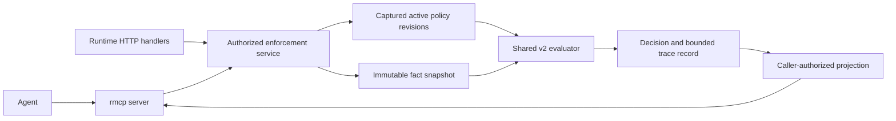

# RFC 017: Enforcement MCP surface for inspection, execution, and tracing

**Status:** Draft design; the tools and service changes below are proposed.
**Created:** 2026-10-18
**Baseline:** `f360035` (current v2 runtime and integration toolkit).
**Related:** [runtime language](009-runtime-facts-and-policy-language.md),
[agent toolkit](011-agent-integration-toolkit.md),
[disclosure](015-policy-access-and-identities.md), and
[audit](016-integration-signals-and-audit.md).

## 1. Decision and agent workflow

Add an enforcement MCP server using the official Rust SDK, `rmcp`, already used by
`ipe-integration`. Give an agent a short, typed workflow:

1. Discover its authorized scope, operations, limits, and request schema.
2. List applicable policy definitions and inspect a particular immutable revision.
3. Execute the complete active policy set against supplied input and current facts.
4. Read the captured explanation and execution trace for that exact evaluation.
5. Test a candidate policy in isolation, with an explicit simulation result.

Here, execution computes an authorization decision. The application enforcement
point still controls the protected operation. An `allow` response does not execute
a deployment, change a business record, publish a policy, or mint a reusable grant.

The critical invariant is **one execution produces both the decision and its
trace**. A subsequent trace request must never rerun the policy against newer facts
and present that run as the explanation of an earlier decision.

## 2. Current implementation and gaps

| Existing surface | Available behavior | Work needed for this proposal |
| --- | --- | --- |
| `runtime.rs::evaluate` | Complete bootstrap and active-document evaluation; one fact snapshot; completion-time expiry check | Shared typed result, policy-set identity, capture and bounded retention |
| `catalog` / `inspect_document` | Input and collection schemas, compiled policies, immutable document revisions | Agent-safe projections, opaque references, bounded listing |
| `test_document` | Candidate evaluation; requires `inspect` and `evaluate`; never publishes | Same result and trace model as active evaluation |
| `CompiledPolicy::evaluate` | Four outcomes, failure category, earliest evidence deadline | Optional bounded event sink and stable node identities |
| `PreparedDocument::evaluate` | Document/section results and source pointers | Trace association and safe section references |
| Integration toolkit | `rmcp` 3.5.1 tool macros, stdio, strict JSON framing, sanitized errors | Reuse SDK conventions and reviewed boundary utilities |

References: [runtime handlers](../crates/ipe-server/src/runtime.rs),
[policy evaluator](../crates/ipe-core/src/runtime_policy.rs),
[document evaluator](../crates/ipe-core/src/policy_document.rs), and
[existing MCP toolkit](../crates/ipe-integration/src/bin/integration-toolkit.rs).

Current response objects are not an agent release schema: document provenance can
include `external.locator`, source pointers, publisher identity, raw rule source,
and debug-formatted failure text. Do not expose them by forwarding arbitrary JSON.
[RFC 004](004-low-overhead-execution-tracing.md) describes the earlier bytecode/JIT
architecture; its full-context capture and performance targets are not implemented
v2 tracing guarantees. This proposal instruments the v2 evaluator directly.

## 3. Rust service and transport ownership



Extract the runtime operations from private Axum handlers into a library service
in `ipe-server`. HTTP and MCP adapters call the same authorization, evaluation,
projection, and record-retention code. The core evaluator remains independent of
MCP. Retain the existing HTTP contract through an adapter; test semantic parity.

Use `ServerHandler`, `#[tool_router]`, `#[tool]`, `#[tool_handler]`,
`Parameters<T>`, and `ServiceExt`. Derive request and response schemas from shared
Rust DTOs with Serde and Schemars. Begin with the repository's locked `rmcp` 3.5.1;
an SDK upgrade is a separate compatibility change. The SDK owns negotiation,
JSON-RPC dispatch, lifecycle, and cancellation notification delivery.

Two deployment forms share the tool contract:

- **Local first:** an `ipe-enforcement-toolkit mcp` stdio process uses an
  operator-configured endpoint and scoped credential to call typed runtime routes.
  It opens no database and performs no independent evaluation. Use the existing
  bounded framing/strict-decoding pattern around the SDK; keep stdout protocol-only.
- **Hosted:** mount the SDK's `StreamableHttpService` at `/mcp`, calling the library
  service in process. Enable `transport-streamable-http-server`; integrate its
  Tower service with Axum. Bind each request to authenticated principal context.
  Release this form only with the remote authorization contract below.

The local bridge needs additive HTTP routes for capabilities, projected policies,
evaluations, and evaluation traces. Define those DTOs once and reuse them in MCP.
Do not depend on the integration workload or provider credentials. Facts are
already local when evaluation begins.

This follows the [official Rust SDK](https://github.com/modelcontextprotocol/rust-sdk)
and MCP's [stdio/Streamable HTTP transports](https://modelcontextprotocol.io/specification/2025-11-25/basic/transports).
The existing custom SSE/JSON proposal is not the transport contract for this work.

## 4. Proposed tools

All tools use snake_case names, closed argument schemas, and a versioned object
result. Each scoped call requires an opaque `scope_ref` issued to this principal;
there is no ambient scope selection. References identify objects, never authority.

| Tool | Arguments beyond `scope_ref` | Result / required authority |
| --- | --- | --- |
| `enforcement_capabilities` | No arguments, including no `scope_ref` | Authorized scope refs, operations, schema version, limits and supported trace levels; authenticated principal |
| `policy_list` | `limit`, optional `cursor` | Visible active bootstrap/document summaries, `policy_set_ref`, continuation; `inspect` |
| `policy_inspect` | `policy_ref`, immutable `revision_ref` | Released source/sections, request schema, typed dependencies, static coverage gaps; `inspect` |
| `policy_evaluate` | `input`, optional `expected_policy_set_ref`, `trace_level` | Full active-set decision and `evaluation_ref`; `evaluate`, plus `inspect` for detailed trace |
| `policy_test` | `candidate`, `input`, `trace_level` | Isolated simulation, compilation diagnostics, candidate identity and evaluation record; `inspect` + `evaluate` |
| `evaluation_get` | `evaluation_ref` | Previously captured decision, context identities, retention deadline; owner + current `evaluate` |
| `evaluation_trace` | `evaluation_ref`, optional `cursor`, `limit` | Captured authorized events and completeness metadata; owner + current `inspect` + `evaluate` |

`trace_level` is `none`, `summary` (default), or `steps`. Summary contains released
reason codes and section outcomes; steps adds execution events. Authorization is
checked before execution: an unauthorized `steps` request fails, rather than
silently pretending that detailed capture succeeded. A decision-only principal
receives only the safe summary allowed by its grant.

`policy_inspect` distinguishes static dependencies from dependencies actually read
in an evaluation. It does not fetch arbitrary fact values. Input schemas are
released to inspect-authorized callers through capabilities/inspection; an
evaluate-only caller uses an operator-provisioned request contract. Missing schema
visibility must be explicit. Raw policy data, source literals, and source text
require a release rule; a policy summary can remain useful when source is withheld.

`policy_evaluate` always includes every active bootstrap policy and document in
the scope, including hidden rules. It has no policy subset, fact override, caller
clock, source URL, or arbitrary expression argument. `policy_test` accepts exactly
one bounded `PolicyDocument` candidate and current facts. It never substitutes
that candidate into the live set; all candidate results have `simulation: true`.
Historical-revision testing and synthetic fact fixtures are later extensions.

For listing, use a bounded, short-lived captured catalog view. Cursors bind the
principal, scope, catalog view and position; current authorization is rechecked
on every page. Expired views require a fresh listing. Masked entries and counts
follow RFC 015. A catalog view pins definitions only, not runtime facts.

Use MCP structured content with an output schema and matching serialized JSON
text for compatible clients. Return a discriminated `result` or `error` envelope;
all structured responses conform to the advertised schema. Unknown tools and
malformed MCP frames are protocol errors. Domain failures such as invalid policy,
forbidden operation, stale reference, busy, or missing evaluation are tool errors
with `isError: true` and stable codes. A valid evaluation yielding deny or
indeterminate is a successful tool call. This follows the MCP
[tools contract](https://modelcontextprotocol.io/specification/2025-11-25/server/tools).

Annotate inspection tools `readOnlyHint: true`, `openWorldHint: false`. Evaluation
and testing create retained diagnostic records: conservatively advertise
`readOnlyHint: false`, `destructiveHint: false`, `idempotentHint: false`, and
`openWorldHint: false`. Retrying can observe new facts and creates a new record.
Annotations describe effects; the service enforces authority.

## 5. Decision and consistency contract

Example proposed `policy_evaluate` arguments and the inner result payload:

```json
{
  "scope_ref": "scp_7q",
  "expected_policy_set_ref": "ps_8m",
  "input": {"enabled": true},
  "trace_level": "steps"
}
```

```json
{
  "schema_version": 1,
  "evaluation_ref": "ev_4n",
  "simulation": false,
  "decision": "deny",
  "evaluation_status": "indeterminate",
  "reason_codes": ["required_evidence_expired"],
  "context": {
    "policy_set_ref": "ps_8m",
    "fact_snapshot_ref": "fs_2k",
    "evaluated_at": 1792368000,
    "completed_at": 1792368000
  },
  "evidence_deadline": null,
  "trace": {"capture": "steps", "completeness": "complete"},
  "record_expires_at": 1792368600
}
```

The service captures one fact snapshot and the active document revisions plus
bootstrap configuration for the run. Those stores are captured separately today:
this is a recorded pair, not an atomic transaction across policy and fact writes.
Once captured, neither side changes during execution. Preserve that distinction
in the public consistency description.

`policy_set_ref` identifies the complete captured set, including bootstrap source
and schema identities. Compare `expected_policy_set_ref` to the set actually used;
a mismatch fails before evaluation. An expired or unknown set reference returns `policy_set_unavailable`,
never an implicit fallback to current policies. Without it, run the current captured set and
report its identity. The check does not freeze future policy publication.
References are opaque, instance-bound handles; keep raw content hashes and complete
revision vectors internal unless their disclosure is authorized. Hidden rule
membership must not become enumerable through the reference.

`fact_snapshot_ref` is an observation identifier, not a historical-read token.
The current store retains latest values, so neither it nor a numeric revision can
reconstruct expired or replaced evidence. The
[fact retrieval proposal](../docs/rfcs/0003-fact-retrieval-api.md) is not a replay
facility. This design retains an explanation, not an executable replay snapshot.

Preserve runtime semantics: deny overrides indeterminate, indeterminate blocks
allow, and at least one applicable allow is required. An all-inapplicable set
returns `decision: deny`, `evaluation_status: deny`, with a safe
`no_applicable_policy` reason where disclosure permits. Section outcomes retain
`not_applicable`. Unsupported external sections remain indeterminate.

Use trusted server time and recheck the earliest consumed-evidence or external
policy deadline at completion. Equality is expired. Trace preparation and record
admission must not let an expired allow escape: perform the final check immediately
before finalizing the response/record, and record any decision change. Clock failure
is an execution error, never an allow. A trace overflow alone does not change the
policy result.

Record reads are explicitly historical (`historical: true`,
`usable_for_enforcement: false`); they do not refresh evidence. Even a newly returned
allow is a point-in-time decision, not a lease until `evidence_deadline`: policy
and fact changes can invalidate it earlier. Clients must not cache it as authority
for a later protected operation. Retry explicitly for a new evaluation.

## 6. Trace model and lifecycle

Add an optional bounded observer to `CompiledPolicy` and `PreparedDocument`.
Assign deterministic node IDs within an immutable revision and retain permitted
source spans at compilation. Source lookup always uses that revision. The
untraced and traced paths execute the same evaluator with identical policy budgets;
do not implement an explanatory interpreter in the MCP adapter.

Events describe actual execution:

| Event | Meaning |
| --- | --- |
| `policy_started` / `section_started` | Exact revision/section entered |
| `trigger_result` | True, false, or evaluation failure |
| `dependency_resolved` / `dependency_failed` | Released binding ref, evidence state, authorized revision/expiry metadata |
| `expression_result` | Node ref, typed outcome; operands omitted by default |
| `branch_skipped` | Short-circuit, false trigger, or prior failure; never fabricated false |
| `policy_result` / `section_result` | Allow, deny, indeterminate, or not applicable |
| `decision_combined` | Runtime combination outcome and safe reason code |
| `completion_checked` | Deadline/clock outcome and final decision |

Events have ordered sequence numbers and parent node/section references. After a
true trigger, declared dependencies resolve before requirements; if resolution
fails early, later dependencies are marked unvisited rather than reported as
resolved. A false trigger does not read its dependencies. Preserve these existing
v2 semantics in explanations.

Capture IDs, typed outcomes and bounded metadata, not full input or fact payloads.
Sanitize before retention and apply current authorization again at read time.
Any later value-tracing extension needs explicit field grants. Text from policy
source, titles and unsupported-section reasons is untrusted data, never tool
instructions. Do not interpolate it into server instructions or diagnostic codes.

The record contains the decision, captured context references, permitted events,
trace completeness, and separate redaction state. `complete` means execution was
fully captured at the requested level; it does not mean all source constraints
are modeled or all data is visible. `truncated` gives a reason (`event_limit` or
`byte_limit`). The final decision and completion check have separately reserved
summary space, so event truncation cannot discard them. `not_captured` is explicit,
and `evaluation_trace` cannot upgrade it by replay. Protected omission counts are
not disclosed.

Retain records for ten minutes in a bounded process-local store, bound to principal
and scope. A completed record survives an MCP session disconnect while the runtime
lives; it does not survive restart. Expiry, eviction, restart and unknown references
return the same safe `evaluation_unavailable` response. Reserve record capacity
before evaluation; return `busy` if admission fails. Never return a dangling
`evaluation_ref` as if capture succeeded. This cache is not RFC 016's durable audit.

Trace cursors bind evaluation, principal, scope, projection version and offset.
Reauthorize each page; invalidate a cursor when disclosure grants change. Retention
expiry ends pagination. Optional MCP resources can later mirror authorized records,
but initial clients need only tools. Do not advertise resources, prompts, sampling,
subscriptions, or asynchronous tasks before their lifecycle exists.

## 7. Authority and bounded execution

Initial inspection and detailed tracing require the existing coarse `inspect`
grant. Candidate testing retains `inspect` + `evaluate`, because arbitrary
predicates can act as a fact-value oracle. Do not grant candidate testing to an
ordinary evaluator. Finer policy/field grants are a later RFC 015 implementation;
MCP naming and redaction alone cannot simulate those grants safely.

Authorize in the shared service on every operation and recheck release authority
before returning captured details. The MCP principal comes from
authenticated transport context; `input` subject fields are application assertions,
not proof of caller identity. Bind protected identity fields server-side where a
deployment requires self-only evaluation. Each record belongs to its calling
principal; support roles need a separately defined read grant before cross-owner
record inspection is possible.

Stdio inherits only its configured scoped credential, supplied outside tool
arguments and command-line values. Hosted MCP requires per-request identity,
audience validation, Origin validation, and the applicable MCP HTTP authorization
flow. Session IDs cannot authorize record access. Do not forward an incoming token
to another resource or substitute an ambient administrator credential. The existing
static runtime bearer configuration is not by itself a complete remote MCP OAuth
implementation. Follow the MCP [authorization specification](https://modelcontextprotocol.io/specification/2025-11-25/basic/authorization).

Proposed initial operator-configurable ceilings (clients may request less):

| Resource | Ceiling / behavior |
| --- | --- |
| Tool input | 512 KiB; candidate document retains the core's 256 KiB limit |
| Complete MCP result | 1 MiB, including structured and text representations |
| Catalog/trace page | Default 50, maximum 100 released entries |
| Trace capture | 512 events and 256 KiB per evaluation; bounded truncation |
| Retention | 256 evaluation records, 64 MiB total; 10-minute TTL; bounded catalog-view store |
| Concurrent evaluation | 2 per principal, 8 per process; admission returns `busy` |
| Evaluation | 5-second cooperative deadline plus aggregate step/item budgets across all policies/sections |

Current `EvalBudget` resets per policy (10,000 steps / 1,000 collection items).
A request-wide meter covering compilation, the full active set, and candidate
preparation is required before exposing agent execution at scale. Size/depth limits
also cover parsing, schema generation, projection and trace serialization.

SDK cancellation must propagate into cooperative checks in the evaluator; merely
aborting an async wait or `spawn_blocking` handle does not stop synchronous work.
Disconnect is not automatically cancellation. A run can finish and retain its
record until its deadline; explicit cancellation stops at bounded checkpoints and
must not produce an allow. Drain workers and release admission permits on shutdown.
Audit records use opaque request/evaluation references and stable status codes;
credentials, raw arguments and fact values stay out of stdout and operational logs.

## 8. Delivery slices and acceptance gates

| Slice | Deliverable | Required proof |
| --- | --- | --- |
| 1: shared service + stdio | Typed projections, capabilities/list/inspect, active evaluate and candidate test through `rmcp`; retained summaries and `evaluation_get` | Existing HTTP outcomes unchanged; MCP schemas and principal/scope isolation verified with an `rmcp` client |
| 2: execution tracing | Stable node refs, observer, bounded step capture and `evaluation_trace` | Trace describes the original run after facts/policies change; no implicit replay; traced/untraced parity |
| 3: hosted transport | SDK Streamable HTTP with complete remote authentication, request identity and lifecycle | Two principals cannot cross-read records or reuse each other's sessions/cursors; Origin and audience rejection |

Advertise only the implemented subset: slice 1 reports `steps` unsupported and
omits `evaluation_trace`; slice 2 completes the inspect/trace/execute workflow.

Acceptance cases must include allow, explicit deny, all-inapplicable, unsupported
external section, expired/missing/stale evidence, and expiry during finalization.
Add concurrent policy publication, expected-set mismatch, scope confusion, candidate
nonpublication, owner isolation, revoked inspection, secret-bearing provenance,
malicious source text, hidden-rule enforcement, and unauthorized source disclosure.
Verify short-circuit/unvisited nodes, truncated traces, page expiry, restart loss,
duplicate JSON keys, oversized outputs, busy admission, and cancellation of a
CPU-bound run. Exercise the real MCP process, including clean stdout and shutdown.
Measure traced/untraced latency and allocation overhead; establish a baseline
before claiming a performance threshold inherited from RFC 004.

## 9. Review decisions

Recommended defaults are seven tools, coarse existing grants for the first local
release, summary capture by default, no value capture, ten-minute local retention,
and active-set execution plus isolated candidate testing. Durable replay, policy
publication, fact enumeration, privilege elevation, and business-action execution
remain separate capabilities with their own contracts. Remote identity-provider
selection and production retention quotas need deployment input before slice 3;
they do not block the local inspect/trace/execute design.
