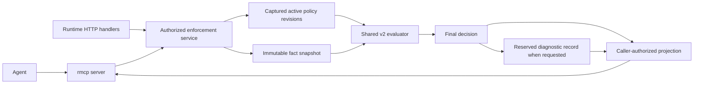

# RFC 017: Enforcement MCP surface for inspection, execution, and tracing

**Status:** Draft design; unified after adversarial review. All service changes remain proposed.
**Created:** 2026-10-18
**Baseline:** `f360035` (current v2 runtime and integration toolkit).
**Related:** [runtime language](009-runtime-facts-and-policy-language.md),
[agent toolkit](011-agent-integration-toolkit.md),
[disclosure](015-policy-access-and-identities.md), and
[audit](016-integration-signals-and-audit.md).

## 1. Decision and agent workflow

Add an enforcement MCP server using the official Rust SDK, `rmcp`, already used by
`ipe-integration`. Give an agent a short, typed workflow:

1. Discover its authorized scope, operations, limits, and request schema.
2. List applicable policy definitions and inspect a particular immutable revision.
3. Execute the complete active policy set against supplied input and current facts.
4. Read the captured explanation and execution trace for that exact evaluation.
5. Test a candidate policy in isolation, with an explicit simulation result.

Here, execution computes an authorization decision. The application enforcement
point still controls the protected operation. An `allow` response does not execute
a deployment, change a business record, publish a policy, or mint a reusable grant.

The critical invariant is **one execution produces both the decision and its
trace**. A subsequent trace request must never rerun the policy against newer facts
and present that run as the explanation of an earlier decision.

## 2. Current implementation and gaps

| Existing surface | Available behavior | Work needed for this proposal |
| --- | --- | --- |
| `runtime.rs::evaluate` | Complete bootstrap and active-document evaluation; one fact snapshot; completion-time expiry check | Shared typed result, policy-set identity, capture and bounded retention |
| `catalog` / `inspect_document` | Input and collection schemas, compiled policies, immutable document revisions | Agent-safe projections, opaque references, bounded listing |
| `test_document` | Candidate evaluation; requires `inspect` and `evaluate`; never publishes | Same result and trace model as active evaluation |
| `CompiledPolicy::evaluate` | Four outcomes, failure category, earliest evidence deadline | Optional bounded event sink and stable node identities |
| `PreparedDocument::evaluate` | Document/section results and source pointers | Trace association and safe section references |
| Integration toolkit | `rmcp` 3.5.1 tool macros, stdio, strict JSON framing, sanitized errors | Reuse SDK conventions and reviewed boundary utilities |

References: [runtime handlers](../crates/ipe-server/src/runtime.rs),
[policy evaluator](../crates/ipe-core/src/runtime_policy.rs),
[document evaluator](../crates/ipe-core/src/policy_document.rs), and
[existing MCP toolkit](../crates/ipe-integration/src/bin/integration-toolkit.rs).

Current response objects are not an agent release schema: document provenance can
include `external.locator`, source pointers, publisher identity, raw rule source,
and debug-formatted failure text. Do not expose them by forwarding arbitrary JSON.
[RFC 004](004-low-overhead-execution-tracing.md) describes the earlier bytecode/JIT
architecture; its full-context capture and performance targets are not implemented
v2 tracing guarantees. This proposal instruments the v2 evaluator directly.

## 3. Rust service and transport ownership



Extract the runtime operations from private Axum handlers into a library service
in `ipe-server`. HTTP and MCP adapters share principal resolution, operation
authorization, evaluation, and disclosure projection. Diagnostic retention is an
explicit execution option with separate admission, not a prerequisite for ordinary
application evaluation. The core evaluator remains independent of MCP.

HTTP compatibility preserves decision semantics, input validation, and failure
behavior; it does not grant lower-trust callers the legacy response's raw
provenance. Introduce explicit credential API profiles: `agent`, `application`,
and `operator_legacy`. An `agent` credential reaches only the projected routes
and cannot use legacy catalog/evaluate/inspect routes, publication, or fact-write
routes. An `application` credential gets the approved decision projection without
requiring diagnostic storage. Existing raw response shapes are transitional,
operator-only access under `operator_legacy`, with explicit grants and audit.
Route authorization runs before decoding or returning data, even for direct HTTP
requests. Never silently assign multiple profiles to an agent credential. Existing
operator credentials require explicit classification during rollout; compatibility
is not a fallback after an agent route denies access.

Use `ServerHandler`, `#[tool_router]`, `#[tool]`, `#[tool_handler]`,
`Parameters<T>`, and `ServiceExt`. Derive request and response schemas from shared
Rust DTOs with Serde and Schemars. Begin with the repository's locked `rmcp` 3.5.1;
an SDK upgrade is a separate compatibility change. The SDK owns negotiation,
JSON-RPC dispatch, lifecycle, and cancellation notification delivery.

Two deployment forms share the tool contract:

- **Local first:** an `ipe-enforcement-toolkit mcp` stdio process uses an
  operator-configured endpoint and scoped credential to call typed runtime routes.
  It opens no database and performs no independent evaluation. Use the existing
  bounded framing/strict-decoding pattern around the SDK; keep stdout protocol-only.
- **Hosted:** mount the SDK's `StreamableHttpService` at `/mcp`, calling the library
  service in process. Enable `transport-streamable-http-server`; integrate its
  Tower service with Axum. Bind each request to authenticated principal context.
  Release this form only with the hosted delivery profile in §8.

The local bridge needs additive HTTP routes for capabilities, projected policies,
evaluations, evaluation traces, and the request-control operations in §7. Define
those DTOs once and reuse them in MCP.
Do not depend on the integration workload or provider credentials. Facts are
already local when evaluation begins.

This follows the [official Rust SDK](https://github.com/modelcontextprotocol/rust-sdk)
and MCP's [stdio/Streamable HTTP transports](https://modelcontextprotocol.io/specification/2025-11-25/basic/transports).
The existing custom SSE/JSON proposal is not the transport contract for this work.

## 4. Proposed tools

All tools use snake_case names, closed argument schemas, and a versioned object
result. The request-control protocol is internal to the adapters; the agent-facing
surface remains these seven tools. Each scoped call requires an opaque `scope_ref` issued to this principal;
there is no ambient scope selection. References identify objects, never authority.

| Tool | Arguments beyond `scope_ref` | Result / required authority |
| --- | --- | --- |
| `enforcement_capabilities` | No arguments, including no `scope_ref` | Authorized scope refs, operations, schema version, limits and supported trace levels; authenticated principal |
| `policy_list` | `limit`, optional `cursor` | Visible active bootstrap/document summaries, `policy_set_ref`, continuation; `inspect` |
| `policy_inspect` | `policy_ref`, immutable `revision_ref` | Released source/sections, request schema, typed dependencies, static coverage gaps; `inspect` |
| `policy_evaluate` | `input`, optional `expected_policy_set_ref`, `trace_level` | Full active-set decision and `evaluation_ref`; `evaluate`, plus `inspect` for detailed trace |
| `policy_test` | `candidate`, `input`, `trace_level` | Isolated simulation, compilation diagnostics, candidate identity and evaluation record; `inspect` + `evaluate` |
| `evaluation_get` | `evaluation_ref` | Captured result projected under current grants; owner + `evaluate` (also `inspect` for candidate results) |
| `evaluation_trace` | `evaluation_ref`, optional `cursor`, `limit` | Captured authorized events and completeness metadata; owner + current `inspect` + `evaluate` |

`trace_level` is `none`, `summary` (default), or `steps`. Summary contains released
reason codes and section outcomes; steps adds execution events. Authorization is
checked before execution: an unauthorized `steps` request fails, rather than
silently pretending that detailed capture succeeded. A decision-only principal
receives only the safe summary allowed by its grant.

`policy_inspect` distinguishes static dependencies from dependencies actually read
in an evaluation. It does not fetch arbitrary fact values. Input schemas are
released to inspect-authorized callers through capabilities/inspection; an
evaluate-only caller uses an operator-provisioned request contract. Missing schema
visibility must be explicit. Raw policy data, source literals, and source text
require a release rule; a policy summary can remain useful when source is withheld.

`policy_evaluate` always includes every active bootstrap policy and document in
the scope, including hidden rules. It has no policy subset, fact override, caller
clock, source URL, or arbitrary expression argument. `policy_test` accepts exactly
one bounded `PolicyDocument` candidate and current facts. Candidate execution
requires authority over the whole scope's fact domain; it cannot be offered as
a masked-field sandbox. It never substitutes
that candidate into the live set; all candidate results have `simulation: true`.
Historical-revision testing and synthetic fact fixtures are later extensions.

For listing, use a bounded, short-lived captured catalog view. Cursors bind the
principal, scope, disclosure epoch, catalog view and visible position; current authorization is rechecked
on every page. Expired or changed-authority views require a fresh listing. Masked entries and counts
follow RFC 015. A catalog view pins definitions only, not runtime facts.

Use MCP structured content with an output schema and matching serialized JSON
text for compatible clients. Return a discriminated `result` or `error` envelope;
all structured responses conform to the advertised schema. Unknown tools and
malformed MCP frames are protocol errors. Domain failures such as invalid policy,
forbidden operation, stale reference, busy, or missing evaluation are tool errors
with `isError: true` and stable codes. A valid evaluation yielding deny or
indeterminate is a successful tool call. This follows the MCP
[tools contract](https://modelcontextprotocol.io/specification/2025-11-25/server/tools).

Annotate inspection tools `readOnlyHint: true`, `openWorldHint: false`. Evaluation
and testing create retained diagnostic records: conservatively advertise
`readOnlyHint: false`, `destructiveHint: false`, `idempotentHint: false`, and
`openWorldHint: false`. Retrying can observe new facts and creates a new record.
Annotations describe effects; the service enforces authority. Each new tool call
creates a new runtime request. Internal transport retries of that same request
never start a second evaluation (§7).

## 5. Decision and consistency contract

Example proposed `policy_evaluate` arguments and the inner result payload:

```json
{
  "scope_ref": "scp_7q",
  "expected_policy_set_ref": "ps_8m",
  "input": {"enabled": true},
  "trace_level": "steps"
}
```

```json
{
  "schema_version": 1,
  "evaluation_ref": "ev_4n",
  "simulation": false,
  "historical": false,
  "decision": "deny",
  "evaluation_status": "indeterminate",
  "reason_codes": ["required_evidence_expired"],
  "context": {
    "policy_set_ref": "ps_8m",
    "fact_snapshot_ref": "fs_2k",
    "evaluated_at": 1792368000,
    "completed_at": 1792368000
  },
  "evidence_deadline": null,
  "trace": {"capture": "steps", "completeness": "complete"},
  "record_expires_at": 1792368600
}
```

The service captures one fact snapshot and the active document revisions plus
bootstrap configuration for the run. Those stores are captured separately today:
this is a recorded pair, not an atomic transaction across policy and fact writes.
Once captured, neither side changes during execution. Preserve that distinction
in the public consistency description.

`policy_set_ref` identifies the complete captured set, including bootstrap source
and schema identities. Compare `expected_policy_set_ref` to the set actually used;
a mismatch fails before evaluation. An expired or unknown set reference returns
`policy_set_unavailable`, never an implicit fallback to current policies. Without
it, run the current captured set and report its identity. The check does not freeze
future policy publication.
References are opaque, instance-bound handles; keep raw content hashes and complete
revision vectors internal unless their disclosure is authorized. Hidden rule
membership must not become enumerable through the reference.

`fact_snapshot_ref` is an observation identifier, not a historical-read token.
The current store retains latest values, so neither it nor a numeric revision can
reconstruct expired or replaced evidence. The
[fact retrieval proposal](../docs/rfcs/0003-fact-retrieval-api.md) is not a replay
facility. This design retains an explanation, not an executable replay snapshot.

Preserve runtime semantics: deny overrides indeterminate, indeterminate blocks
allow, and at least one applicable allow is required. An all-inapplicable set
returns `decision: deny`, `evaluation_status: deny`, with a safe
`no_applicable_policy` reason where disclosure permits. Section outcomes retain
`not_applicable`. Unsupported external sections remain indeterminate.

Use trusted server time and recheck the earliest consumed-evidence or external
policy deadline at completion. Equality is expired. The finalization transition
in §7 checks time, cancellation and current authority before committing a result.
Trace preparation cannot let an expired allow escape. Clock failure is an execution
error, never an allow. Trace truncation alone does not change the policy result.
The release gate is the last check before handing serialized output to transport;
subsequent delivery delay cannot extend the observation's validity.

Record reads are explicitly historical (`historical: true`,
`usable_for_enforcement: false`); they do not refresh evidence. Even a newly returned
allow is a point-in-time decision, not a lease until `evidence_deadline`: policy
and fact changes can invalidate it earlier. Clients must not cache it as authority
for a later protected operation. Retry explicitly for a new evaluation.

## 6. Trace projection and diagnostic retention

### Capture and release schema

Add an optional bounded observer to `CompiledPolicy` and `PreparedDocument`.
Assign deterministic internal node IDs within an immutable revision and retain
permitted source spans at compilation. Source lookup uses that exact revision.
The traced and untraced paths use the same evaluator and policy budgets; the MCP
adapter does not implement an explanatory interpreter.

| Event | Released meaning |
| --- | --- |
| `policy_started` / `section_started` | Authorized policy/revision/section references |
| `trigger_result` | Permitted truth result or stable failure code |
| `dependency_resolved` / `dependency_failed` | Authorized binding ref and permitted evidence state/expiry metadata |
| `expression_result` | Authorized node ref and the closed outcome enum below |
| `branch_skipped` | Permitted short-circuit, false-trigger, or prior-failure reason |
| `policy_result` / `section_result` | Permitted allow, deny, indeterminate, or not-applicable outcome |
| `decision_combined` / `completion_checked` | Final decision and permitted completion reason |

`expression_result.outcome` is a closed tagged enum: `predicate` with an approved
boolean, `evaluated` with no value, `failed` with an allowlisted code, or `skipped`
with an allowlisted reason. Only approved predicate nodes may emit boolean values.
A leaf access to a string, number, object, array or other fact value emits at most
`evaluated`. No `serde_json::Value`, operand, literal, collection length, debug
string or arbitrary error message can enter the event DTO. A failed event may use
the generic `evaluation_failed` code when its detailed category is protected.
Node visibility and predicate-result release are separate checks: knowing a source
span does not authorize learning the value it tests.

After a true trigger, dependencies resolve before requirements; an early resolution
failure leaves later dependencies unvisited. A false trigger reads none of them.
Events reflect those paths and never fabricate a false value for skipped work.
Text in policy source, titles and unsupported-section reasons is untrusted data,
not server instructions. Source release uses the same field allowlist as inspection.

### A trace is a caller-authorized view

Apply a fixed capture release profile before retaining events. Internal node IDs,
sequence positions and hidden-parent references are not public identifiers.
For each released view, renumber visible events densely, allocate opaque view-local
node references, and reparent to the nearest visible ancestor or the view root.
Expose no placeholder for an existence-protected ancestor. Cursor offsets and page
counts refer only to this visible sequence; do not encode internal offsets in IDs.
Do not expose occurrence-count or structural-path information through node aliases.

Events excluded by the capture profile do not consume the released trace's event
or byte budget. All evaluation work still consumes the runtime work budget. This
prevents hidden events from displacing visible events merely by filling the trace
buffer. Capture is bounded without keeping a second unbounded raw trace.

Completeness and disclosure are separate. Where aggregate capture information is
authorized, use `complete`, `truncated` with `event_limit`/`byte_limit`, or
`not_captured`. For a release profile that protects hidden execution existence,
return `not_disclosed` consistently, whether or not this particular run visited
hidden nodes. Do not vary redaction flags, counts, truncation reasons or coverage
claims with hidden execution. `trace_level:none` may still report the caller-known
`not_captured`. Remaining page indicators describe visible entries only.

Reserve summary space for the final decision and completion check independently
of the event buffer. A trace cannot be upgraded by replaying evaluation. Bind each
detailed capture and cursor to its effective release profile and `authz_epoch`.
The effective profile includes credential-specific field/node/aggregate grants and
classification version, not just a role name. After owner and current operation
checks, reject a mismatched profile or epoch with `trace_view_expired`; the caller
must explicitly request a fresh evaluation for a new trace. This applies to both
narrower and broader views. A broad capture may have spent its event budget on
nodes hidden under a later narrow view, so filtering it cannot preserve that
view's visible-event budget guarantee. The first release has no capture tiers
that would make such reuse safe.

Result summaries can still be projected from their separately reserved summary
under current grants; they do not reconstruct details from the event buffer.
Revoking `inspect` denies detailed trace and candidate-result reads. A credential
rotation with unchanged effective authority preserves ownership and view bindings;
it does not reset quotas or cause a new capture.

This is structural and payload disclosure control, not a constant-time guarantee.
The permitted final decision, budget failure, and response timing can still support
inference. Restrict arbitrary candidate predicates to principals authorized over
the scope's complete fact domain; finer predicate-oracle resistance is not claimed.

### Retention and availability

Agent evaluation/test calls reserve result storage before executing, even for
`trace_level:none`. Retain completed records for ten minutes in process-local
memory. Records survive transport disconnect, not runtime restart. Unknown,
expired, restarted and inaccessible references return `evaluation_unavailable`.
This is a diagnostic cache, not the durable audit archive in RFC 016.

Use hard reservations for each configured `(principal_id, scope)` allocation.
Validate reservation sums against the principal, scope and process count/byte
ceilings at startup; reject overcommitted configuration. A credential rotation or
new MCP session cannot create a fresh allocation. A caller exceeding its allocation
receives `busy`; it cannot consume another allocation or evict another owner's
records. The first release has no elastic borrowing or automatic early eviction.
An unconfigured allocation cannot execute diagnostic work. Capabilities reports
its unavailable operation without disclosing other owners or their usage.

Proposed small-deployment defaults are 32 records / 8 MiB per principal, 128 records /
32 MiB per scope, and 256 records / 64 MiB per process. Per-scope allocations for one
principal must share its principal ceiling. Thus eight default-sized principal
allocations fill the process budget; larger deployments must explicitly choose
smaller reservations or larger bounded ceilings. No global count is advertised to
agents. Include reserved in-flight results and retained metadata in accounting.
Cancelled/failed runs release payload reservations; their bounded control receipts
have a separate allocation (§7). Catalog views have separately reserved quotas.

Ordinary application HTTP evaluation uses the same evaluator but does not require
an agent diagnostic reservation. Give it a separate worker/admission pool with
reserved capacity; agent work cannot consume that pool. Diagnostic saturation
must not turn an otherwise admissible application decision into `busy`. All pools
remain bounded, so this does not promise availability under CPU or storage failure.
If a deployment requires durable audit, its separately administered audit policy
can still fail closed when the RFC 016 spool cannot record. Diagnostic retention
must neither satisfy nor bypass that requirement.

## 7. Principal identity, request control, and finalization

### One principal model across transports

The shared service receives a server-constructed `PrincipalContext`: stable
`principal_id`, authorized scope, operation grants, API profile, release profile
and disclosure `authz_epoch`. These are not tool arguments or caller assertions.

Local credential configuration must add an explicit operator-assigned principal
ID. Reject ambiguous credential mappings at configuration load rather than
resolving them by iteration order. The principal ID is unique within the runtime's
administrative identity namespace, never recycled to an unrelated identity, and
independent of token bytes, environment
variable names and MCP sessions. Multiple credentials for that principal share
ownership and quotas; rotation preserves both. Separate principals in the same
scope remain separate owners. Hosted `(issuer, subject)` identities map through
an operator-controlled registry into this same principal type. An issuer-less
subject string or caller-supplied principal ID is insufficient.

Every credential maps to exactly one principal and explicit API profile. Effective
grants still come from the credential and current authorization state; having the
same principal ID does not union privileges from its other credentials. `authz_epoch`
changes on relevant operation grants, API/release profile, or classification
changes. Cached grants fail closed when their freshness cannot be established.
Record ownership is necessary but never sufficient for access. An authenticated
owner can cancel its admitted request after losing execution privilege; it gains
no result visibility through cancellation. A disabled credential still fails
authentication and the request remains bounded by its server deadline.

`input` subject fields are application assertions, not proof of identity. Bind
protected identity fields server-side for self-only deployments. Existing coarse
`inspect` grants gate policy reading and detailed tracing; `inspect` + `evaluate`
gate candidate tests and retrieval of their results. Support-role access to another
owner's records requires a separate future grant. A restricted view must not be
marketed as field-level authorization for arbitrary candidate evaluation.

### Explicit control across the stdio bridge

The runtime owns a request state machine:

```text
reserved -> running -> completed | failed | cancelled
reserved -> cancelled | expired
```

The local bridge maps its MCP request ID and connection generation to an opaque
runtime `request_ref`. These are different namespaces. Add authenticated control
routes under `/v1/agent/scopes/{scope_ref}`:

| Route | Semantics |
| --- | --- |
| `POST /requests` | Reserve operation-specific quota and allocate owner-bound `request_ref` and `evaluation_ref`; does not evaluate |
| `POST /requests/{request_ref}/execute` | Validate the bounded payload for the reserved operation and start at most once; return the terminal result |
| `POST /requests/{request_ref}/cancel` | Idempotent owner-authorized cancellation; return only safe control state |
| `GET /requests/{request_ref}` | Retrieve control state and any terminal result under current operation/disclosure authority |

Reserve before sending execute. If cancellation arrives while reservation is in
flight, the bridge's bounded supervisor completes reservation handling and sends
cancel instead of execute. An abandoned reservation expires after five seconds.
Cancelling a reserved request prevents any subsequent execute. The supervisor is
not dropped with the MCP handler; a separate bounded HTTP control lane carries
cancel even when execution slots are full. Credentials and request refs never
become authority through possession alone.

Execute transitions once under synchronization. A duplicate execute returns the
existing state/result under current grants and ignores its payload; it never
replaces input or starts a new run. Only the first accepted execution binds input.
Duplicate execute and GET retrieval use the historical envelope from
`evaluation_get`, including `usable_for_enforcement:false`; only the original
execution response is a fresh result. A bridge retry cannot renew a lost allow.
Unknown or expired request refs are never recreated by execute. Control receipts
remain bounded for ten minutes under a separate per-owner count/byte reservation;
when that reservation is full, reject new requests before starting work. Refs are
never reused. Each new agent tool call allocates a new request, while bridge retries
reuse the existing request. No durable retry or cross-restart execution guarantee
is implied.

Cancellation and completion share one synchronized terminal-state transition.
Cancellation winning before completion marks the run cancelled, signals cooperative
checks, and prevents committing an allow or an ordinary completed result. Completion
winning first is immutable; later cancellation reports `already_completed` without
returning the decision or rewriting history. This handles the races allowed by the
[MCP cancellation contract](https://modelcontextprotocol.io/specification/2025-11-25/basic/utilities/cancellation).

Before committing completion, the service checks cancellation, the trusted clock,
consumed-evidence deadlines, and execution authority, and prepares the permitted
result within its reservation. It then commits the final decision and record
atomically in the request registry. Immediately before delivery, recheck disclosure
authority and project or reject the result. A changed release grant never authorizes
reusing an older serialized response. Revocation after the release gate cannot
recall bytes already handed to transport; later requests always reauthorize.

CPU evaluation and preparation check the cancellation token and request-wide work
meter at bounded intervals. Aborting an async wait or a `spawn_blocking` handle is
not a stop guarantee. Worker permits are released only after actual work stops,
not when the client disconnects. Use bounded shutdown and explicitly account for
non-preemptible storage work. Direct HTTP disconnect alone does not cancel a run;
the bridge sends explicit cancel for MCP cancellation, EOF or its own shutdown.
A lost control connection leaves at most the server-bounded run/reservation.

## 8. Hosted MCP delivery and resource bounds

### First hosted profile: SDK sessions, no result replay

Use the standard `rmcp` service and its request context for authenticated identity.
For the first hosted release, select a tested sessionful lifecycle with ordinary
MCP request cancellation: advertise protocol `2025-11-25`, set
`legacy_session_mode = true`, and reject unadvertised protocol versions. In the
installed SDK, newer `2026-07-28` negotiation is stateless even when that flag is
true; it must not silently change the cancellation contract. Newer protocol support
is an explicit follow-up compatibility decision, discussed in §10.

Use bounded in-memory sessions with no external session/event store. Disable
completed-response retention (`completed_cache_ttl = 0`) and reject GET/resume,
`Last-Event-ID`, and session restoration before SDK replay dispatch. All seven tools
return on the originating POST stream; expose no subscription or background
notification stream. A reconnect uses reauthorizing `evaluation_get` summary reads
or `evaluation_trace` reads bound to the original capture profile. Summary reads
apply current projection; an expired trace view requires a fresh evaluation. If
the client lost the reference before delivery, it can start a new evaluation;
the first release does
not promise recovery of that lost response. Bound transient SDK channel buffers,
session counts, idle lifetimes and in-flight frames as well as application records.

This choice matters because SDK session resumption can replay a serialized result
without calling the tool handler. Setting a short cache TTL alone is insufficient.
An eventual resumable profile must bind every buffered frame to principal, scope
and disclosure epoch, invalidate on revocation, and recheck authority before each
frame is released, including an already-open stream. Until that is proven, the
no-replay ingress rule is mandatory.

Authenticate and authorize every transport operation before SDK dispatch, including
initialize, tool POST, cancellation notifications and session DELETE. Bind sessions
to their principal and current authority; a session ID confers no privilege. Reject
cross-owner session reuse, and invalidate sessions on relevant authority changes.
Cancellation/shutdown reaches the shared request supervisor before a session is
discarded. For this profile, loss of the response stream explicitly requests
cancellation of unfinished work; a completed record survives. Do not rely on SDK
defaults: stateless paths have their own disconnect cancellation behavior.

Credentials are never tool arguments or command-line values. Hosted deployment
requires audience validation and the applicable MCP authorization flow; the current
static bearer configuration is not a complete OAuth deployment. Set explicit Host
and Origin allowlists (or reject every supplied Origin when browser use is disabled).
Never forward an incoming token to another resource or use an ambient administrator
credential. Follow the MCP [authorization specification](https://modelcontextprotocol.io/specification/2025-11-25/basic/authorization).

### Admission and work ceilings

These are proposed defaults; lower client requests never raise operator ceilings.

| Resource | Ceiling / behavior |
| --- | --- |
| Entire inbound MCP envelope | 512 KiB; candidate retains the core's 256 KiB limit |
| Complete MCP result | 1 MiB, including structured and text representations |
| Catalog/trace page | Default 50, maximum 100 visible entries |
| Released trace capture | 512 events and 256 KiB; summary has reserved space |
| Diagnostic retention | Reserved count/byte allocations from §6; 10-minute TTL |
| Control receipts | Default 128 / 128 KiB per principal; reserve before request creation |
| Catalog views | Default 4 / 1 MiB per principal, 60-second TTL; reserved against global limits |
| Agent evaluation | 2 concurrent per principal, 8 per process in a dedicated pool |
| Application evaluation | Separate bounded pool; capacity configured independently |
| Hosted sessions | 2 per principal, 16 per process; bounded transient output buffers |
| Runtime request | 5-second cooperative execution deadline plus aggregate step/item budgets |

Current `EvalBudget` resets per policy (10,000 steps / 1,000 collection items).
A request-wide meter must cover compilation, the full active set, candidate
preparation, tracing and projection in the first release. Independently bound
parsing/schema depth, allocation and output bytes; default tool count limits do
not bound these operations. Pre-authentication transport admission and control
operations also need hard process ceilings and per-principal rate limits. Reserve
control capacity so evaluation saturation cannot prevent cancellation. SDK buffers,
control receipts and catalog views have explicit process memory caps in addition
to the 64 MiB diagnostic-record budget; deployment must account for their sum.

Diagnostic pressure never bypasses execution authority, required durable audit,
or the final evidence check. Operational logs contain opaque references and stable
codes, not credentials, raw inputs, fact values, or arbitrary cancellation reasons.

## 9. Delivery slices and adversarial acceptance gates

| Slice | Deliverable | Required proof |
| --- | --- | --- |
| 1: service + stdio | Principal/API profiles, reserved quotas, control state machine, projected inspection, evaluate/test and retained summary reads | HTTP decision semantics preserved; no legacy disclosure bypass; real bridge cancellation and ownership/rotation tests |
| 2: execution tracing | Closed event DTOs, visible-view projection, bounded capture, `evaluation_trace` | Same execution explains its result after state changes; structural masking, capture-profile binding and trace-budget isolation |
| 3: hosted transport | SDK session profile, no replay, complete authentication and release gates | Cross-owner session rejection, revoked-stream/replay rejection, every ingress method covered |

Advertise only implemented tools/levels: slice 1 reports `steps` unsupported and
omits `evaluation_trace`. Slice 2 completes the local inspect/trace/execute workflow.
Quotas, request control and release authorization are slice-1 prerequisites, not
later production hardening.

Retain the base semantic tests: allow, deny, all-inapplicable, unsupported external
section, missing/expired/stale evidence, expiry at finalization, concurrent policy
publication, expected-set mismatch, candidate nonpublication and traced/untraced
parity. Add the following review-derived gates:

| Consideration | Counterexample that acceptance must prevent |
| --- | --- |
| Retention fairness | One owner fills its allocation with sequential `trace_level:none` calls; another owner's reserved evaluations and ordinary HTTP enforcement still work |
| Cancellation bridge | Cancel before reserve response, before execute, during CPU work and racing completion; no duplicate run, premature permit release or pre-completion cancelled allow |
| Hosted replay | Capture sensitive output, revoke inspection, attempt GET/Last-Event-ID/session restore; no buffered details are delivered |
| Trace structure | Runs with identical visible work but different hidden nodes produce the same visible structure and protected coverage state; hidden nodes do not exhaust visible-event budgets; narrower credentials cannot reuse a broad capture |
| Principal identity | Same-scope distinct owners cannot cross-read; rotated credentials share ownership/quota; lesser grants remain lesser despite a shared principal |
| HTTP compatibility | An agent credential cannot obtain raw provenance through any legacy HTTP route, including error responses |
| Expression schema | String/object/number leaf results, protected booleans and debug errors cannot become trace payloads |

Also exercise expiry during pagination, release-epoch changes, hidden-parent
reparenting, duplicated execute/cancel requests, full control-receipt allocation,
unknown refs, restart loss, malformed/duplicate JSON keys, byte limits, bounded
shutdown and clean MCP stdout. Compare actual SDK transport behavior with the
chosen profile. Measure trace overhead before setting a performance target;
RFC 004's earlier target is not an existing v2 guarantee.

## 10. Decisions and open questions

The contracts above incorporate the adversarial review into the main design.
They are recommended design decisions, not implemented guarantees. Principal
identity, ownership, fair reserved capacity, actual cancellation propagation,
current-authority delivery, closed event payloads and legacy-route isolation are
required invariants. They must not depend on answers to the deployment questions
below.

### Application compatibility and rollout

**Question:** Which applications currently consume raw fields from the legacy
HTTP responses? The recommended agent profile is isolated immediately, while known
operator clients get explicit transitional `operator_legacy` access. Removing raw
fields from all routes at once simplifies the boundary but could break unknown
clients. Inventory consumers before slice 1 deployment, assign an owner and sunset
date to each legacy dependency, and test that no agent credential inherits it.
Preserving raw fields for agents is not an acceptable compatibility option.

### Capacity and service objectives

**Question:** How many principals/scopes must run concurrently, what application
latency objective must be protected, and how long do agents need trace records?
The small-deployment defaults use hard partitions and ten-minute retention, which
are simple to verify but leave idle reserved memory. Tune reservations and separate
application workers from measured traffic before deployment. Elastic borrowing
would improve utilization but needs a fair reclaim policy that cannot erase another
owner's guaranteed record lifetime; defer it until there is evidence it is needed.
Production memory accounting includes SDK, control and catalog allocations, not
just the trace store.

### Hosted protocol and reconnect experience

**Question:** Do target clients support the selected sessionful `2025-11-25`
profile, and is losing an undelivered evaluation reference acceptable? Recommend
that profile with replay disabled for the first hosted release. It preserves the
seven-tool surface and standard SDK cancellation. Supporting newer stateless
negotiation may require an explicit agent-visible operation/cancel contract or a
proven SDK mechanism for cross-request cancellation. Reliable recovery of lost
responses likewise needs caller-held correlation and authorized lookup. Decide
these before slice 3 interoperability tests; do not quietly enable SSE replay or
accept a protocol that changes cancellation semantics.

### Disclosure usefulness and request schemas

**Question:** Which policy source, dependency metadata, predicate outcomes and
aggregate coverage facts may each agent role see? Recommend reviewed release
profiles, no value tracing, and consistent `not_disclosed` coverage for roles that
cannot learn hidden execution. This limits diagnosis compared with full traces.
Changing a trace release profile requires a new evaluation, which loses continuity
with the prior execution. Separately budgeted capture tiers could preserve some
continuity but increase memory and classification complexity; defer them. Choose
example agent tasks and prove that approved views answer them before slice 2.
Evaluate-only agents currently need a provisioned input contract; a separately
approved public request-schema view could improve discoverability without granting
broad inspection. Schema release is a classification decision, not a side effect
of making a tool easier to call.

### Identity, revocation and recovery

**Question:** Which identity provider, token lifetime and revocation mechanism will
hosted deployments use? Local principal IDs and rotation semantics are fixed by
§7; hosted identity maps into that model. Recommend authoritative disclosure epochs
and fail-closed grant freshness, with no sensitive response replay. Choose the
provider and specify how administrative changes reach active release gates before
slice 3. Previously delivered bytes cannot be recalled. Recovery after runtime
restart and durable replay remain separate from the process-local diagnostic cache.

### Durable audit requirement

**Question:** Which deployments must durably record each decision before allowing?
Recommend configuring the RFC 016 audit profile separately from optional agent
diagnostics. Such deployments fail closed on audit-spool failure even when trace
capacity is available; ordinary deployments do not acquire that requirement merely
by enabling MCP. Select the production audit profile and evidence retention before
production rollout. Captured traces are useful explanations but do not reconstruct
expired facts or replace an encrypted evidence archive.
